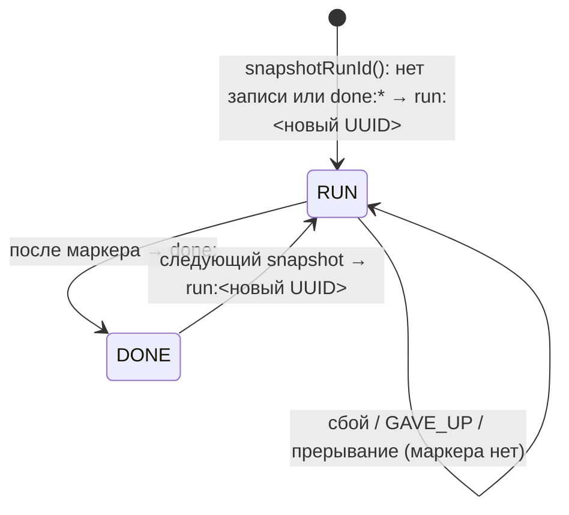

# full-snapshot, Design

> Модульный дизайн — [`../design.md`](../design.md). `AC/` = `adapters/adapter-core/src/main/java/io/github/unlocker/archrag/adaptercore/`. Формат маркера и raw — [`../contracts.md`](../contracts.md) §2-3.

## Зависит от / Связанные спецификации

[`../design.md`](../design.md#зависит-от--связанные-спецификации); специально: matrix §2 №1 (литерал `snapshot-complete` продублирован — 🔴 R-01), №6 (raw маркера читает `StoredEventReader`), №7 (`Reconciler` — потребитель маркера, `ingestion/graph-projector/.../Reconciler.java`); ADR [0020](../../../docs/adr/0020-tombstone-instead-of-hard-delete.md), [0013](../../../docs/adr/0013-operator-ops-via-admin-endpoint.md); `_reversa_sdd/state-machines.md` (строка 9 «Прогон snapshot»). Retry — [`source-fetch-retry`](../source-fetch-retry/design.md).

## Интерфейс

| Вход | Метод | Результат |
|---|---|---|
| расписание | `Poller.pollOnce()` при пустом checkpoint | `PollResult` |
| расписание | `SourceAdapter.startReconciliation` → `Poller.snapshotOnce()` | `PollResult` (исход логируется INFO) |
| HTTP | `POST /control/snapshot` → `Poller.snapshotOnce()` | статус + JSON `{"outcome","appended","syncRunId"}` ([`../contracts.md`](../contracts.md) §1.2) |

## Поток `Poller.snapshot(source)` (`AC/Poller.java:147-174`)

1. `runId = snapshotRunId(source)`: `loadCheckpoint("<code>-snapshot")`; если cursor начинается с `run:` — `runId` = остаток; иначе `runId = runIds.get()` (UUID) и `saveCheckpoint("<code>-snapshot", source, "run:"+runId)` (`:180-188`).
2. `cursor = null`, `appended = 0`.
3. Цикл: `page = fetch(cursor, appended, runId)`; каждое изменение → `inbox.record(snapshotEventId(runId, c), c, runId, runId)` (eventId, correlationId = `runId`, syncRunId = `runId`); `appended++` (`:152-156`).
4. `hasMore`: если `nextCursor == null || == cursor` → `noProgress()`; иначе `cursor = nextCursor`, следующая страница (`:157-162`).
5. Не `hasMore`: если `!snapshotComplete || nextCursor == null` → `IllegalStateException("<code> ended snapshot without snapshot-complete")` (`:164-167`).
6. Иначе строго по порядку (`:168-172`):
   1. `inbox.record(EventMapper.snapshotComplete(system, runId, clock.instant(), appended), runId)` — raw маркера, затем `append`;
   2. `saveCheckpoint("<code>-snapshot", source, "done:"+runId)`;
   3. `saveCheckpoint("<code>-poller", source, page.nextCursor())`;
   4. вернуть `PollResult(SNAPSHOT_COMPLETED, appended, runId)`.

`GaveUp` на любой странице → `exclusive` превращает в `GAVE_UP(appended, runId)` (`:112-114`); `run:<id>` остаётся.

## Диаграмма состояний checkpoint `<code>-snapshot`

🟢 (`AC/Poller.java:39-40, 170, 181-187`).

## Расписание reconciliation (`AC/SourceAdapter.java:97-115`)

`Executors.newSingleThreadScheduledExecutor(Thread.ofVirtual().factory())`; `scheduleWithFixedDelay(snapshotOnce, reconcileInterval, reconcileInterval)`; `RuntimeException` → ERROR `<code> reconcile failed: <класс>`, расписание продолжается; успех → INFO `<code> reconcile <OUTCOME>`. Повторный вызов — no-op. Общий `ReentrantLock` с polling: занято → `ALREADY_RUNNING`, цикл пропущен до следующего интервала 🟡 (U-11).

## Control-вход (`AC/WebhookServer.java:67-94`)

Метод ≠ POST → `405` без тела; иначе `snapshot.get()`: `ALREADY_RUNNING` → 409, `GAVE_UP` → 503, остальное → 202; `RuntimeException` → лог `snapshot failed: <класс>`, 500, `{}`. Тело читать не нужно; `Content-Type: application/json`.

## Решения

| Решение | Evidence | Уверенность |
|---|---|---|
| Единый алгоритм для первого запуска и reconcile — только `cursor = null` | `AC/Poller.java:103-105` | 🟢 |
| `syncRunId` хранится в checkpoint → возобновление идемпотентно | `:180-188` | 🟢 |
| Маркер пишется **до** `done:` и до перевода курсора: при падении между ними повторный запуск добавит второй маркер того же `runId` → `DUPLICATE` | `:168-171` | 🟡 (вывод из порядка) |
| Таблица Reconciler — вне модуля (удаления делает graph-projector) | `docs/03-interfaces.md:378` | 🟢 |

## Риски

- 🟡 U-12: перезапись курсора polling в конце snapshot (`:171`).
- 🟡 U-11: пропуск reconcile при занятом замке.
- 🟡 U-13: одинаковый `sourceVersion` у `poll:` и `snap:` событий.
- 🔴 R-01: тип маркера продублирован в потребителях.
- 🟡 Для источников, у которых все объекты помещаются в одну страницу, поведение то же: единственная страница обязана нести `snapshotComplete`.
