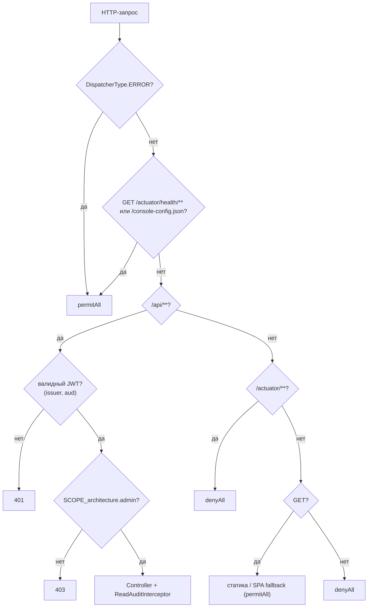

# auth-and-spa: дизайн

> Модульный дизайн: [`../design.md`](../design.md) (порядок правил, аудит, ошибки). Контракты: [`../contracts.md`](../contracts.md) §1, §6.

## Interface

| Символ | Сигнатура | Результат | Трассировка |
|--------|-----------|-----------|-------------|
| `ConsoleSecurityConfiguration.consoleSecurityFilterChain` | `(HttpSecurity, OAuth2ResourceServerProperties) -> SecurityFilterChain` | цепочка фильтров | `access/admin-console/src/main/java/io/github/unlocker/archrag/adminconsole/security/ConsoleSecurityConfiguration.java:28-55` 🟢 |
| `ConsoleSecurityConfiguration.contentSecurityPolicy` | `static (String issuerUri) -> String` | строка CSP | `access/admin-console/src/main/java/io/github/unlocker/archrag/adminconsole/security/ConsoleSecurityConfiguration.java:61-66` 🟢 |
| `ConsoleProperties` | `record(resourceUri, clientId, scope)` | `IllegalArgumentException` при пустом `resourceUri` | `access/admin-console/src/main/java/io/github/unlocker/archrag/adminconsole/config/ConsoleProperties.java:13-28` 🟢 |
| `ConsoleConfigController.config` | `() -> ConsoleConfig` | `{issuer, clientId, scope}` | `access/admin-console/src/main/java/io/github/unlocker/archrag/adminconsole/config/ConsoleConfigController.java:27-30` 🟢 |
| `SpaWebConfiguration` | `WebMvcConfigurer` | ресурсы и перехватчик аудита | `access/admin-console/src/main/java/io/github/unlocker/archrag/adminconsole/config/SpaWebConfiguration.java:21-45` 🟢 |
| `SpaFallbackResolver.isFallbackRoute` | `static (String path) -> boolean` | `false` для `api/**`, `actuator/**` и путей с точкой в последнем сегменте | `access/admin-console/src/main/java/io/github/unlocker/archrag/adminconsole/config/SpaWebConfiguration.java:62-70` 🟢 |
| `ReadAuditInterceptor.preHandle` / `afterCompletion` | `HandlerInterceptor` | запись аудита | `access/admin-console/src/main/java/io/github/unlocker/archrag/adminconsole/audit/ReadAuditInterceptor.java:30-58` 🟢 |

## Fluxo Principal

1. Правила и их порядок — `access/admin-console/src/main/java/io/github/unlocker/archrag/adminconsole/security/ConsoleSecurityConfiguration.java:38-52` 🟢.
2. Ресурсы: `addResourceHandler("/**")` из `classpath:/META-INF/resources/`, `resourceChain(true)`, резолвер `SpaFallbackResolver` (`access/admin-console/src/main/java/io/github/unlocker/archrag/adminconsole/config/SpaWebConfiguration.java:32-40`) 🟢.
3. Резолвер: существующий читаемый файл (не каталог, непустой путь) отдаётся; иначе для маршрута SPA и при существующем `index.html` — `INDEX`; иначе `null` (404) (`access/admin-console/src/main/java/io/github/unlocker/archrag/adminconsole/config/SpaWebConfiguration.java:50-60`) 🟢.
4. Перехватчик аудита подключается только на `/api/**` (`access/admin-console/src/main/java/io/github/unlocker/archrag/adminconsole/config/SpaWebConfiguration.java:42-45`) 🟢.

## Fluxos Alternativos

- Пустой `resource-uri` → ошибка при создании `ConsoleProperties` до старта сервера (`access/admin-console/src/main/java/io/github/unlocker/archrag/adminconsole/config/ConsoleProperties.java:22-27`) 🟢.
- Issuer без схемы/authority в `iss` дал бы некорректный CSP: `URI.create(issuerUri)` ожидает валидный URI (`access/admin-console/src/main/java/io/github/unlocker/archrag/adminconsole/security/ConsoleSecurityConfiguration.java:61-64`) 🟡.
- Ошибка записи аудита → предупреждение `Сбой записи аудита чтения: <класс>`, ответ не меняется (`access/admin-console/src/main/java/io/github/unlocker/archrag/adminconsole/audit/ReadAuditInterceptor.java:54-57`) 🟢.
- Запрос, не дошедший до обработчика (401/403), не имеет аудит-записи (`access/admin-console/src/main/java/io/github/unlocker/archrag/adminconsole/config/SpaWebConfiguration.java:44`) 🟡.
- Нестандартные HTTP-методы на `/api/**` с admin-токеном проходят авторизацию и отклоняются MVC (Q-07) 🟡.

## Dependências

`spring-boot-starter-security-oauth2-resource-server`, `spring-boot-starter-actuator`, бандл `admin-ui` в `META-INF/resources` (`access/admin-console/pom.xml:20-23, 48-55`); Keycloak (issuer, JWKS); логгер `archrag.audit.console`.

## Decisões de Design Identificadas

| Решение | Evidence | Уверенность |
|---------|----------|-------------|
| Scope-проверка только на `/api/**`; статика публична, чтобы SPA могла загрузиться и пройти логин | `access/admin-console/src/main/java/io/github/unlocker/archrag/adminconsole/security/ConsoleSecurityConfiguration.java:44-50` | 🟢 |
| Audience консоли отдельный от audience admin REST и MCP | `access/admin-console/src/main/resources/application.yml:15, 20`; ADR 0026 | 🟢 |
| `connect-src` содержит origin issuer, иначе CSP блокировал бы token endpoint | `access/admin-console/src/main/java/io/github/unlocker/archrag/adminconsole/security/ConsoleSecurityConfiguration.java:57-60` | 🟢 |
| Аудит на уровне MVC `HandlerInterceptor`, а не фильтра безопасности | `access/admin-console/src/main/java/io/github/unlocker/archrag/adminconsole/config/SpaWebConfiguration.java:42-45` | 🟡 |
| Дефолтные маппинги статики Boot отключены (`add-mappings=false`), статику ведёт `SpaWebConfiguration` | `access/admin-console/src/main/resources/application.yml:6-9` | 🟢 |

## Riscos e Lacunas

- 🟢 [R.8: ответ владельца, вопрос 12] Аудит отказов 401/403 отсутствует, аудит — лог без retention (Q-06).
- 🟡 Любой пользователь realm получает токен консоли (Q-02); проверки `azp` в консоли нет (Q-13).
- 🟡 Метод `/api/**` не фильтруется правилом безопасности (Q-07).
- 🟡 Хранение токена в памяти — свойство `admin-ui` (Q-14).
