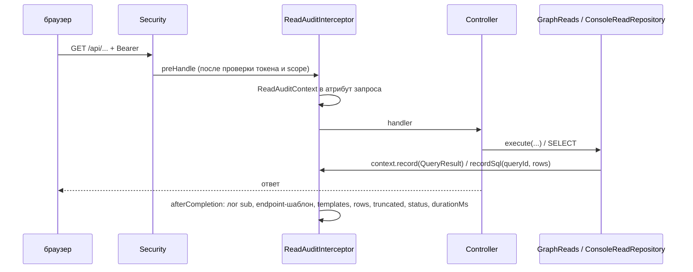

# access/admin-console: дизайн

> Ссылки даны полными путями от корня репозитория. Требования: [`requirements.md`](requirements.md). Контракты: [`contracts.md`](contracts.md).
> Входные артефакты: [`../flowcharts/admin-console.md`](../flowcharts/admin-console.md) (блок-схемы), [`../data-dictionary.md`](../data-dictionary.md) §X.3 (формы ответов и конфигурация), [`../permissions.md`](../permissions.md) §5.
> Use case-спецификации: [`graph-browse/`](graph-browse/design.md), [`sync-journal/`](sync-journal/design.md), [`identity-audit/`](identity-audit/design.md), [`auth-and-spa/`](auth-and-spa/design.md).
> Сквозные части (пулы, аудит чтений, ошибки, пагинация, конфигурация) описаны здесь и в use case не дублируются.

## Интерфейс

Пакет `io.github.unlocker.archrag.adminconsole` и подпакеты `api`, `audit`, `config`, `graph`, `pg`, `security`. HTTP-контракт — в [`contracts.md`](contracts.md) §1.

| Символ | Сигнатура | Результат / исключения | Трассировка |
|--------|-----------|------------------------|-------------|
| `GraphReads.execute` | `(String templateId, Map params, ResultBudget) -> QueryResult` | делегирует `GraphQueryExecutor`, пишет результат в аудит запроса | `access/admin-console/src/main/java/io/github/unlocker/archrag/adminconsole/graph/GraphReads.java:36-45` 🟢 |
| `GraphReads.ceilings` | `() -> ResultBudget` | потолки конфигурации как бюджет | `access/admin-console/src/main/java/io/github/unlocker/archrag/adminconsole/graph/GraphReads.java:31-33` 🟢 |
| `ConsoleReadRepository.*` | `checkpoints`, `eventCounts`, `lastProjected`, `events`, `eventsById`, `errorReason`, `dlqOfEvent`, `dlq`, `conflicts`, `candidates`, `audit` | `Page<T>`/списки/карты; только `SELECT` | `access/admin-console/src/main/java/io/github/unlocker/archrag/adminconsole/pg/ConsoleReadRepository.java:53-266` 🟢 |
| `PageRequest.of` | `(Integer page, Integer size) -> PageRequest` | `InvalidRequestException` вне диапазона | `access/admin-console/src/main/java/io/github/unlocker/archrag/adminconsole/pg/PageRequest.java:14-24` 🟢 |
| `SyncSources.toStored` / `toCode` / `status` | `(String) -> String` | allowlist; URN-префикс `urn:corp:` | `access/admin-console/src/main/java/io/github/unlocker/archrag/adminconsole/pg/SyncSources.java:38-61` 🟢 |
| `ReadAuditContext.current` / `record` / `recordSql` | накопитель аудита запроса | атрибут запроса | `access/admin-console/src/main/java/io/github/unlocker/archrag/adminconsole/audit/ReadAuditContext.java:25-45` 🟢 |
| `ReadAuditInterceptor` | `HandlerInterceptor` на `/api/**` | запись в логгер `archrag.audit.console` | `access/admin-console/src/main/java/io/github/unlocker/archrag/adminconsole/audit/ReadAuditInterceptor.java:30-58` 🟢 |
| `ConsoleSecurityConfiguration.contentSecurityPolicy` | `static (String issuerUri) -> String` | строка CSP | `access/admin-console/src/main/java/io/github/unlocker/archrag/adminconsole/security/ConsoleSecurityConfiguration.java:61-66` 🟢 |

## Старт приложения (сборка бинов)

1. `@SpringBootApplication`; автоконфигурации `spring.neo4j.*`, `spring.datasource.*`, Flyway не используются (`access/admin-console/src/main/java/io/github/unlocker/archrag/adminconsole/graph/GraphReaderConfiguration.java:21-22`; `access/admin-console/src/main/java/io/github/unlocker/archrag/adminconsole/pg/ConsolePgConfiguration.java:12-16`) 🟢.
2. Neo4j: `Driver` с `AuthTokens.basic(reader)`, ленивое соединение, `destroyMethod=close`; `QueryLimits` из `archrag.query.limits.*`; реестр = `ConsoleTemplates.ALL` + `search_assets`, `get_asset`, `explain_provenance`; `GraphQueryExecutor` (`access/admin-console/src/main/java/io/github/unlocker/archrag/adminconsole/graph/GraphReaderConfiguration.java:28-57`) 🟢.
3. PostgreSQL: `HikariDataSource` (`console-pg`, `readOnly`, `SET default_transaction_read_only = on`, максимум 4, минимум idle 0, `initializationFailTimeout=-1`), `JdbcClient`, `Clock.systemUTC()` (`access/admin-console/src/main/java/io/github/unlocker/archrag/adminconsole/pg/ConsolePgConfiguration.java:21-48`) 🟢.
4. Безопасность: `ConsoleProperties` (audience обязателен), цепочка фильтров (`access/admin-console/src/main/java/io/github/unlocker/archrag/adminconsole/security/ConsoleSecurityConfiguration.java:28-55`) 🟢.
5. Web: статика и SPA fallback, `ReadAuditInterceptor` на `/api/**` (`access/admin-console/src/main/java/io/github/unlocker/archrag/adminconsole/config/SpaWebConfiguration.java:32-45`); `spring.web.resources.add-mappings=false` (`access/admin-console/src/main/resources/application.yml:6-9`) 🟢.

## Безопасность REST

Порядок правил `authorizeHttpRequests` (`access/admin-console/src/main/java/io/github/unlocker/archrag/adminconsole/security/ConsoleSecurityConfiguration.java:38-52`) 🟢:
1. `DispatcherType.ERROR` → `permitAll` (чтобы ошибки отдавались без повторной аутентификации);
2. `GET /actuator/health/**`, `GET /console-config.json` → `permitAll`;
3. `/api/**` → `hasAuthority(SCOPE_architecture.admin)` (любой HTTP-метод);
4. `/actuator/**` → `denyAll`;
5. `GET /**` → `permitAll` (статика и маршруты SPA);
6. любой другой запрос → `denyAll`.

JWT: `issuer-uri` из `ARCHRAG_OIDC_ISSUER_URI`, `audiences` = `archrag.console.resource-uri` (`access/admin-console/src/main/resources/application.yml:10-15`) 🟢. Проверки `azp`, роли, клиента в консоли нет 🟡 (Q-02; в отличие от `AuthorizedPartyValidator` в `ingestion-service`).

## Аудит чтений

- `preHandle` кладёт `ReadAuditContext` и время старта; `afterCompletion` пишет одну запись `console read` через `AUDIT.atInfo().addKeyValue(...)` (`access/admin-console/src/main/java/io/github/unlocker/archrag/adminconsole/audit/ReadAuditInterceptor.java:30-53`) 🟢.
- `endpoint` = метод + `BEST_MATCHING_PATTERN_ATTRIBUTE` (шаблон без значений path-переменных), `unmatched` при отсутствии (`access/admin-console/src/main/java/io/github/unlocker/archrag/adminconsole/audit/ReadAuditInterceptor.java:43-47`) 🟢.
- Идентификаторы выборок PostgreSQL попадают в `templates` как `sql:<имя таблицы/выборки>` (`access/admin-console/src/main/java/io/github/unlocker/archrag/adminconsole/audit/ReadAuditContext.java:34-38`; `access/admin-console/src/main/java/io/github/unlocker/archrag/adminconsole/pg/ConsoleReadRepository.java:293-298`) 🟢.
- Сбой логирования ловится `RuntimeException` и пишется предупреждением с классом исключения (`access/admin-console/src/main/java/io/github/unlocker/archrag/adminconsole/audit/ReadAuditInterceptor.java:54-57`) 🟢.

## Обработка ошибок

| Исключение | HTTP | Тело | Трассировка |
|------------|------|------|-------------|
| `InvalidRequestException` | 400 | `{error:"invalid_request", message}` | `access/admin-console/src/main/java/io/github/unlocker/archrag/adminconsole/api/ApiExceptionHandler.java:23-26` 🟢 |
| `MethodArgumentTypeMismatchException`, `MissingServletRequestParameterException` | 400 | `{error:"invalid_request", message:"malformed or missing request parameter"}` | `access/admin-console/src/main/java/io/github/unlocker/archrag/adminconsole/api/ApiExceptionHandler.java:28-31` 🟢 |
| `NotFoundException` | 404 | `{error:"not_found", message}` | `access/admin-console/src/main/java/io/github/unlocker/archrag/adminconsole/api/ApiExceptionHandler.java:33-36` 🟢 |
| `QueryTimeoutException` | 504 | `{error:"query_timeout", message:"graph query timed out"}` | `access/admin-console/src/main/java/io/github/unlocker/archrag/adminconsole/api/ApiExceptionHandler.java:38-41` 🟢 |
| прочие (`Neo4jException`, `IllegalStateException`, ошибки БД) | 500 | формирует Spring Boot | обработчика нет 🟡 (Q-05) |

## Пагинация журнальных списков

`Where`/`page(...)`: `SELECT count(*)` и `SELECT <колонки> ... ORDER BY <константа> LIMIT :limit OFFSET :offset` с одинаковым `WHERE`; ответ `Page{items, page, size, total}` (`access/admin-console/src/main/java/io/github/unlocker/archrag/adminconsole/pg/ConsoleReadRepository.java:270-290`; `access/admin-console/src/main/java/io/github/unlocker/archrag/adminconsole/pg/Page.java:13`) 🟢. Фильтр `null` пропускается (`access/admin-console/src/main/java/io/github/unlocker/archrag/adminconsole/pg/ConsoleReadRepository.java:347-352`) 🟢. Время передаётся `Timestamp.from(instant)`; в ответах `Instant` (`access/admin-console/src/main/java/io/github/unlocker/archrag/adminconsole/pg/ConsoleReadRepository.java:103-104, 333-336`) 🟢.

## Конфигурация

`archrag.console.*` (`resource-uri` обязателен, `client-id`, `scope`), `archrag.neo4j.reader.*`, `archrag.console-pg.*`, `archrag.query.limits.*`, `server.shutdown=graceful` — таблица значений и переменных окружения в [`contracts.md`](contracts.md) §4 (`access/admin-console/src/main/resources/application.yml:1-58`) 🟢.

## Зависит от / Связанные спецификации

| Что | Связь | Трассировка |
|-----|-------|-------------|
| `access/graph-query-core` | библиотека шаблонов и исполнителя: [`../graph-query-core/design.md`](../graph-query-core/design.md) | `access/admin-console/pom.xml:25-28`; `access/admin-console/src/main/java/io/github/unlocker/archrag/adminconsole/graph/GraphReaderConfiguration.java:44-57` 🟢 |
| `access/admin-ui` | статика SPA в jar (`META-INF/resources`) | `access/admin-console/pom.xml:20-23`; `access/admin-console/src/main/java/io/github/unlocker/archrag/adminconsole/config/SpaWebConfiguration.java:23` 🟢 |
| `ingestion/ingestion-service` | миграция `V6` создаёт роль `archrag_console_ro`; миграции схемы PostgreSQL | `ingestion/ingestion-service/src/main/resources/db/migration/V6__console_readonly_role.sql:6-16` 🟢 |
| `ingestion/event-journal`, `ingestion/identity-resolution` | владельцы таблиц `inbox_event`, `dlq_entry`, `consumer_checkpoint`, `identity_candidate`, `source_conflict`; консоль читает по именам колонок без общего контракта | `access/admin-console/src/main/java/io/github/unlocker/archrag/adminconsole/pg/ConsoleReadRepository.java:38-40, 141, 178-179, 209-210` 🟡 |
| `ingestion/ingestion-service` (`admin_audit`) | источник журнала админских операций | `access/admin-console/src/main/java/io/github/unlocker/archrag/adminconsole/pg/ConsoleReadRepository.java:239-247` 🟢 |
| Keycloak (клиент `archrag-admin-console`) | issuer, публичный клиент PKCE | `platform/docker/docker-compose.yml:282-283` 🟡 |
| `platform/docker` | сеть `console-edge`, публикация порта на loopback, секреты | `platform/docker/docker-compose.yml:274-305, 543` 🟢 |
| Зависимости на `ingestion/*`, `adapters/*` | отсутствуют по схеме модулей; статусы и коды источников продублированы в `SyncSources` | `access/admin-console/src/main/java/io/github/unlocker/archrag/adminconsole/pg/SyncSources.java:6-12` 🟢 |

## Decisões de Design Identificadas

| Решение | Evidence | Уверенность |
|---------|----------|-------------|
| Консоль — отдельный read-only сервис, не часть ingestion | `docs/adr/0026-admin-console-readonly-loopback.md`; `access/admin-console/src/main/java/io/github/unlocker/archrag/adminconsole/AdminConsoleApplication.java:6` | 🟢 |
| Граф читается только шаблонами `graph-query-core` через `GraphReads` (иначе вызов выпадает из аудита) | `access/admin-console/src/main/java/io/github/unlocker/archrag/adminconsole/graph/GraphReads.java:13-18` | 🟢 |
| Статусы и коды источников продублированы в `SyncSources`, чтобы не зависеть от ingestion | `access/admin-console/src/main/java/io/github/unlocker/archrag/adminconsole/pg/SyncSources.java:6-12` | 🟢 |
| Три рубежа read-only для PostgreSQL: GRANT `SELECT`, `readOnly` драйвера, `default_transaction_read_only` | `access/admin-console/src/main/java/io/github/unlocker/archrag/adminconsole/pg/ConsolePgConfiguration.java:28-30`; V6 | 🟢 |
| Роль в БД без пароля в миграции; пароль задаёт стенд (`console-pg-init`) | `ingestion/ingestion-service/src/main/resources/db/migration/V6__console_readonly_role.sql:1-3`; `platform/docker/docker-compose.yml:254-272` | 🟢 |
| Аудит чтений — лог, а не таблица | `access/admin-console/src/main/java/io/github/unlocker/archrag/adminconsole/audit/ReadAuditInterceptor.java:16-20, 28` | 🟡 (Q-06) |
| CSP `connect-src` = origin issuer, а не полный URI | `access/admin-console/src/main/java/io/github/unlocker/archrag/adminconsole/security/ConsoleSecurityConfiguration.java:57-60` | 🟢 |

## Estado Interno

- Состояния между запросами нет: контекст аудита живёт в атрибуте запроса, пул и драйвер — бины (`access/admin-console/src/main/java/io/github/unlocker/archrag/adminconsole/audit/ReadAuditContext.java:10-12`) 🟢.
- `ConsoleConfigController.config` — неизменяемый объект, собранный в конструкторе (`access/admin-console/src/main/java/io/github/unlocker/archrag/adminconsole/config/ConsoleConfigController.java:20-25`) 🟢.

## Riscos e Lacunas

- 🔴 Loopback обеспечивается только Compose-маппингом порта, приложение слушает все интерфейсы контейнера (Q-01).
- 🔴 Необработанные исключения (`Neo4jException`, ошибки БД) дают стандартный 500 без контрактного тела (Q-05).
- 🔴 `dlq_entry.replayed_at` не заполняется: фильтр `replayed` вводит в заблуждение (Q-03).
- 🔴 События с `/` в `eventId` нельзя открыть карточкой (Q-04).
- 🔴 Аудит чтений — только лог, 401/403 в него не попадают, retention не определён (Q-06).
- 🟡 Любой пользователь realm получает токен консоли (Q-02, П-9).
- 🟡 Копипаст `GraphReaderConfiguration`/`GraphController` с `mcp-server`, пятая копия таблицы кодов источников (Q-08).
