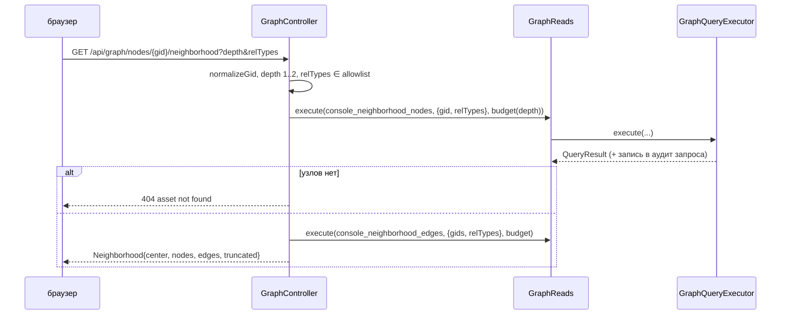

# graph-browse: дизайн

> Модульный дизайн: [`../design.md`](../design.md). Контракты: [`../contracts.md`](../contracts.md) §1.

## Interface

| Символ | Сигнатура | Результат | Трассировка |
|--------|-----------|-----------|-------------|
| `GraphController.stats` | `() -> Stats` | сводка | `access/admin-console/src/main/java/io/github/unlocker/archrag/adminconsole/api/GraphController.java:56-65` 🟢 |
| `GraphController.search` | `(String q, List<String> types, Integer limit) -> SearchResponse` | `InvalidRequestException` | `access/admin-console/src/main/java/io/github/unlocker/archrag/adminconsole/api/GraphController.java:68-102` 🟢 |
| `GraphController.node` | `(String gid) -> NodeCard` | `NotFoundException`, `InvalidRequestException` | `access/admin-console/src/main/java/io/github/unlocker/archrag/adminconsole/api/GraphController.java:105-124` 🟢 |
| `GraphController.neighborhood` | `(String gid, Integer depth, List<String> relTypes) -> Neighborhood` | то же | `access/admin-console/src/main/java/io/github/unlocker/archrag/adminconsole/api/GraphController.java:127-167` 🟢 |
| `GraphResponses.*` | записи ответов | | `access/admin-console/src/main/java/io/github/unlocker/archrag/adminconsole/api/GraphResponses.java:7-69` 🟢 |

## Fluxo Principal

1. **stats**: три `execute` подряд на `reads.ceilings()` (`access/admin-console/src/main/java/io/github/unlocker/archrag/adminconsole/api/GraphController.java:58-61`) 🟢.
2. **search**: валидация → параметры → бюджет с `maxNodes=min(limit, ceiling)` → `search_assets` → `AssetHit` (`access/admin-console/src/main/java/io/github/unlocker/archrag/adminconsole/api/GraphController.java:73-101, 200-209`) 🟢.
3. **node**: `get_asset` → при строке `explain_provenance` → `NodeCard` (`access/admin-console/src/main/java/io/github/unlocker/archrag/adminconsole/api/GraphController.java:106-123`) 🟢.
4. **neighborhood**: см. диаграмму; `GraphNode`/`GraphEdge` строятся из строк (`access/admin-console/src/main/java/io/github/unlocker/archrag/adminconsole/api/GraphController.java:157-166, 211-218`) 🟢.

## Fluxos Alternativos

- `q` пуст или длиннее 200 → 400 до обращения к графу (`access/admin-console/src/main/java/io/github/unlocker/archrag/adminconsole/api/GraphController.java:74-79`) 🟢.
- `types` содержит `null` или чужое значение → 400 «Unknown type; allowed: ...» (список allowlist безопасен, ввод не эхоится) (`access/admin-console/src/main/java/io/github/unlocker/archrag/adminconsole/api/GraphController.java:181-185`) 🟢.
- `get_asset` вернул ноль строк → 404; `explain_provenance` ноль строк → `sources=[]` (`access/admin-console/src/main/java/io/github/unlocker/archrag/adminconsole/api/GraphController.java:110-112, 235-237`) 🟢.
- `QueryTimeoutException` из исполнителя → 504 общим обработчиком (`access/admin-console/src/main/java/io/github/unlocker/archrag/adminconsole/api/ApiExceptionHandler.java:38-41`) 🟢.
- Прочие `Neo4jException` → стандартный 500 (Q-05) 🟡.
- Значения свойств, не ISO-времена и не списки, возвращаются как есть (`access/admin-console/src/main/java/io/github/unlocker/archrag/adminconsole/api/GraphController.java:248`) 🟡.

## Dependências

`GraphReads` (аудит запроса), шаблоны `ConsoleTemplates` и `AssetTemplates` из `graph-query-core`, `FulltextQuery`, `UUID` (`access/admin-console/src/main/java/io/github/unlocker/archrag/adminconsole/api/GraphController.java:11-25`).

## Decisões de Design Identificadas

| Решение | Evidence | Уверенность |
|---------|----------|-------------|
| Глубина окрестности ограничена константой контроллера независимо от потолка конфигурации | `access/admin-console/src/main/java/io/github/unlocker/archrag/adminconsole/api/GraphController.java:43-44` | 🟢 |
| Узлы и рёбра окрестности — два шаблона и два вызова, второй по списку `gid` результата первого | `access/admin-console/src/main/java/io/github/unlocker/archrag/adminconsole/api/GraphController.java:151-161` | 🟢 |
| Служебные ключи узла скрываются из `properties`, чтобы они не дублировали поля карточки | `access/admin-console/src/main/java/io/github/unlocker/archrag/adminconsole/api/GraphController.java:46-47, 226-228` | 🟡 |
| `normalizeGid` повторяет логику MCP (копипаст) | `access/admin-console/src/main/java/io/github/unlocker/archrag/adminconsole/api/GraphController.java:190-197` | 🟡 (Q-08) |

## Riscos e Lacunas

- 🔴 Необработанные исключения графа → 500 без контракта (Q-05).
- 🟡 `search` не поддерживает фильтр окружения, хотя шаблон его умеет (`environment` всегда `null`).
- 🟡 Тексты свойств узлов отдаются без пометки недоверенных (ловушка 11; Q-05 в [`../../graph-query-core/questions.md`](../../graph-query-core/questions.md)).
