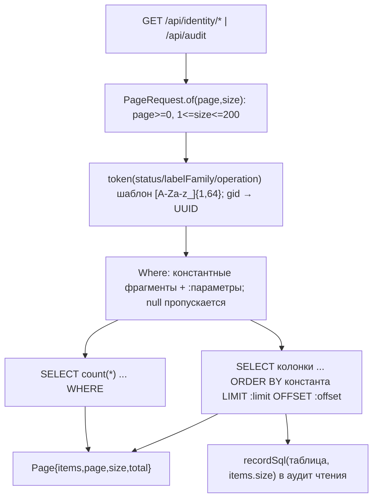

# identity-audit: дизайн

> Модульный дизайн: [`../design.md`](../design.md). Контракты: [`../contracts.md`](../contracts.md) §1, §2.

## Interface

| Символ | Сигнатура | Результат | Трассировка |
|--------|-----------|-----------|-------------|
| `IdentityController.conflicts` | `(status, gid, page, size) -> Page<Conflict>` | | `access/admin-console/src/main/java/io/github/unlocker/archrag/adminconsole/api/IdentityController.java:30-38` 🟢 |
| `IdentityController.candidates` | `(status, labelFamily, page, size) -> Page<Candidate>` | | `access/admin-console/src/main/java/io/github/unlocker/archrag/adminconsole/api/IdentityController.java:41-49` 🟢 |
| `IdentityController.token` | `static (String value, String name[, String default]) -> String` | `InvalidRequestException` при несоответствии шаблону | `access/admin-console/src/main/java/io/github/unlocker/archrag/adminconsole/api/IdentityController.java:51-63` 🟢 |
| `AuditController.audit` | `(operation, status, from, to, page, size) -> Page<Audit>` | | `access/admin-console/src/main/java/io/github/unlocker/archrag/adminconsole/api/AuditController.java:25-39` 🟢 |
| `ConsoleReadRepository.conflicts` / `candidates` / `audit` | `Page<T>` | | `access/admin-console/src/main/java/io/github/unlocker/archrag/adminconsole/pg/ConsoleReadRepository.java:172, 203, 233` 🟢 |

## Fluxo Principal

1. Контроллеры валидируют параметры до репозитория (`access/admin-console/src/main/java/io/github/unlocker/archrag/adminconsole/api/IdentityController.java:36-37, 47-48`; `access/admin-console/src/main/java/io/github/unlocker/archrag/adminconsole/api/AuditController.java:33-38`) 🟢.
2. `page(...)` строит запросы (`access/admin-console/src/main/java/io/github/unlocker/archrag/adminconsole/pg/ConsoleReadRepository.java:271-290`) 🟢.
3. `candidates.matched` читается `matched::text` и разбирается `JsonMapper.readTree` (`access/admin-console/src/main/java/io/github/unlocker/archrag/adminconsole/pg/ConsoleReadRepository.java:209, 223`) 🟢.
4. `audit`: `request`/`result` выбираются как `CASE WHEN length(x::text) > 4000 THEN NULL ELSE x::text END` с отдельным булевым признаком (`access/admin-console/src/main/java/io/github/unlocker/archrag/adminconsole/pg/ConsoleReadRepository.java:241-246`) 🟢.

## Fluxos Alternativos

- `status` не задан → `OPEN` для identity; для `audit` без значения по умолчанию (`access/admin-console/src/main/java/io/github/unlocker/archrag/adminconsole/api/IdentityController.java:37, 48`; `access/admin-console/src/main/java/io/github/unlocker/archrag/adminconsole/api/AuditController.java:38`) 🟢.
- Пустой/пробельный `gid` → фильтр не применяется; неверный UUID → 400 без эха (`access/admin-console/src/main/java/io/github/unlocker/archrag/adminconsole/api/IdentityController.java:65-74`) 🟢.
- `gid` сравнивается через `CAST(:gid AS uuid)` (`access/admin-console/src/main/java/io/github/unlocker/archrag/adminconsole/pg/ConsoleReadRepository.java:175`) 🟢.
- Колонка `finished_at` может быть `null` (операция идёт или аварийно прервана): `Instant` = `null` (`access/admin-console/src/main/java/io/github/unlocker/archrag/adminconsole/pg/ConsoleReadRepository.java:264, 333-336`) 🟢.

## Dependências

`ConsoleReadRepository`, `Rows`, `PageRequest`; таблицы `source_conflict`, `identity_candidate`, `admin_audit`.

## Decisões de Design Identificadas

| Решение | Evidence | Уверенность |
|---------|----------|-------------|
| Список «открытых» по умолчанию, история — явным `status=RESOLVED` | `access/admin-console/src/main/java/io/github/unlocker/archrag/adminconsole/api/IdentityController.java:29, 37` | 🟢 |
| Большие jsonb аудита не отдаются, вместо них признак усечения | `access/admin-console/src/main/java/io/github/unlocker/archrag/adminconsole/pg/ConsoleReadRepository.java:35-36` | 🟢 |
| Токен-шаблон вместо allowlist для `status`/`operation`/`labelFamily` (значения заранее не перечислены, но параметризованы) | `access/admin-console/src/main/java/io/github/unlocker/archrag/adminconsole/api/IdentityController.java:20-21` | 🟡 |

## Riscos e Lacunas

- 🟡 Содержимое `request`/`result` аудита без маскирования (Q-16).
- 🟡 Допустимые значения `status` кандидатов и конфликтов нигде не перечислены, фильтр принимает любой токен (Р-4).
- 🔴 `identity_candidate.status` не выходит из `OPEN`; закрытие конфликта вручную невозможно (вне модуля, `../../detective-gaps.md:22, 51`).
