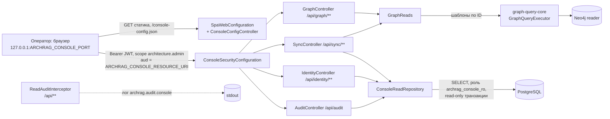

# access/admin-console: требования

> Запускаемое приложение: раздаёт статику SPA (`admin-ui`) и read-only REST `/api/**` для оператора. Пути в трассировке развёрнуты до корня репозитория. Дизайн: [`design.md`](design.md); внешние контракты: [`contracts.md`](contracts.md); открытые вопросы: [`questions.md`](questions.md); решения: [`decisions.md`](decisions.md).
> Use case-спецификации: [`graph-browse/`](graph-browse/requirements.md), [`sync-journal/`](sync-journal/requirements.md), [`identity-audit/`](identity-audit/requirements.md), [`auth-and-spa/`](auth-and-spa/requirements.md).

## Визуальная схема



## Visão Geral

`admin-console` — отдельный read-only сервис для оператора (ADR 0026): сводка графа, поиск активов, карточка, окрестность, состояние синхронизации (checkpoints, журнал событий, DLQ), identity-конфликты и кандидаты, журнал админских операций. Граф читается под reader-учёткой Neo4j только именованными шаблонами `graph-query-core`; журнал — под ролью PostgreSQL `archrag_console_ro` (только `SELECT`). Изменяющих операций нет, writer-секретов нет. В `docker-compose` порт публикуется только на `127.0.0.1` 🟢 (`access/admin-console/src/main/java/io/github/unlocker/archrag/adminconsole/AdminConsoleApplication.java:6-12`; `access/admin-console/src/main/java/io/github/unlocker/archrag/adminconsole/graph/GraphReaderConfiguration.java:18-23`; `access/admin-console/src/main/java/io/github/unlocker/archrag/adminconsole/pg/ConsolePgConfiguration.java:12-16`; `platform/docker/docker-compose.yml:293`).

## Responsabilidades

- Resource server: JWT (issuer, обязательный audience), scope `architecture.admin` на `/api/**`, остальное fail-closed 🟢 (`access/admin-console/src/main/java/io/github/unlocker/archrag/adminconsole/security/ConsoleSecurityConfiguration.java:28-55`).
- Read-only API графа: `stats`, `search`, `nodes/{gid}`, `nodes/{gid}/neighborhood` 🟢 (`access/admin-console/src/main/java/io/github/unlocker/archrag/adminconsole/api/GraphController.java:56-167`).
- Read-only API синхронизации: `sources`, `events`, `events/{source}/{eventId}`, `dlq` 🟢 (`access/admin-console/src/main/java/io/github/unlocker/archrag/adminconsole/api/SyncController.java:56-121`).
- Read-only API identity и аудита: `conflicts`, `candidates`, `audit` 🟢 (`access/admin-console/src/main/java/io/github/unlocker/archrag/adminconsole/api/IdentityController.java:30-49`; `access/admin-console/src/main/java/io/github/unlocker/archrag/adminconsole/api/AuditController.java:25-39`).
- Раздача SPA и публичной конфигурации для OIDC-логина 🟢 (`access/admin-console/src/main/java/io/github/unlocker/archrag/adminconsole/config/SpaWebConfiguration.java:32-40`; `access/admin-console/src/main/java/io/github/unlocker/archrag/adminconsole/config/ConsoleConfigController.java:27-30`).
- Аудит чтений (структурированный лог) 🟢 (`access/admin-console/src/main/java/io/github/unlocker/archrag/adminconsole/audit/ReadAuditInterceptor.java:22-58`).
- Единый формат ошибок `{error, message}` без эха ввода 🟢 (`access/admin-console/src/main/java/io/github/unlocker/archrag/adminconsole/api/ApiExceptionHandler.java:12-41`).

## Regras de Negócio

- Каждый путь `/api/**` требует authority `SCOPE_architecture.admin`; без токена 401, без scope 403, токен с чужим audience 401 🟢 (`access/admin-console/src/main/java/io/github/unlocker/archrag/adminconsole/security/ConsoleSecurityConfiguration.java:44-45`; тесты `access/admin-console/src/test/java/io/github/unlocker/archrag/adminconsole/ConsoleApiTest.java:94, 100, 108`).
- Публично без токена: `GET /actuator/health/**`, `GET /console-config.json`, статика и маршруты SPA (`GET /**`); `/actuator/**` — `denyAll`; любой не-`GET` вне `/api/**` — `denyAll` 🟢 (`access/admin-console/src/main/java/io/github/unlocker/archrag/adminconsole/security/ConsoleSecurityConfiguration.java:42-52`; тест `access/admin-console/src/test/java/io/github/unlocker/archrag/adminconsole/ConsoleApiTest.java:129`).
- `archrag.console.resource-uri` обязателен: это audience токена; пустое значение — отказ запуска 🟢 (`access/admin-console/src/main/java/io/github/unlocker/archrag/adminconsole/config/ConsoleProperties.java:22-27`; `access/admin-console/src/main/resources/application.yml:15, 20`; тест `access/admin-console/src/test/java/io/github/unlocker/archrag/adminconsole/ConsoleStartupTest.java:15`).
- Консоль не получает writer-учётных данных: свойства Neo4j только `archrag.neo4j.reader.*`, PostgreSQL — только `archrag.console-pg.*`, Flyway и `spring.datasource` в конфигурации отсутствуют 🟢 (`access/admin-console/src/main/resources/application.yml:24-34`; тест `access/admin-console/src/test/java/io/github/unlocker/archrag/adminconsole/ConsoleStartupTest.java:40`).
- PostgreSQL: пул `readOnly=true`, `connectionInitSql = SET default_transaction_read_only = on`, максимум 4 соединения, ленивое подключение 🟢 (`access/admin-console/src/main/java/io/github/unlocker/archrag/adminconsole/pg/ConsolePgConfiguration.java:28-35`; тест `platform/integration-tests/src/test/java/io/github/unlocker/archrag/integrationtests/SyncConsoleIT.java:251`).
- Роль `archrag_console_ro` имеет `SELECT` на шесть таблиц (`inbox_event`, `consumer_checkpoint`, `dlq_entry`, `identity_candidate`, `source_conflict`, `admin_audit`) и не читает `identity_mapping`, не пишет 🟢 (`ingestion/ingestion-service/src/main/resources/db/migration/V6__console_readonly_role.sql:14-16`; тест `platform/integration-tests/src/test/java/io/github/unlocker/archrag/integrationtests/SyncConsoleIT.java:183`).
- Raw payload не отдаётся: ответы журнала содержат только `payloadRef` (ключ S3) и `contentHash`; в выборках колонок payload нет 🟢 (`access/admin-console/src/main/java/io/github/unlocker/archrag/adminconsole/pg/Rows.java:6-9, 14-32`; `access/admin-console/src/main/java/io/github/unlocker/archrag/adminconsole/pg/ConsoleReadRepository.java:38-40`; тесты `access/admin-console/src/test/java/io/github/unlocker/archrag/adminconsole/SyncApiTest.java:115, 136`).
- Значения фильтров — именованные параметры; в текст SQL попадают только константные фрагменты `WHERE`, колонки и сортировка 🟢 (`access/admin-console/src/main/java/io/github/unlocker/archrag/adminconsole/pg/ConsoleReadRepository.java:27-29, 270-290, 342-365`).
- Свободные значения фильтров (`source`, `status`, `operation`, `labelFamily`, `types`, `relTypes`) проходят allowlist или шаблон `[A-Za-z_]{1,64}`; неизвестное значение → 400 без эха ввода 🟢 (`access/admin-console/src/main/java/io/github/unlocker/archrag/adminconsole/pg/SyncSources.java:38-61`; `access/admin-console/src/main/java/io/github/unlocker/archrag/adminconsole/api/IdentityController.java:21, 55-63`; `access/admin-console/src/main/java/io/github/unlocker/archrag/adminconsole/api/GraphController.java:175-188`; тесты `access/admin-console/src/test/java/io/github/unlocker/archrag/adminconsole/SyncApiTest.java:98`, `access/admin-console/src/test/java/io/github/unlocker/archrag/adminconsole/ConsoleApiTest.java:245`).
- Тексты из источников режутся до 500 символов; `request`/`result` аудита больше 4000 символов не отдаются (`NULL` + признак `requestTruncated`/`resultTruncated`) 🟢 (`access/admin-console/src/main/java/io/github/unlocker/archrag/adminconsole/pg/ConsoleReadRepository.java:34-36, 241-246, 338-340`; тест `platform/integration-tests/src/test/java/io/github/unlocker/archrag/integrationtests/SyncConsoleIT.java:240`).
- Граф читается только через `GraphReads` → `GraphQueryExecutor` (именованные шаблоны); Cypher из запроса не собирается 🟢 (`access/admin-console/src/main/java/io/github/unlocker/archrag/adminconsole/graph/GraphReads.java:14-18, 36-37`; `access/admin-console/src/main/java/io/github/unlocker/archrag/adminconsole/api/GraphController.java:33-35`).
- Бюджет графовых запросов — потолки конфигурации (глубина 6, 500 узлов, 50 путей, 5 с, 512 КБ); глубина окрестности дополнительно ≤ 2 константой контроллера 🟢 (`access/admin-console/src/main/resources/application.yml:35-41`; `access/admin-console/src/main/java/io/github/unlocker/archrag/adminconsole/api/GraphController.java:43-44, 134-136`).
- Размер страницы журнальных списков: `page ≥ 0`, `1 ≤ size ≤ 200`, по умолчанию 50 🟢 (`access/admin-console/src/main/java/io/github/unlocker/archrag/adminconsole/pg/PageRequest.java:8-24`).
- Аудит чтения: одна запись на запрос `/api/**`, дошедший до контроллера: `sub`, метод и шаблон маршрута (без query и значений path-переменных), ID шаблонов графа и `sql:<выборка>`, число строк, `truncated`, `status`, `durationMs`; токен и параметры не пишутся 🟢 (`access/admin-console/src/main/java/io/github/unlocker/archrag/adminconsole/audit/ReadAuditInterceptor.java:15-58`; тесты `access/admin-console/src/test/java/io/github/unlocker/archrag/adminconsole/ConsoleApiTest.java:367, 391`).
- Сбой записи аудита не меняет ответ 🟢 (`access/admin-console/src/main/java/io/github/unlocker/archrag/adminconsole/audit/ReadAuditInterceptor.java:54-57`).
- Ответы 401/403 Spring Security в аудит чтений не попадают (перехватчик срабатывает после фильтров безопасности) 🟡 (`access/admin-console/src/main/java/io/github/unlocker/archrag/adminconsole/config/SpaWebConfiguration.java:42-45`; Q-06).
- Ролевого ограничения внутри scope `architecture.admin` нет: любой пользователь realm получает токен консоли; принято владельцем 2026-10-08 как ограничение PoC 🟡 (`docs/adr/0026-admin-console-readonly-loopback.md`; П-9; Q-02).
- Привязка к loopback обеспечивается только публикацией порта в Compose (`127.0.0.1:${ARCHRAG_CONSOLE_PORT:-8090}:8080`); `server.address` приложения не задан 🟢 [R.8: ответ владельца, вопрос 8] (`platform/docker/docker-compose.yml:292-293`; Q-01).

## Requisitos Funcionais

| ID | Требование | Приоритет | Критерий приёмки |
|----|-----------|-----------|------------------|
| RF-01 | `GET /api/graph/stats`, `/search`, `/nodes/{gid}`, `/nodes/{gid}/neighborhood` | Must | [`graph-browse`](graph-browse/requirements.md) AC-01..AC-06 |
| RF-02 | `GET /api/sync/sources`, `/events`, `/events/{source}/{eventId}`, `/dlq` | Must | [`sync-journal`](sync-journal/requirements.md) AC-01..AC-06 |
| RF-03 | `GET /api/identity/conflicts`, `/candidates`, `GET /api/audit` | Must | [`identity-audit`](identity-audit/requirements.md) AC-01..AC-04 |
| RF-04 | Аутентификация JWT, scope `architecture.admin`, audience консоли, fail-closed | Must | [`auth-and-spa`](auth-and-spa/requirements.md) AC-01..AC-03; AC-07 ниже |
| RF-05 | Раздача SPA, fallback на `index.html`, `console-config.json` | Must | `auth-and-spa` AC-04..AC-06 |
| RF-06 | Аудит чтений без токена и параметров | Must | `auth-and-spa` AC-07; AC-08 ниже |
| RF-07 | Единые ошибки `{error, message}`, 504 на таймаут запроса графа | Must | AC-09 ниже |
| RF-08 | Старт без writer-учёток и без PostgreSQL | Should | AC-10 ниже |

## Requisitos Não Funcionais

| Тип | Требование | Evidence | Уверенность |
|-----|------------|----------|-------------|
| Безопасность | Только чтение: ни `executeWrite`, ни DML в `src/main`; контроллеры содержат только `@GetMapping` | `access/admin-console/src/main/java/io/github/unlocker/archrag/adminconsole/api/GraphController.java:56, 68, 105, 127`; `access/admin-console/src/main/java/io/github/unlocker/archrag/adminconsole/api/SyncController.java:56, 78, 97, 113`; `access/admin-console/src/main/java/io/github/unlocker/archrag/adminconsole/api/IdentityController.java:30, 41`; `access/admin-console/src/main/java/io/github/unlocker/archrag/adminconsole/api/AuditController.java:25` | 🟢 |
| Безопасность | Сессии `STATELESS`, CSRF отключён (токен в заголовке), `nosniff`, CSP `default-src 'self'`, `frame-ancestors 'none'` | `access/admin-console/src/main/java/io/github/unlocker/archrag/adminconsole/security/ConsoleSecurityConfiguration.java:32-37, 61-66` | 🟢 |
| Безопасность | Пароли Neo4j и PostgreSQL не печатаются (`toString` с `***`); токен не читается, только `sub` | `access/admin-console/src/main/java/io/github/unlocker/archrag/adminconsole/graph/GraphReaderProperties.java:17-21`; `access/admin-console/src/main/java/io/github/unlocker/archrag/adminconsole/pg/ConsolePgProperties.java:15-19`; `access/admin-console/src/main/java/io/github/unlocker/archrag/adminconsole/audit/ReadAuditInterceptor.java:60-68` | 🟢 |
| Безопасность | Секреты через Docker secrets; у контейнера только секреты reader и `archrag_console_ro` | `platform/docker/docker-compose.yml:287-289` | 🟢 |
| Безопасность | Токены в браузере хранятся только в памяти (`oidc-client-ts`, `InMemoryWebStorage`) | `docs/adr/0026-admin-console-readonly-loopback.md`; код UI — спецификация `admin-ui` | 🟡 |
| Производительность | Таймаут графовой транзакции 5 с → 504 `query_timeout`; пул PostgreSQL ≤ 4 соединений | `access/admin-console/src/main/resources/application.yml:40`; `access/admin-console/src/main/java/io/github/unlocker/archrag/adminconsole/api/ApiExceptionHandler.java:38-41`; `access/admin-console/src/main/java/io/github/unlocker/archrag/adminconsole/pg/ConsolePgConfiguration.java:31` | 🟢 |
| Доступность | Консоль жива без PostgreSQL: пул ленивый, health-проба БД отключена | `access/admin-console/src/main/java/io/github/unlocker/archrag/adminconsole/pg/ConsolePgConfiguration.java:33-34`; `access/admin-console/src/main/resources/application.yml:46-50` | 🟢 |
| Доступность | Плавная остановка: `server.shutdown=graceful`, 20 с | `access/admin-console/src/main/resources/application.yml:4-5, 43-44` | 🟢 |
| Наблюдаемость | Метрик нет; открыт только `health` (liveness/readiness) | `access/admin-console/src/main/resources/application.yml:51-58` | 🟢 |
| Эксплуатация | Порт 8080 в контейнере, на хосте `127.0.0.1:8090` (по умолчанию) | `platform/docker/docker-compose.yml:292-293` | 🟢 |

> Inferido a partir do código. SLO, лимиты частоты запросов и retention аудита чтений в модуле не заданы 🟢 [R.8: ответ владельца, вопрос 12] (см. [`questions.md`](questions.md) Q-06, Q-12).

## Критерии приёмки (сквозные)

```gherkin
# AC-07: безопасность, позитив
Дано приложение с audience urn:archrag:console и issuer https://idp.test/realms/archrag (тестовая конфигурация)
Когда клиент вызывает GET /api/graph/stats с JWT, содержащим scope architecture.admin и этот audience
Тогда ответ 200 со сводкой                          # ConsoleApiTest.statsReturnsCountsAndLastUpdate (access/admin-console/src/test/java/io/github/unlocker/archrag/adminconsole/ConsoleApiTest.java:203)

# AC-07b: безопасность, негатив
Дано токен без Authorization
Когда GET /api/graph/stats
Тогда 401 и исполнитель графа не вызывался          # ConsoleApiTest.apiWithoutTokenIsUnauthorized (access/admin-console/src/test/java/io/github/unlocker/archrag/adminconsole/ConsoleApiTest.java:94)
Дано токен только со scope architecture.read
Когда GET /api/graph/stats
Тогда 403, исполнитель не вызывался                 # ConsoleApiTest.apiWithoutAdminScopeIsForbidden (access/admin-console/src/test/java/io/github/unlocker/archrag/adminconsole/ConsoleApiTest.java:100)
Дано токен с audience urn:archrag:other
Когда GET /api/graph/stats
Тогда 401                                            # ConsoleApiTest.apiWithForeignAudienceIsUnauthorized (access/admin-console/src/test/java/io/github/unlocker/archrag/adminconsole/ConsoleApiTest.java:108)

# AC-08: аудит чтений
Дано запрос GET /api/graph/nodes/{gid} с токеном sub=test-user
Когда запрос обработан
Тогда одна запись archrag.audit.console: sub, endpoint "GET /api/graph/nodes/{gid}", templates [get_asset, explain_provenance], rows, truncated, status, durationMs; токена и gid в записи нет
                                                     # ConsoleApiTest.auditRecordsSubEndpointTemplatesAndNeverTheToken (access/admin-console/src/test/java/io/github/unlocker/archrag/adminconsole/ConsoleApiTest.java:367)

# AC-09: ошибки
Дано таймаут транзакции Neo4j
Когда GET /api/graph/stats
Тогда 504 {"error":"query_timeout","message":"graph query timed out"}      # 🟡 тестов нет (access/admin-console/src/main/java/io/github/unlocker/archrag/adminconsole/api/ApiExceptionHandler.java:38-41)
Дано параметр вне диапазона или неизвестное значение allowlist
Когда любой GET
Тогда 400 {"error":"invalid_request", ...} без эха значения          # SyncApiTest.unknownSourceAndStatusAreRejectedWithoutEchoingInput (access/admin-console/src/test/java/io/github/unlocker/archrag/adminconsole/SyncApiTest.java:98)

# AC-10: старт
Дано пустой ARCHRAG_CONSOLE_RESOURCE_URI
Когда запускается приложение
Тогда старт прерывается ошибкой с именем свойства archrag.console.resource-uri     # ConsoleStartupTest.blankResourceUriFailsStartup (access/admin-console/src/test/java/io/github/unlocker/archrag/adminconsole/ConsoleStartupTest.java:15)
```

## Prioridade (MoSCoW)

| Требование | MoSCoW | Justificativa |
|-----------|--------|---------------|
| Security и read-only (RF-04) | Must | ADR 0026; критерий готовности 6 PoC |
| API графа, журнала, identity, аудита (RF-01..RF-03) | Must | Основная ценность консоли оператора |
| SPA и `console-config.json` (RF-05) | Must | Вход оператора |
| Аудит чтений (RF-06) | Must | ADR 0026 |
| Ролевая модель внутри scope | Won't | Принято владельцем как ограничение PoC (П-9) |
| Изменяющие операции в консоли | Won't | Остаются в admin REST ingestion (ADR 0013, 0026) |
| Закрытие записей DLQ из консоли | Won't | Нет в коде (🟡 [R.8: решение принято, реализация — UNLOCKER-276 (п. 2)] Q-03) |

## Зависит от / Связанные спецификации

См. раздел «Зависит от / Связанные спецификации» в [`design.md`](design.md).

## Rastreabilidade de Código

| Файл | Класс | Покрытие |
|------|-------|----------|
| `access/admin-console/src/main/java/io/github/unlocker/archrag/adminconsole/AdminConsoleApplication.java` | точка входа | 🟢 |
| `access/admin-console/src/main/java/io/github/unlocker/archrag/adminconsole/security/ConsoleSecurityConfiguration.java`, `access/admin-console/src/main/java/io/github/unlocker/archrag/adminconsole/config/ConsoleProperties.java` | безопасность | 🟢 |
| `access/admin-console/src/main/java/io/github/unlocker/archrag/adminconsole/config/SpaWebConfiguration.java`, `access/admin-console/src/main/java/io/github/unlocker/archrag/adminconsole/config/ConsoleConfigController.java` | SPA | 🟢 |
| `access/admin-console/src/main/java/io/github/unlocker/archrag/adminconsole/api/GraphController.java`, `access/admin-console/src/main/java/io/github/unlocker/archrag/adminconsole/api/GraphResponses.java` | API графа | 🟢 |
| `access/admin-console/src/main/java/io/github/unlocker/archrag/adminconsole/api/SyncController.java`, `access/admin-console/src/main/java/io/github/unlocker/archrag/adminconsole/api/IdentityController.java`, `access/admin-console/src/main/java/io/github/unlocker/archrag/adminconsole/api/AuditController.java` | API журнала | 🟢 |
| `access/admin-console/src/main/java/io/github/unlocker/archrag/adminconsole/api/ApiExceptionHandler.java`, `access/admin-console/src/main/java/io/github/unlocker/archrag/adminconsole/api/InvalidRequestException.java`, `access/admin-console/src/main/java/io/github/unlocker/archrag/adminconsole/api/NotFoundException.java` | ошибки | 🟢 |
| `access/admin-console/src/main/java/io/github/unlocker/archrag/adminconsole/graph/GraphReaderConfiguration.java`, `access/admin-console/src/main/java/io/github/unlocker/archrag/adminconsole/graph/GraphReaderProperties.java`, `access/admin-console/src/main/java/io/github/unlocker/archrag/adminconsole/graph/GraphReads.java` | граф | 🟢 |
| `access/admin-console/src/main/java/io/github/unlocker/archrag/adminconsole/pg/ConsolePgConfiguration.java`, `access/admin-console/src/main/java/io/github/unlocker/archrag/adminconsole/pg/ConsolePgProperties.java`, `access/admin-console/src/main/java/io/github/unlocker/archrag/adminconsole/pg/ConsoleReadRepository.java`, `access/admin-console/src/main/java/io/github/unlocker/archrag/adminconsole/pg/Rows.java`, `access/admin-console/src/main/java/io/github/unlocker/archrag/adminconsole/pg/Page.java`, `access/admin-console/src/main/java/io/github/unlocker/archrag/adminconsole/pg/PageRequest.java`, `access/admin-console/src/main/java/io/github/unlocker/archrag/adminconsole/pg/SyncSources.java` | PostgreSQL | 🟢 |
| `access/admin-console/src/main/java/io/github/unlocker/archrag/adminconsole/audit/ReadAuditContext.java`, `access/admin-console/src/main/java/io/github/unlocker/archrag/adminconsole/audit/ReadAuditInterceptor.java` | аудит чтений | 🟢 |
| `access/admin-console/src/main/resources/application.yml` | конфигурация | 🟢 |
