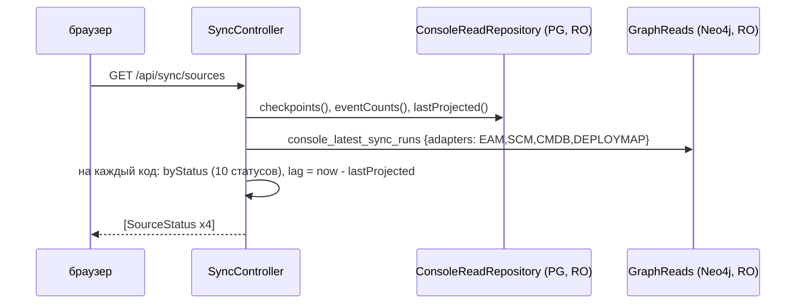

# sync-journal: дизайн

> Модульный дизайн: [`../design.md`](../design.md) (пагинация, SQL, аудит). Контракты: [`../contracts.md`](../contracts.md) §1, §2.

## Interface

| Символ | Сигнатура | Результат | Трассировка |
|--------|-----------|-----------|-------------|
| `SyncController.sources` | `() -> List<SourceStatus>` | 4 элемента | `access/admin-console/src/main/java/io/github/unlocker/archrag/adminconsole/api/SyncController.java:56-75` 🟢 |
| `SyncController.events` | `(source, status, from, to, page, size) -> Page<Event>` | | `access/admin-console/src/main/java/io/github/unlocker/archrag/adminconsole/api/SyncController.java:78-91` 🟢 |
| `SyncController.event` | `(source, eventId) -> EventDetail` | `NotFoundException` | `access/admin-console/src/main/java/io/github/unlocker/archrag/adminconsole/api/SyncController.java:97-110` 🟢 |
| `SyncController.dlq` | `(source, replayed, page, size) -> Page<DlqEntry>` | | `access/admin-console/src/main/java/io/github/unlocker/archrag/adminconsole/api/SyncController.java:113-121` 🟢 |
| `ConsoleReadRepository.checkpoints` / `eventCounts` / `lastProjected` | карты по коду источника | | `access/admin-console/src/main/java/io/github/unlocker/archrag/adminconsole/pg/ConsoleReadRepository.java:53-94` 🟢 |
| `ConsoleReadRepository.events` / `eventsById` / `errorReason` / `dlqOfEvent` / `dlq` | | | `access/admin-console/src/main/java/io/github/unlocker/archrag/adminconsole/pg/ConsoleReadRepository.java:99-167` 🟢 |

## Fluxo Principal

1. `sources`: три чтения PostgreSQL и одно графа, затем сборка по `SyncSources.CODES` (`access/admin-console/src/main/java/io/github/unlocker/archrag/adminconsole/api/SyncController.java:58-74`) 🟢.
2. `events`: `PageRequest.of` → проверка `from < to` → `repository.events(toStored(source), status(status), from, to, page)` (`access/admin-console/src/main/java/io/github/unlocker/archrag/adminconsole/api/SyncController.java:86-90`) 🟢.
3. `event`: `toStored(source)` → `eventsById(eventId, stored)` → первый → `errorReason` → `dlqOfEvent` (`access/admin-console/src/main/java/io/github/unlocker/archrag/adminconsole/api/SyncController.java:99-109`) 🟢.
4. `dlq`: `repository.dlq(toStored(source), replayed, page)` (`access/admin-console/src/main/java/io/github/unlocker/archrag/adminconsole/api/SyncController.java:119-120`) 🟢.

## Fluxos Alternativos

- Нет события → 404 `event not found`; пустой `errorReason` → `null` (`access/admin-console/src/main/java/io/github/unlocker/archrag/adminconsole/api/SyncController.java:104-108`) 🟢.
- Ключ `(source, eventId)` уникален, но `eventsById` берёт `LIMIT 2` и использует первый — на случай вызова без источника (`access/admin-console/src/main/java/io/github/unlocker/archrag/adminconsole/pg/ConsoleReadRepository.java:114-125`) 🟡.
- Граф недоступен или таймаут → `sources` целиком падает (504 или 500): отдельной деградации «без lastSyncRun» нет 🟡 (`access/admin-console/src/main/java/io/github/unlocker/archrag/adminconsole/api/SyncController.java:61, 123-127`).
- `SyncRun.adapter` в верхнем регистре, ключи результата приводятся `toLowerCase` (`access/admin-console/src/main/java/io/github/unlocker/archrag/adminconsole/api/SyncController.java:37, 130`) 🟢.

## Dependências

`ConsoleReadRepository` (JdbcClient, роль `archrag_console_ro`), `GraphReads`, `Clock` (`access/admin-console/src/main/java/io/github/unlocker/archrag/adminconsole/api/SyncController.java:42-50`); таблицы `inbox_event`, `consumer_checkpoint`, `dlq_entry` (ingestion).

## Decisões de Design Identificadas

| Решение | Evidence | Уверенность |
|---------|----------|-------------|
| Короткие коды источников в API, URN в колонках (`urn:corp:<код>`) | `access/admin-console/src/main/java/io/github/unlocker/archrag/adminconsole/pg/SyncSources.java:11-16` | 🟢 |
| Вместо истории статусов отдаются записи DLQ события и пометка `historyNote` | `access/admin-console/src/main/java/io/github/unlocker/archrag/adminconsole/api/SyncController.java:39-40, 93-95` | 🟢 |
| Отставание — от последнего `PROJECTED` (`updated_at`), а не от checkpoint | `access/admin-console/src/main/java/io/github/unlocker/archrag/adminconsole/pg/ConsoleReadRepository.java:82-94`; `access/admin-console/src/main/java/io/github/unlocker/archrag/adminconsole/api/SyncController.java:69-70` | 🟡 |
| Статусы и источники — копии списков ingestion (консоль не зависит от `ingestion/*`) | `access/admin-console/src/main/java/io/github/unlocker/archrag/adminconsole/pg/SyncSources.java:6-12` | 🟡 |

## Riscos e Lacunas

- 🔴 `replayed_at` не заполняется: фильтр DLQ «открытые» бесполезен (Q-03).
- 🔴 События с `/` в `eventId` без карточки (Q-04).
- 🟡 Пустые `fetched/applied/failed/endedAt` у `lastSyncRun` (Q-10).
- 🟡 Копии таблиц кодов и статусов (Q-08).
