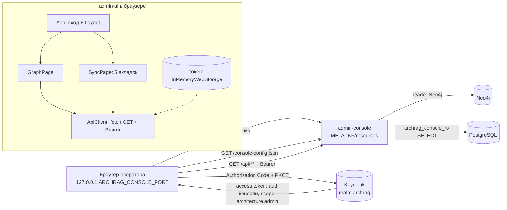

# access/admin-ui: требования

> SPA админ-консоли (React 18 + TypeScript + Webpack), только чтение. Пути в трассировке развёрнуты до корня репозитория. Дизайн: [`design.md`](design.md); внешние контракты: [`contracts.md`](contracts.md); открытые вопросы: [`questions.md`](questions.md); решения: [`decisions.md`](decisions.md).
> Use case-спецификации: [`oidc-login/`](oidc-login/requirements.md), [`graph-explorer/`](graph-explorer/requirements.md), [`sync-monitoring/`](sync-monitoring/requirements.md), [`identity-audit/`](identity-audit/requirements.md), [`build-bundle/`](build-bundle/requirements.md).
> Серверная сторона REST — [`../flowcharts/admin-console.md`](../flowcharts/admin-console.md) (отдельной SDD-папки у `access/admin-console` нет). Блок-схемы UI — [`../flowcharts/admin-ui.md`](../flowcharts/admin-ui.md).

## Визуальная схема



## Visão Geral

`admin-ui` — одностраничное приложение оператора: два раздела (`#/graph` «Граф», `#/sync` «Синхронизация»), все данные берёт из read-only REST `access/admin-console` (`/api/**`), логинится в Keycloak публичным клиентом по Authorization Code + PKCE и держит токен только в памяти вкладки 🟢 (`access/admin-ui/src/App.tsx:12-49`, `access/admin-ui/src/auth/authService.ts:39-80`, `access/admin-ui/src/api/endpoints.ts:47-72`). Maven-модуль `jar` без Java-кода: Webpack-бандл кладётся в `target/classes/META-INF/resources`, статику отдаёт `admin-console` 🟢 (`access/admin-ui/pom.xml:16`, `access/admin-ui/webpack.config.js:5-18`). Во внешний ingress не публикуется: консоль слушает только `127.0.0.1` (см. [`../docker/requirements.md`](../docker/requirements.md)) 🟢.

## Responsabilidades

- Загрузить публичную конфигурацию OIDC (`/console-config.json`), завершить вход или уйти на IdP 🟢.
- Типизированный `GET`-клиент с Bearer-токеном; реакция на 401 (повторный вход один раз) и 403 (экран «Нет прав») 🟢.
- Раздел «Граф»: сводка, поиск активов, карточка актива (свойства, жизненный цикл, происхождение), окрестность (Cytoscape) 🟢.
- Раздел «Синхронизация»: источники-«светофор», журнал событий с карточкой, DLQ, Identity (конфликты и кандидаты), аудит админ-операций 🟢.
- Показывать данные источников как текст (без HTML) и не раскрывать текст ошибок сервера 🟢.
- Собираться Maven-ом воспроизводимо (Node/npm закреплены), без runtime-конфигурации в бандле 🟢.

## Regras de Negócio

- Все вызовы API — `GET`; метод `post` в клиенте объявлен, но ни одна страница его не вызывает 🟢 (`access/admin-ui/src/api/apiClient.ts:35-38, 72-73`; `access/admin-ui/src/api/endpoints.ts:47-72`). Запрет изменяющих операций держит бэкенд: не-`GET` вне `/api/**` — `denyAll`, а контроллеры консоли содержат только `@GetMapping` 🟢 (`access/admin-console/src/main/java/io/github/unlocker/archrag/adminconsole/security/ConsoleSecurityConfiguration.java:48-52`; `docs/adr/0026-admin-console-readonly-loopback.md:18`).
- Токен и пользователь живут в `InMemoryWebStorage`; перезагрузка вкладки = новый вход 🟢 (`access/admin-ui/src/auth/authService.ts:48`).
- Параллельные 401 запускают вход один раз; провал входа показывает «Не удалось выполнить вход. Обновите страницу.» 🟢 (`access/admin-ui/src/api/ApiContext.tsx:20-28, 33-35`).
- 403 в одном разделе показывает экран «Нет прав» только в этом разделе; смена раздела (`key={route}`) сбрасывает его 🟢 (`access/admin-ui/src/App.tsx:43-45`; `access/admin-ui/src/api/ApiContext.tsx:29, 36`).
- Неизвестный hash ведёт в «Граф» 🟢 (`access/admin-ui/src/useHashRoute.ts:11-14`).
- Пустой поисковый запрос не отправляется; запрос ограничен 200 символами в поле ввода 🟢 (`access/admin-ui/src/pages/graph/AssetSearch.tsx:19, 41`).
- Ответ устаревшего поискового запроса не затирает ответ более нового 🟢 (`access/admin-ui/src/pages/graph/AssetSearch.tsx:14, 21-26`).
- Размер страницы всех таблиц — 50 (сервер допускает 1..200) 🟢 (`access/admin-ui/src/pages/sync/EventsTab.tsx:8`; `access/admin-console/src/main/java/io/github/unlocker/archrag/adminconsole/pg/PageRequest.java:10-11, 20-22`).
- Окрестность: глубина только 1 или 2 (сервер: 1..2); при `truncated` показывается баннер 🟢 (`access/admin-ui/src/pages/graph/NeighborhoodView.tsx:23-29, 41-45`; `access/admin-console/src/main/java/io/github/unlocker/archrag/adminconsole/api/GraphController.java:44`).
- Фильтры списков (источник, статус, период, DLQ) сбрасывают страницу на первую 🟢 (`access/admin-ui/src/pages/sync/EventsTab.tsx:64-69`; `access/admin-ui/src/pages/sync/DlqTab.tsx:27-38`).
- Значения свойств, причин и значений конфликтов выводятся как текст React; URL репозитория — текстом, не ссылкой; подписи узлов графа рисуются на canvas 🟢 (`access/admin-ui/src/components/common.tsx:65-69`; `access/admin-ui/src/pages/graph/AssetCard.tsx:15, 25`; `access/admin-ui/src/components/GraphCanvas.tsx:6-9`).
- Сообщение об ошибке — только «Ошибка запроса (HTTP N)» или общее; тело ответа сервера не показывается 🟢 (`access/admin-ui/src/hooks/useAsync.ts:9-13`).
- 🟡 Порог «устарел» (7 суток), пороги lag светофора (15 мин, 60 мин), allowlist'ы типов, источников и статусов — константы UI, продублированные с бэкендом и не связанные с ним кодом (`access/admin-ui/src/api/constants.ts:1-63`) — Q-04, Q-05.

## Requisitos Funcionais

| ID | Требование | Приоритет | Критерий приёмки |
|----|-----------|-----------|------------------|
| RF-01 | Читать `/console-config.json` (`issuer`, `clientId`, `scope`) до рендера; при ошибке показать сообщение и не рендерить приложение | Must | [`oidc-login`](oidc-login/requirements.md) AC-01, AC-02; `access/admin-ui/src/auth/authService.test.ts:22-34` |
| RF-02 | Вход Authorization Code + PKCE, токен в памяти, восстановление hash-маршрута после redirect | Must | `oidc-login` AC-01, AC-03; `access/admin-ui/src/auth/authService.test.ts:42-80`, `access/admin-ui/src/App.test.tsx:18-47` |
| RF-03 | `GET` с `Authorization: Bearer`; 401 → повторный вход один раз; 403 → экран «Нет прав» | Must | `oidc-login` AC-04, AC-05; `access/admin-ui/src/api/api.test.tsx:19-130` |
| RF-04 | Hash-навигация `#/graph`, `#/sync`; неизвестное значение → «Граф» | Must | AC-01 ниже; `access/admin-ui/src/useHashRoute.test.ts:3-11`, `access/admin-ui/src/App.test.tsx:26-33` |
| RF-05 | Сводка графа: узлы по меткам, связи по типам, время последнего обновления, кнопка «Обновить» | Should | [`graph-explorer`](graph-explorer/requirements.md) AC-01; `access/admin-ui/src/pages/GraphPage.test.tsx:64-90` |
| RF-06 | Поиск активов с фильтром типов | Must | `graph-explorer` AC-02, AC-03; `access/admin-ui/src/pages/GraphPage.test.tsx:91-119, 243` |
| RF-07 | Карточка актива: свойства, жизненный цикл, происхождение, блок «Исходный код» у `Deployment` | Must | `graph-explorer` AC-04, AC-05; `access/admin-ui/src/pages/GraphPage.test.tsx:121-196` |
| RF-08 | Окрестность узла: глубина 1/2, фильтр типов связей, баннер `truncated`, переход по клику на узел | Must | `graph-explorer` AC-06, AC-07; `access/admin-ui/src/pages/GraphPage.test.tsx:198-241` |
| RF-09 | Источники: светофор, последний `SyncRun`, lag, события по статусам, автообновление 30 с | Must | [`sync-monitoring`](sync-monitoring/requirements.md) AC-01, AC-02; `access/admin-ui/src/pages/SyncPage.test.tsx:65-120` |
| RF-10 | Журнал событий: фильтры источник/статус/период, пагинация, карточка без payload | Must | `sync-monitoring` AC-03, AC-04; `access/admin-ui/src/pages/SyncPage.test.tsx:121-173` |
| RF-11 | DLQ: по умолчанию `replayed=false`, переключатель «Включая повторённые» | Should | `sync-monitoring` AC-05; `access/admin-ui/src/pages/SyncPage.test.tsx:174-191` |
| RF-12 | Identity: конфликты и кандидаты по статусу `OPEN`/`RESOLVED` | Should | [`identity-audit`](identity-audit/requirements.md) AC-01, AC-02; `access/admin-ui/src/pages/SyncPage.test.tsx:192-203, 220-232` |
| RF-13 | Аудит админ-операций ingestion, постранично, флаг «обрезано» | Should | `identity-audit` AC-03, AC-04; `access/admin-ui/src/pages/SyncPage.test.tsx:204-219, 233-237` |
| RF-14 | Сборка Maven: Node/npm закреплены, `npm ci` → `npm test` → `npm run build`, бандл в `META-INF/resources` | Must | [`build-bundle`](build-bundle/requirements.md) AC-01, AC-02 |
| RF-15 | В UI нет изменяющих операций (ни одного не-`GET` вызова) | Must | AC-02 ниже (проверка по коду, автотеста на отсутствие `post` нет 🟡) |

## Requisitos Não Funcionais

| Тип | Требование | Evidence | Уверенность |
|-----|------------|----------|-------------|
| Безопасность | Токен только в памяти (`userStore` — `sessionStorage`/in-memory по коду); одноразовое `state`/`code_verifier` по умолчанию `oidc-client-ts@3.1.0` пишется в `localStorage` (`stateStore` не задан), а не в `sessionStorage`, как утверждает ADR 0026 `[Ревью R.7]` | `access/admin-ui/src/auth/authService.ts:10, 35-37, 48`; `docs/adr/0026-admin-console-readonly-loopback.md:21` | 🟢 токен / 🟢 расхождение с ADR 0026 по `state`, снято уточнением ADR от 2026-10-14 (UNLOCKER-288) (Q-08; проверено по исходникам `oidc-client-ts@3.1.0`) |
| Безопасность | Публичный клиент, PKCE (`response_type: 'code'`), `redirect_uri = origin + "/"` | `access/admin-ui/src/auth/authService.ts:40, 46`; `platform/docker/keycloak/archrag-realm.json:77-90` | 🟢 |
| Безопасность | Бандл совместим со строгой CSP (`default-src 'self'`): без inline-скриптов и стилей, CSS отдельным файлом | `access/admin-ui/webpack.config.js:26-30`; `access/admin-console/src/main/java/io/github/unlocker/archrag/adminconsole/security/ConsoleSecurityConfiguration.java:61-66`; `access/admin-console/src/test/java/io/github/unlocker/archrag/adminconsole/ConsoleApiTest.java:183` | 🟢 |
| Безопасность | Недоверенные тексты источников не интерпретируются как HTML | `access/admin-ui/src/components/common.tsx:65-69`; `access/admin-ui/src/components/GraphCanvas.tsx:6-9` | 🟢 |
| Безопасность | Тело ответа сервера и токен не попадают в сообщения об ошибках | `access/admin-ui/src/hooks/useAsync.ts:9-13`; `access/admin-ui/src/api/apiClient.ts:65-67` | 🟢 |
| Производительность | Автообновление только вкладки «Источники», раз в 30 с, без сброса экрана | `access/admin-ui/src/api/constants.ts:58-59`; `access/admin-ui/src/hooks/useAsync.ts:26-52` | 🟢 |
| Надёжность | Устаревший ответ не перезаписывает состояние (флаг `cancelled`, счётчик `latest`) | `access/admin-ui/src/hooks/useAsync.ts:29-42`; `access/admin-ui/src/pages/graph/AssetSearch.tsx:21-26` | 🟢 |
| Сборка | Node `v22.12.0`, npm `10.9.0`; зависимости закреплены точными версиями и `package-lock.json` | `access/admin-ui/pom.xml:20-21`; `access/admin-ui/package.json:11-34` | 🟢 |
| Сборка | Исходники в production-jar не публикуются (`devtool: false`) | `access/admin-ui/webpack.config.js:34-35` | 🟢 |
| Доступность (a11y) | Роли `tablist`/`tab`, `role="alert"` для ошибок, подписи таблиц `aria-label` | `access/admin-ui/src/pages/SyncPage.tsx:23-34`; `access/admin-ui/src/components/common.tsx:29` | 🟡 (SLO/требований a11y нет, выведено из разметки) |

> Inferido a partir do código. Validar с эксплуатацией: SLO, поддерживаемые браузеры и целевой объём данных не заданы 🟢 [R.8: ответ владельца, вопрос 12] (см. [`questions.md`](questions.md) Q-12).

## Критерии приёмки (сквозные)

```gherkin
# AC-01: навигация, позитив
Дано оператор вошёл, hash пустой
Когда открывается консоль
Тогда показан раздел «Граф»; клик «Синхронизация» переключает hash в #/sync и раздел     # App.test.tsx «switches section on hash change»; useHashRoute.test.ts

# AC-01n: навигация, негатив
Дано hash = #/unknown
Когда вычисляется маршрут
Тогда выбран раздел «Граф»                                                               # useHashRoute.test.ts «falls back to graph for empty or unknown hash»

# AC-02: только чтение
Дано любая вкладка любого раздела
Когда пользователь выполняет все доступные действия (поиск, фильтры, пагинация, обновление)
Тогда UI отправляет только GET на /api/** и GET /console-config.json                       # проверка по коду: access/admin-ui/src/api/endpoints.ts:47-72; автотеста нет 🟡

# AC-03: сообщение об ошибке без утечки
Дано сервер отвечает 500 с телом, содержащим внутренние детали
Когда UI показывает ошибку загрузки
Тогда текст — «Ошибка запроса (HTTP 500)», тело ответа не выводится                      # access/admin-ui/src/hooks/useAsync.ts:10-13; SyncPage.test.tsx «sources show error state»
```

## Prioridade (MoSCoW)

| Требование | MoSCoW | Justificativa |
|-----------|--------|---------------|
| Вход, клиент API, 401/403 (RF-01..03) | Must | Без токена консоль недоступна (scope `architecture.admin`, ADR 0026) |
| Граф: поиск, карточка, окрестность (RF-06..08) | Must | Основной сценарий оператора |
| Источники, журнал (RF-09, RF-10) | Must | Единственный обзор состояния синхронизации |
| Сводка, DLQ, Identity, Аудит (RF-05, RF-11..13) | Should | Диагностика; часть опирается на недоделанные признаки (Q-02, Q-03) |
| Кнопка «Выйти» (`logout`) | Won't | Метод есть, UI не использует (Q-06) |
| Тихое обновление токена | Won't | Не реализовано (Q-07) |
| Изменяющие операции (replay, rebuild, reconcile, crosswalk) | Won't | Запрещены ADR 0026; остаются в admin REST ingestion |

## Зависит от / Связанные спецификации

См. раздел «Зависит от / Связанные спецификации» в [`design.md`](design.md).

## Rastreabilidade de Código

| Файл | Класс / назначение | Покрытие |
|------|--------------------|----------|
| `access/admin-ui/src/index.tsx`, `access/admin-ui/src/App.tsx`, `access/admin-ui/src/useHashRoute.ts` | точка входа, корень, маршруты | 🟢 |
| `access/admin-ui/src/auth/authService.ts` | OIDC-сервис и загрузка конфигурации | 🟢 |
| `access/admin-ui/src/api/apiClient.ts`, `access/admin-ui/src/api/ApiContext.tsx`, `access/admin-ui/src/api/endpoints.ts`, `access/admin-ui/src/api/constants.ts`, `access/admin-ui/src/api/types.ts` | клиент API, провайдер, вызовы, константы, типы | 🟢 |
| `access/admin-ui/src/hooks/useAsync.ts`, `access/admin-ui/src/components/common.tsx`, `access/admin-ui/src/components/GraphCanvas.tsx`, `access/admin-ui/src/components/Layout.tsx`, `access/admin-ui/src/components/ForbiddenScreen.tsx` | общие хуки и компоненты | 🟢 |
| `access/admin-ui/src/pages/GraphPage.tsx`, `access/admin-ui/src/pages/graph/AssetCard.tsx`, `access/admin-ui/src/pages/graph/AssetSearch.tsx`, `access/admin-ui/src/pages/graph/GraphSummary.tsx`, `access/admin-ui/src/pages/graph/NeighborhoodView.tsx` | раздел «Граф» | 🟢 |
| `access/admin-ui/src/pages/SyncPage.tsx`, `access/admin-ui/src/pages/sync/SourcesTab.tsx`, `access/admin-ui/src/pages/sync/EventsTab.tsx`, `access/admin-ui/src/pages/sync/DlqTab.tsx`, `access/admin-ui/src/pages/sync/IdentityTab.tsx`, `access/admin-ui/src/pages/sync/AuditTab.tsx` | раздел «Синхронизация» | 🟢 |
| `access/admin-ui/pom.xml`, `access/admin-ui/package.json`, `access/admin-ui/package-lock.json`, `access/admin-ui/webpack.config.js`, `access/admin-ui/tsconfig.json`, `access/admin-ui/jest.config.js` | сборка и тесты | 🟢 |
| `access/admin-ui/src/testing/mockApi.tsx` | мок API для Jest | 🟢 |
