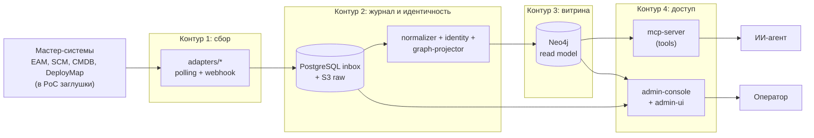

# Архитектура Arch RAG: обзор

> Architect, этап R.5 (UNLOCKER-270). Синтез артефактов R.1–R.4 (`inventory.md`, `dependencies.md`, `code-analysis.md`, `flowcharts/`, `database/`, `domain.md`, `state-machines.md`, `permissions.md`, `adrs/`) и `docs/00`–`06`, ADR 0001–0031. Исходники и `docs/` не правились.
> Метки: 🟢 подтверждено в коде/конфиге · 🟡 выведено · 🔴 расхождение или пробел. Ссылки `файл:строка` даны от корня репозитория и перепроверены `grep -n` в этом прогоне.
> Skill `reversa-architect` v1.1.0 в runtime этого прогона не установлен (нет в `.agents/` и `.claude/skills/` рабочей копии), поэтому использована копия `SKILL.md` версии 1.1.0 из npx-кэша Reversa на той же машине; её совпадение с версией, которой работали R.1–R.4, не проверялось. `doc_level = completo` (`.reversa/state.json`).

## 1. Состав документов этапа

| Файл | Что внутри |
|---|---|
| [`c4-context.md`](c4-context.md) | C4 уровень 1: система, персоны, внешние системы |
| [`c4-containers.md`](c4-containers.md) | C4 уровень 2: запускаемые контейнеры стенда, сети, хранилища |
| [`c4-components.md`](c4-components.md) | C4 уровень 3: `ingestion`, `mcp-server` + `graph-query-core`, `adapter-core` |
| [`erd-complete.md`](erd-complete.md) | Сквозной ERD: PostgreSQL ↔ Neo4j ↔ S3 (атрибуты — по ссылке на `database/erd.md`) |
| [`integrations.md`](integrations.md) | Карта интеграций: мастер-системы, OIDC, MCP-клиенты, консоль, хранилища, наблюдаемость |
| [`tech-debt.md`](tech-debt.md) | Технический долг, сверка с `docs/05-production-gap-list.md` |
| [`traceability/spec-impact-matrix.md`](traceability/spec-impact-matrix.md) | Какое изменение что ломает: включая связи, которых нет в `pom.xml` |

`integrations.md` и `tech-debt.md` — требования брief'а задачи; в шаблоне skill они отдельными файлами не названы (отклонение от шаблона, см. комментарий к задаче).

## 2. Назначение и четыре контура

Arch RAG — операционный граф знаний об архитектуре предприятия: мастер-системы остаются владельцами данных, Neo4j — производная read-only витрина, MCP-сервер даёт ИИ-агентам только предметные read-only операции (подробно — [`soul.md`](soul.md), ADR [0001](../docs/adr/0001-neo4j-derived-read-model.md), [0018](../docs/adr/0018-domain-tools-not-arbitrary-cypher.md)). Система делится на четыре контура (ADR [0002](../docs/adr/0002-four-contours.md)); в Maven они соответствуют каталогам первого уровня (`pom.xml:15-21`).

Контуры 1–3 пишут, контур 4 только читает. Проверенные границы зависимостей: `access/*` не зависит от `ingestion/*` и `adapters/*`; `contracts/*` не зависит от остальных 🟢 (`_reversa_sdd/dependencies.md:97-97`; граф зависимостей — там же, §3). Единственное допущение: `ingestion/ingestion-service` зависит от `adapters/adapter-core` в scope `test` (контрактный тест `StoredEventReader`) 🟢 (`ingestion/ingestion-service/pom.xml:71-76`).

## 3. Модули Maven → запускаемые контейнеры

В стенде модули не равны контейнерам. Соответствие (подробности — [`c4-containers.md`](c4-containers.md)):

| Контейнер compose | Из каких модулей собран | Роль |
|---|---|---|
| `ingestion` | `ingestion-service` + библиотеки `event-journal`, `normalizer`, `identity-resolution`, `graph-projector` (+ `canonical-model`, `event-schemas`) | единственный писатель Neo4j и владелец схемы PostgreSQL |
| `mcp-server` | `mcp-server` + `graph-query-core` | MCP, `architecture.read` |
| `admin-console` | `admin-console` + `admin-ui` (статика в jar) + `graph-query-core` | read-only консоль, `architecture.admin` |
| `adapter-eam/scm/cmdb/deploymap` | один образ `demo-launcher` с `command: adapter <SRC>` + адаптеры | сбор |
| `stub-*`, `eam-api-stub` | `demo-launcher` + `platform/source-stubs` | имитация мастер-систем |
| `reverse-proxy`, `keycloak`, `postgres`, `neo4j`, `seaweedfs` | внешние образы | инфраструктура |
| `otel-collector`, `prometheus`, `grafana` | внешние образы (профиль `observability`) | метрики |

Источник: `platform/docker/docker-compose.yml:41-526`; образ адаптеров — `platform/docker/docker-compose.yml:311-336`.

## 4. Ключевые архитектурные инварианты

| # | Инвариант | Где держится | Уверенность |
|---|---|---|---|
| И-1 | Neo4j пишет только `ingestion`; `access/*` получают только reader-учётку | `ingestion/ingestion-service/src/main/java/io/github/unlocker/archrag/ingestionservice/IngestionServiceConfiguration.java:69-69`; `access/mcp-server/src/main/resources/application.yml:37-41`; `access/admin-console/src/main/resources/application.yml:25-29` | 🟢 |
| И-2 | Read-only доказывается в три слоя: статические шаблоны и allowlist, `EXPLAIN → READ_ONLY`, `AccessMode.READ` | `access/graph-query-core/src/main/java/io/github/unlocker/archrag/graphquerycore/GraphQueryExecutor.java:99-124`; серверный отказ проверен `platform/integration-tests/src/test/java/io/github/unlocker/archrag/integrationtests/GraphQueryCoreIT.java:111-120` | 🟢 |
| И-3 | Идемпотентность решает версия (`SourceVersion`), а не `eventId`; `source + eventId` дедуплицирует приём | `ingestion/graph-projector/src/main/java/io/github/unlocker/archrag/graphprojector/VersionDecision.java:20-38`; `ingestion/event-journal/src/main/java/io/github/unlocker/archrag/eventjournal/PostgresEventJournal.java:53-97` | 🟢 |
| И-4 | Checkpoint `projector` сдвигается после коммита Neo4j | `ingestion/graph-projector/src/main/java/io/github/unlocker/archrag/graphprojector/EventProcessor.java:612-617` | 🟢 |
| И-5 | Удаление только через tombstone и только после `snapshot-complete` | `ingestion/graph-projector/src/main/java/io/github/unlocker/archrag/graphprojector/Reconciler.java:88-144` | 🟢 |
| И-6 | Один писатель: PostgreSQL advisory lock на диспетчер и админские операции | `ingestion/ingestion-service/src/main/java/io/github/unlocker/archrag/ingestionservice/AdminLock.java:41-41` | 🟢 |
| И-7 | Три независимых контура аутентификации (MCP, admin REST, консоль) с разными `aud` | [`integrations.md`](integrations.md) §3 | 🟢 |
| И-8 | Каждый `tools/call` закрыт scope'ом, неизвестный tool — fail-closed | `access/mcp-server/src/main/java/io/github/unlocker/archrag/mcpserver/security/ToolScopeFilter.java:82-82` | 🟢 |

## 5. Расхождения кода с документами (🔴), которые видит архитектор

Полный реестр — [`detective-gaps.md`](detective-gaps.md). Здесь только те, что влияют на архитектуру целиком.

| № | Что | Ссылки |
|---|---|---|
| 🔴 А-1 | `docs/05-production-gap-list.md` п. 2.3 (аннотации MCP-tools) устарел: все шесть tools задают `readOnlyHint = true` | `access/mcp-server/src/main/java/io/github/unlocker/archrag/mcpserver/tools/SearchAssetsTool.java:43-43`; `docs/05-production-gap-list.md:29-29`; [`tech-debt.md`](tech-debt.md) §2 |
| 🔴 А-2 | `docs/00-vision.md:555` называет `protocol=STREAMABLE`, код — `STATELESS` (ADR 0017, UNLOCKER-224) | `access/mcp-server/src/main/resources/application.yml:11-11`; `docs/00-vision.md:555-555` |
| 🟡 [R.8: решение принято, реализация — UNLOCKER-276 (п. 1, 2)] А-3 | Недостижимые и незаполняемые состояния: `SUPERSEDED`, `QUARANTINED → RETRYING`, `dlq_entry.replayed_at`, `identity_candidate.status`, `SyncRun.status` (Р-1…Р-5) | [`detective-gaps.md`](detective-gaps.md) §2 |
| 🔴 А-4 | Литералы типов событий и таблица кодов источников продублированы в 4–6 местах без общего источника и теста на совпадение | [`traceability/spec-impact-matrix.md`](traceability/spec-impact-matrix.md) §2 |
| 🔴 А-5 | Раскладка модулей шире схемы `docs/00-vision.md:453`; `platform/observability` как модуля нет | `docs/00-vision.md:453-453`; `_reversa_sdd/inventory.md:98-98` |

## 6. Как читать дальше

Следующий этап (Writer, R.6a) строит спецификации по компонентам и использует [`traceability/spec-impact-matrix.md`](traceability/spec-impact-matrix.md) как карту зависимостей между ними. Writer в этом этапе не запускался.
