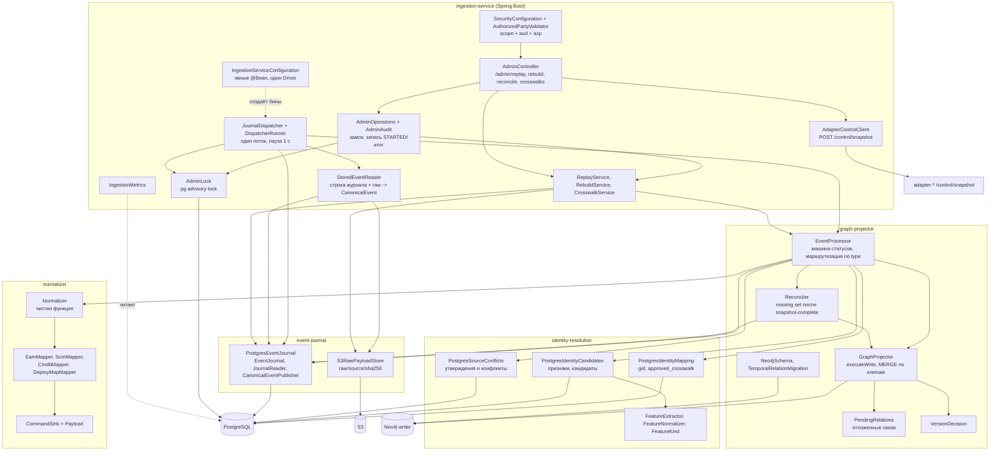
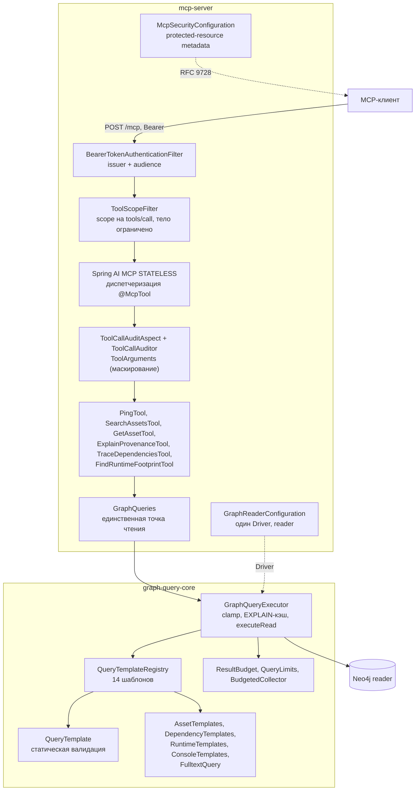
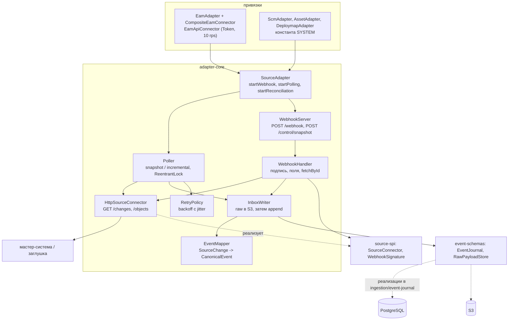

# C4, уровень 3: компоненты

> Architect, этап R.5 (UNLOCKER-270). Компонентный уровень сделан только для трёх ключевых контейнеров: `ingestion` (вместе с identity и projector), `mcp-server` с `graph-query-core` и каркас адаптеров `adapter-core`. `admin-console` и `admin-ui` описаны в `code-analysis.md` §X3–X4, `platform/*` — §Y–Z. Метки: 🟢 код · 🟡 выведено · 🔴 расхождение. Классы названы так же, как в коде; пути сокращены до корня пакета:
> `IS` = `ingestion/ingestion-service/src/main/java/io/github/unlocker/archrag/ingestionservice`, `GP` = `ingestion/graph-projector/src/main/java/io/github/unlocker/archrag/graphprojector`, `IR` = `ingestion/identity-resolution/src/main/java/io/github/unlocker/archrag/identityresolution`, `EJ` = `ingestion/event-journal/src/main/java/io/github/unlocker/archrag/eventjournal`, `NZ` = `ingestion/normalizer/src/main/java/io/github/unlocker/archrag/normalizer`. В таблицах ссылки даны полными путями.

## 1. Контейнер `ingestion`

### 1.1 Диаграмма

### 1.2 Компоненты

| Компонент | Ответственность | Инварианты | Основание |
|---|---|---|---|
| `JournalDispatcher` / `DispatcherRunner` | выбирает события `RECEIVED`/`RETRYING` и промежуточные по таймауту, гонит через `EventProcessor`; пропускает объект после сбоя в том же проходе | один поток; страница берётся под `AdminLock`; порядок `(received_at, source, event_id)` | `ingestion/ingestion-service/src/main/java/io/github/unlocker/archrag/ingestionservice/JournalDispatcher.java:100-100`; `ingestion/ingestion-service/src/main/java/io/github/unlocker/archrag/ingestionservice/DispatcherRunner.java:43-43` 🟢 |
| `StoredEventReader` | собирает `CanonicalEvent` из строки `inbox_event` и raw JSON | формат повторяет `EventMapper` адаптеров; держит контрактный тест | `ingestion/ingestion-service/src/main/java/io/github/unlocker/archrag/ingestionservice/StoredEventReader.java:34-34` 🟢 |
| `AdminController` + `AdminOperations` | admin REST; каждая операция идёт под замком и пишет аудит | `/admin/**` только со scope `architecture.admin`, `aud` админки и `azp` из allow-list | `ingestion/ingestion-service/src/main/java/io/github/unlocker/archrag/ingestionservice/SecurityConfiguration.java:42-43`; `ingestion/ingestion-service/src/main/java/io/github/unlocker/archrag/ingestionservice/AdminController.java:61-61` 🟢 |
| `ReplayService` / `RebuildService` / `CrosswalkService` | replay создаёт новые строки `replay:<id>:<eventId>`; rebuild стирает все узлы Neo4j и делает replay; crosswalk присваивает общий `gid` | исходные строки журнала не меняются; `gid` переживает rebuild | `ingestion/ingestion-service/src/main/java/io/github/unlocker/archrag/ingestionservice/RebuildService.java:18-18` 🟢 |
| `EventProcessor` | ведёт событие до конечного статуса: валидация → нормализация → gid → кандидаты → конфликты → запись → `PROJECTED` | checkpoint `projector` только после коммита Neo4j; коды ошибок без значений источника | `ingestion/graph-projector/src/main/java/io/github/unlocker/archrag/graphprojector/EventProcessor.java:185-199`; `ingestion/graph-projector/src/main/java/io/github/unlocker/archrag/graphprojector/EventProcessor.java:612-617` 🟢 |
| `Normalizer` + мапперы | `CanonicalEvent + RawPayloadRef → NormalizationResult`; единственное место, где живёт source DTO | неполная запись не затирает граф (`null`, а не значение по умолчанию); связи на неизвестный конец откладываются | `ingestion/normalizer/src/main/java/io/github/unlocker/archrag/normalizer/Normalizer.java:54-86` 🟢 |
| `PostgresIdentityMapping` | `(source, sourceType, sourceId) → gid`, approved crosswalk | `gid` назначается один раз и навсегда; при `rebuild` остаётся | `ingestion/identity-resolution/src/main/java/io/github/unlocker/archrag/identityresolution/PostgresIdentityMapping.java:36-60` 🟢 |
| `PostgresIdentityCandidates` | признаки и кандидаты на совпадение без авто-слияния | `MAX_MATCHES = 50`; оценка по весам `FeatureKind` | `ingestion/identity-resolution/src/main/java/io/github/unlocker/archrag/identityresolution/PostgresIdentityCandidates.java:33-33` 🟢 |
| `PostgresSourceConflicts` | утверждения свойств/связей и конфликты по `AuthorityMatrix` | ничего не пишет в граф; значение выбирает проектор | `ingestion/identity-resolution/src/main/java/io/github/unlocker/archrag/identityresolution/PostgresSourceConflicts.java:81-103` 🟢 |
| `GraphProjector` | запись `GraphCommand` одной транзакцией `executeWrite` | внутри транзакции нет обращений к PG/S3; `MERGE` только по ключам под constraint; Cypher только с параметрами | `ingestion/graph-projector/src/main/java/io/github/unlocker/archrag/graphprojector/GraphProjector.java:302-359` 🟢 |
| `PendingRelations` | отложенные связи на ещё не пришедший конец; достройка по `healPending`/`healAliases` | версия отложенной связи должна совпадать с версией утверждающей записи | `ingestion/graph-projector/src/main/java/io/github/unlocker/archrag/graphprojector/PendingRelations.java:86-107` 🟢 |
| `Reconciler` | missing set: tombstone-события для записей вне snapshot | запускается только из `snapshot-complete`; tombstone с применённой версией | `ingestion/graph-projector/src/main/java/io/github/unlocker/archrag/graphprojector/Reconciler.java:88-144` 🟢 |
| `PostgresEventJournal` / `S3RawPayloadStore` | приём с дедупликацией `source + eventId`, переходы статусов под `FOR UPDATE`, S3 по content hash | `DUPLICATE` из `append` не персистируется; ключ S3 `raw/<source>/<sha256>` | `ingestion/event-journal/src/main/java/io/github/unlocker/archrag/eventjournal/PostgresEventJournal.java:53-97`; `ingestion/event-journal/src/main/java/io/github/unlocker/archrag/eventjournal/S3RawPayloadStore.java:74-74` 🟢 |

### 1.3 Заметки

- Диспетчер, replay и rebuild делят один PostgreSQL advisory lock: во время admin-операции диспетчер «спит» 🟢 (`ingestion/ingestion-service/src/main/java/io/github/unlocker/archrag/ingestionservice/AdminLock.java:41-41`). Следствие: `POST /admin/reconcile/{source}` держит замок до 10 минут (`ingestion/ingestion-service/src/main/java/io/github/unlocker/archrag/ingestionservice/AdapterControlClient.java:20-20`) 🟡.
- Зависимость `graph-projector → normalizer, identity-resolution` — штатная (`ingestion/graph-projector/pom.xml:18-39`); `ingestion-service` собирает всё через явные `@Bean`, без component scan для доменных классов 🟢.
- 🟢 (реализовано — UNLOCKER-280, 281, 282) Бывшие недостижимые состояния и незаполняемые поля, видимые в этом контейнере: `SUPERSEDED` (удалён), выход из `QUARANTINED` (release), `dlq_entry.replayed_at`, `identity_candidate.status`, итоговый статус `SyncRun` (Р-1…Р-5, [`detective-gaps.md`](detective-gaps.md) §2).

## 2. Контейнер `mcp-server` и библиотека `graph-query-core`

### 2.1 Диаграмма

### 2.2 Компоненты

| Компонент | Ответственность | Инварианты | Основание |
|---|---|---|---|
| `ToolScopeFilter` | проверка scope до диспетчеризации | `tools/call` без записи в `tool-scopes` — 403 (fail-closed); JSON-RPC batch и тело больше 1 МБ отвергаются; `initialize` и `tools/list` требуют только валидный токен 🟡 | `access/mcp-server/src/main/java/io/github/unlocker/archrag/mcpserver/security/ToolScopeFilter.java:82-82` 🟢 |
| Tools | валидация аргументов, бюджет, сборка типизированного ответа | ошибки без эха ввода; `trace_dependencies` отвергает `maxDepth` выше потолка | `access/mcp-server/src/main/java/io/github/unlocker/archrag/mcpserver/tools/TraceDependenciesTool.java:82-158` 🟢 |
| `GraphQueries` | единственный путь tools к графу, пишет шаблон и строки в `ToolCallContext` | tools не обращаются к `GraphQueryExecutor` напрямую | `access/mcp-server/src/main/java/io/github/unlocker/archrag/mcpserver/graph/GraphQueries.java:27-31` 🟢 |
| `GraphQueryExecutor` | принимает ID шаблона, а не текст Cypher; режет бюджет до потолков; `EXPLAIN` один раз на шаблон; `executeRead` с таймаутом | `Node/Relationship/Path` в результате запрещены (проекции); `limit` зарезервирован | `access/graph-query-core/src/main/java/io/github/unlocker/archrag/graphquerycore/GraphQueryExecutor.java:60-97` 🟢 |
| `QueryTemplate` | статическая валидация: `LIMIT $limit`, параметры совпадают с объявленными, граница пути только `{maxDepth}` или число | `*` и `*1..` без верхней границы запрещены | `access/graph-query-core/src/main/java/io/github/unlocker/archrag/graphquerycore/QueryTemplate.java:42-105` 🟢 |
| `QueryTemplateRegistry` | иммутабельный реестр с проверкой потолка глубины и уникальности ID | литеральная глубина шаблона не выше `limits.maxDepth` | `access/graph-query-core/src/main/java/io/github/unlocker/archrag/graphquerycore/QueryTemplateRegistry.java:32-45` 🟢 |
| `ToolCallAuditAspect` | аудит каждого вызова, включая отказы | токен не читается; аргументы усекаются и маскируются | `access/mcp-server/src/main/java/io/github/unlocker/archrag/mcpserver/audit/ToolCallAuditAspect.java:29-60` 🟢 |

### 2.3 Заметки

- `admin-console` использует ту же `graph-query-core`, но своё приложение и свой `GraphReaderConfiguration` (почти дословная копия MCP-варианта) — [`traceability/spec-impact-matrix.md`](traceability/spec-impact-matrix.md) §2 🟡.
- Индекс `asset_text` создаёт `ingestion` (`Neo4jSchema`), а читает шаблон `search_assets` из `graph-query-core`; контейнеры связаны через имя индекса без compile-time проверки 🟡 (там же, §2).
- `mcp-server` обращается к `canonical-model` (`AuthorityMatrix`, `NodeLabel`) без явной зависимости в `pom.xml` — только транзитивно 🟡 (`access/mcp-server/src/main/java/io/github/unlocker/archrag/mcpserver/tools/ExplainProvenanceTool.java:3-3`).

## 3. Библиотека `adapter-core` и привязки адаптеров

### 3.1 Диаграмма

### 3.2 Компоненты

| Компонент | Ответственность | Инварианты | Основание |
|---|---|---|---|
| `Poller` | нет checkpoint — `snapshot`, иначе `incremental(cursor)` | курсор сдвигается после записи страницы в inbox; прерванный snapshot продолжается под тем же `syncRunId`; порядок `маркер → done → инкрементальный курсор` | `adapters/adapter-core/src/main/java/io/github/unlocker/archrag/adaptercore/Poller.java:89-96` 🟢 |
| `WebhookHandler` | подпись → JSON → поля → `fetchById` → запись | `401` подпись, `400` формат, `503` источник недоступен, `404` объект неизвестен, `202` после записи; дедупликация по `eventId` из подписанного тела | `adapters/adapter-core/src/main/java/io/github/unlocker/archrag/adaptercore/WebhookHandler.java:56-107` 🟢 |
| `WebhookServer` | JDK `HttpServer` на виртуальных потоках; `/control/snapshot` без аутентификации | тело ≤ 64 КБ; необработанное исключение — 500 без деталей | `adapters/adapter-core/src/main/java/io/github/unlocker/archrag/adaptercore/WebhookServer.java:54-56` 🟢 |
| `HttpSourceConnector` | `GET /changes?limit&cursor`, `GET /objects/{type}/{id}`; только чтение | `429` и `5xx` — `SourceUnavailableException`; тексты ответов источника в исключения и логи не попадают | `adapters/adapter-core/src/main/java/io/github/unlocker/archrag/adaptercore/HttpSourceConnector.java:56-72` 🟢 |
| `EventMapper` | `SourceChange → CanonicalEvent`, маркер `snapshot-complete` | `eventId` детерминирован (`poll:`, `snap:`, `snapshot-complete:`); `null` верхнего уровня отбрасывается | `adapters/adapter-core/src/main/java/io/github/unlocker/archrag/adaptercore/EventMapper.java:52-95` 🟢 |
| `InboxWriter` | `rawStore.put` → `journal.append` | единственная точка записи адаптера; ошибки журнала и S3 пробрасываются | `adapters/adapter-core/src/main/java/io/github/unlocker/archrag/adaptercore/InboxWriter.java:34-48` 🟢 |
| `EamApiConnector` / `CompositeEamConnector` | реальный формат «EAM Tool API» плюс «старая заглушка» для TEAM и SERVICE_DEPENDENCY | `DELETE` не порождается (удаление находит только snapshot); `page_size ≤ 500`, ≤ 10 запросов/с | `adapters/eam-adapter/src/main/java/io/github/unlocker/archrag/eamadapter/EamApiConnector.java:45-56` 🟢 |

### 3.3 Заметки

- Источник и адаптер связаны константой `SYSTEM` в трёх тонких привязках; `scm`, `asset`, `deploymap` — копии одного шаблона по 39 строк 🟢 (`adapters/scm-adapter/src/main/java/io/github/unlocker/archrag/scmadapter/ScmAdapter.java:18-18`).
- Типы событий `deleted` и `snapshot-complete` объявлены здесь (`adapters/adapter-core/src/main/java/io/github/unlocker/archrag/adaptercore/EventMapper.java:29-32`), а не в контракте; потребители держат копии литералов 🔴 ([`traceability/spec-impact-matrix.md`](traceability/spec-impact-matrix.md) §2).
- `adapter-core` не знает Neo4j и не импортирует `canonical-model`/`ingestion/*` — граница «source DTO не выходит из адаптера и normalizer» держится 🟢 (`adapters/adapter-core/src/main/java/io/github/unlocker/archrag/adaptercore/EventMapper.java:14-16`).
