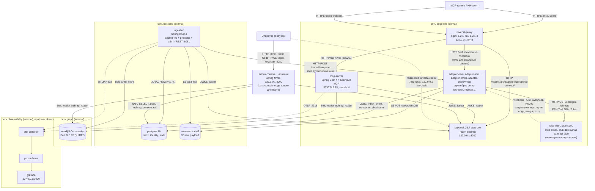

# C4, уровень 2: контейнеры

> Architect, этап R.5 (UNLOCKER-270). Уровень — запускаемые контейнеры демо-стенда Docker Compose (ADR [0021](../docs/adr/0021-compose-demo-stand.md)), а не Maven-модули: соответствие модулей контейнерам — [`architecture.md`](architecture.md) §3. Метки: 🟢 код/конфиг · 🟡 выведено · 🔴 расхождение. Порядок запуска и скрипты backup/restore — [`flowcharts/docker.md`](flowcharts/docker.md); не дублируются.

## 1. Диаграмма

Стрелка подписана протоколом. Сплошные границы — сети compose; `internal` означает «без доступа наружу» (`platform/docker/docker-compose.yml:528-543`).

## 2. Контейнеры

| Контейнер | Технология | Ответственность | Порт на хосте | Сети | Основание |
|---|---|---|---|---|---|
| `reverse-proxy` | `nginx:1.27-alpine` | единственная публикуемая TLS-точка: `/mcp`, protected-resource metadata, OIDC endpoints Keycloak, `/webhooks/<src>` | `127.0.0.1:8443` | edge | `platform/docker/docker-compose.yml:448-471`; `platform/docker/proxy/nginx.conf:1-63` 🟢 |
| `keycloak` | `quay.io/keycloak/keycloak:26.4`, `start-dev`, импорт `archrag-realm.json` | выдача токенов агенту (`client_credentials`) и оператору (Code+PKCE) | `127.0.0.1:8080` | edge, backend | `platform/docker/docker-compose.yml:137-176` 🟢 |
| `mcp-server` | Spring Boot 4.1.1, Spring AI 2.0.1 `mcp-server-webmvc`, `STATELESS` | 6 tools, scope на `tools/call`, аудит; масштабируется `--scale` | нет | edge, graph, observability | `platform/docker/docker-compose.yml:222-254`; `access/mcp-server/src/main/resources/application.yml:11-11` 🟢 |
| `admin-console` | Spring MVC + SPA React 18 (`admin-ui` в jar) | read-only REST `/api/**` и статика | `127.0.0.1:8090` | backend, graph, console-edge | `platform/docker/docker-compose.yml:274-309` 🟢 |
| `ingestion` | Spring Boot 4.1.1, чистый JDBC, Neo4j Java Driver | диспетчер журнала, проекция, admin REST, миграции PG и схема Neo4j | нет | backend, graph, observability | `platform/docker/docker-compose.yml:178-220` 🟢 |
| `adapter-eam/scm/cmdb/deploymap` | образ `demo-launcher`, `command: adapter <SRC>` | polling, webhook, snapshot, запись в inbox и S3; ровно один экземпляр | нет | edge, backend | `platform/docker/docker-compose.yml:311-379` 🟢 |
| `stub-*`, `eam-api-stub` | `platform/source-stubs` | имитация мастер-систем, управление сценариями | нет | edge | `platform/docker/docker-compose.yml:381-446` 🟢 |
| `postgres` | PostgreSQL 16 | журнал, crosswalk, кандидаты, конфликты, аудит админки (10 таблиц) | нет | backend | `platform/docker/docker-compose.yml:102-117` 🟢 |
| `neo4j` | `neo4j:5-community` (🔴 плавающий тег), Bolt TLS `REQUIRED` | граф, 16 меток, 18 constraints, 2 индекса | нет | graph | `platform/docker/docker-compose.yml:52-76`; `platform/docker/docker-compose.yml:62-62` 🟢 |
| `seaweedfs` | `chrislusf/seaweedfs:4.48` | S3 для raw payload | нет | backend | `platform/docker/docker-compose.yml:119-135` 🟢 |
| одноразовые | `certs`, `neo4j-init` (пользователь `archrag_reader`), `console-pg-init` (пароль `archrag_console_ro`) | подготовка сертификатов и учёток | нет | backend, graph | `platform/docker/docker-compose.yml:41-100`; `platform/docker/docker-compose.yml:256-272` 🟢 |
| `otel-collector`, `prometheus`, `grafana` | профиль `observability` | метрики OTLP → Prometheus → Grafana | `127.0.0.1:3000` (Grafana) | observability, obs-edge | `platform/docker/docker-compose.yml:471-526` 🟢 |

## 3. Что важно архитектору

1. **Разделение прав записи — на уровне учёток приложения, не СУБД Neo4j.** `ingestion` ходит под `neo4j` (writer), `mcp-server` и `admin-console` — под `archrag_reader`; роли Community не поддерживает, запрет записи держит код (ADR [0004](../docs/adr/0004-neo4j-community-constraints.md), [0005](../docs/adr/0005-readonly-mcp-by-application.md); `docs/05-production-gap-list.md` п. 1.3) 🟢. На стороне PostgreSQL консоль получает отдельную роль `archrag_console_ro` с `SELECT` ровно на шесть таблиц 🟢 (`ingestion/ingestion-service/src/main/resources/db/migration/V6__console_readonly_role.sql:15-15`).
2. **Ingestion и все адаптеры — по одному экземпляру.** Замок snapshot адаптера — внутрипроцессный (`adapters/adapter-core/src/main/java/io/github/unlocker/archrag/adaptercore/Poller.java:50-50`); писателя графа защищает PostgreSQL advisory lock (`ingestion/ingestion-service/src/main/java/io/github/unlocker/archrag/ingestionservice/AdminLock.java:41-41`). `mcp-server` масштабируется горизонтально (stateless, без собственного состояния) 🟢.
3. **Миграции PostgreSQL применяет `ingestion` при старте.** Каталог `db/migration` разделён тремя модулями (V1, V2/V4/V5/V7, V3/V6), поэтому схема существует, только если запущен `ingestion`; адаптеры и консоль зависят от его `healthy` 🟢 (`platform/docker/docker-compose.yml:32-35`; `ingestion/ingestion-service/src/main/java/io/github/unlocker/archrag/ingestionservice/IngestionServiceConfiguration.java:38-38`).
4. **Токены трёх контуров не взаимозаменяемы:** audience `ARCHRAG_MCP_RESOURCE_URI`, `ARCHRAG_ADMIN_RESOURCE_URI`, `ARCHRAG_CONSOLE_RESOURCE_URI`; у admin REST дополнительно `azp ∈ allowed-clients` — [`integrations.md`](integrations.md) §3 🟢.
5. **Админский REST из внешнего ingress не доступен:** в `nginx.conf` нет `location /admin`. Консоль read-only и вызовов в `/admin/*` не делает 🟢 (`_reversa_sdd/code-analysis.md:937-937`).
6. **Демо-допущения, которых нет в production** (`bolt+ssc` без проверки цепочки, dev-режим Keycloak, секреты стенда в `.env.example`, плавающий тег Neo4j) перечислены в [`tech-debt.md`](tech-debt.md) со ссылками на `docs/05-production-gap-list.md`.
