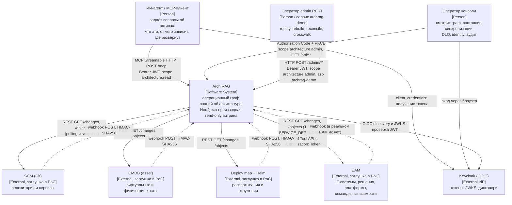

# C4, уровень 1: контекст

> Architect, этап R.5 (UNLOCKER-270). Метки: 🟢 код/конфиг · 🟡 выведено · 🔴 расхождение. Общий обзор — [`architecture.md`](architecture.md); интеграции с протоколами и аутентификацией — [`integrations.md`](integrations.md).

## 1. Диаграмма

## 2. Персоны

| Персона | Как получает доступ | Что делает | Основание |
|---|---|---|---|
| ИИ-агент / MCP-клиент | клиент `archrag-demo`, `client_credentials`, scope `architecture.read` по умолчанию | вызывает 5 предметных tools и `ping` | `platform/docker/keycloak/archrag-realm.json:51-61` 🟢 |
| Оператор консоли | публичный клиент `archrag-admin-console`, Authorization Code + PKCE, оба scope optional | читает граф и состояние конвейера; изменяющих операций в UI нет | `platform/docker/keycloak/archrag-realm.json:77-90` 🟢, ADR [0026](../docs/adr/0026-admin-console-readonly-loopback.md) |
| Оператор admin REST | тот же `archrag-demo`, запрашивает optional-scope `architecture.admin` | replay, rebuild, reconcile, загрузка crosswalk | `ingestion/ingestion-service/src/main/java/io/github/unlocker/archrag/ingestionservice/AdminController.java:61-61` 🟢 |

Админский REST не публикуется наружу: в конфигурации прокси нет `location /admin` 🟢 (`platform/docker/proxy/nginx.conf:1-63` — перечислены `/mcp`, `/.well-known/oauth-protected-resource`, `/realms/archrag/protocol/openid-connect/`, `/webhooks/*`). Оператор вызывает его из контейнера `ingestion` (так делает `restore.sh`, [`flowcharts/docker.md`](flowcharts/docker.md) §3) 🟡.

## 3. Внешние системы

| Система | В PoC | Что отдаёт | Формат/протокол | Уверенность |
|---|---|---|---|---|
| EAM | `eam-api-stub` (формат `docs/eam-api.yaml`) + `stub-eam` (TEAM и SERVICE_DEPENDENCY) | `PLATFORM`, `SOLUTION`, `IT_SYSTEM`; команды и зависимости | REST, `Authorization: Token`; ≤ 10 запросов/с | 🟢 |
| SCM (Git) | `stub-scm` | `REPOSITORY`, `SERVICE` | REST `/changes`, `/objects`, webhook | 🟢 |
| CMDB (asset) | `stub-cmdb` | `COMPUTE_INSTANCE` | REST, webhook | 🟢 |
| Deploy map + Helm | `stub-deploymap` | `ENVIRONMENT`, `DEPLOYMENT` (форматы `deploymap-poc-0/1`) | REST, webhook | 🟢 |
| Keycloak | образ `quay.io/keycloak/keycloak:26.4`, `start-dev`, импорт realm | токены и JWKS | OIDC | 🟢 |

Все четыре мастер-системы в PoC — заглушки (ADR [0010](../docs/adr/0010-master-systems-are-stubs.md)), реальные контракты не проверены (`docs/05-production-gap-list.md` п. 3.5, [`tech-debt.md`](tech-debt.md)).

Ссылки: заглушки и их образы — `platform/docker/docker-compose.yml:381-446`; сопоставление источников кодам `eam|scm|cmdb|deploymap` и модулям (`asset-adapter` ↔ `cmdb`, `deploymap-adapter` ↔ `DEPLOY_MAP`) — `adapters/asset-adapter/src/main/java/io/github/unlocker/archrag/assetadapter/AssetAdapter.java:18-18` (🟡: имя модуля не совпадает с кодом источника).

## 4. Что вне контекста системы

Kafka (production-вариант брокера, ADR [0006](../docs/adr/0006-postgres-inbox-event-backbone.md)), реальные мастер-системы, корпоративный IdP и Kubernetes — вне PoC (ADR [0022](../docs/adr/0022-out-of-poc-scope.md), `docs/05-production-gap-list.md`). `Document`/chunks и vector search в модели нет — граф структурный, не «GraphRAG из документов» ([`soul.md`](soul.md) §1) 🟢.
