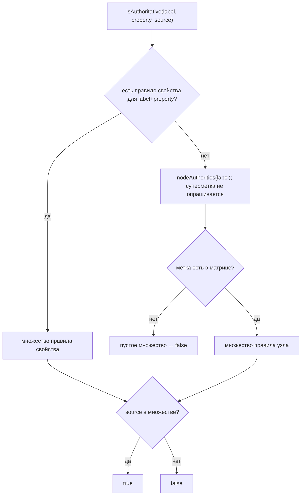

# authority-lookup — Дизайн

> Общие таблицы — [`../design.md`](../design.md). Здесь — структура и алгоритм.

## Интерфейс

| Символ | Сигнатура | Возврат |
|---|---|---|
| `AuthorityMatrix.defaults()` | `static AuthorityMatrix` | singleton `DEFAULTS` (`CM/authority/AuthorityMatrix.java:43-45`) |
| `isAuthoritative(NodeLabel, SourceSystemCode)` | `boolean` | `nodeAuthorities(label).contains(source)` (`:48-50`) |
| `isAuthoritative(NodeLabel, String, SourceSystemCode)` | `boolean` | `propertyAuthorities(label, property).contains(source)` (`:53-55`) |
| `isAuthoritative(RelationType, SourceSystemCode)` | `boolean` | `relationAuthorities(type).contains(source)` (`:58-60`) |
| `nodeAuthorities(NodeLabel)` | `Set<SourceSystemCode>` | `nodes.getOrDefault(label, Set.of())` (`:63-65`) |
| `propertyAuthorities(NodeLabel, String)` | `Set<SourceSystemCode>` | `properties.getOrDefault(label, Map.of()).getOrDefault(property, nodeAuthorities(label))` (`:68-70`) |
| `relationAuthorities(RelationType)` | `Set<SourceSystemCode>` | `relations.getOrDefault(type, Set.of())` (`:73-75`) |

Конструктор приватный; экземпляр иначе, чем `defaults()`, внешним кодом создать нельзя 🟢 (`:34-40`) — подмена правил (по конфигурации) в этой версии невозможна 🟡 (spec-impact-matrix §2 № 12).

## Основной поток

Инициализация (`poc()`, `:77-118`): `EnumMap` для узлов/свойств/связей, затем `Map.copyOf` (узлы, связи) и собственный `copyProperties`, превращающий внутренние карты в `Map.copyOf` (`:117, 120-125`). Матрица строится один раз при загрузке класса (`DEFAULTS = poc()`, `:28`) 🟢.

## Зависимости

`NodeLabel`, `RelationType`, `SourceSystemCode` — внутри модуля; статические импорты констант (`:3-4`) 🟢. Потребители: `GraphProjector` (`ingestion/ingestion-service/.../IngestionServiceConfiguration.java:86`), `PostgresSourceConflicts` (`:64`), `ExplainProvenanceTool.java:28` — три независимых вызова `AuthorityMatrix.defaults()` дают один и тот же объект 🟢.

## Решения

| Решение | Evidence | Уверенность |
|---|---|---|
| Три уровня: узел, свойство, связь (ADR 0008) | `CM/authority/AuthorityMatrix.java:30-32` | 🟢 |
| Свойство → fallback на узел; суперметка не используется | `:68-70`; Javadoc `:19-20` | 🟢 |
| `MANUAL` не авторитетен; ручное решение — отдельное утверждение (E3) | `:20-21` | 🟢 |
| Явные правила свойств дублируют узловые («pin against drift») | `:93` | 🟢 |
| Нет кастомизации по конфигурации | `:34-40` | 🟡 |

## Риски

- 🔴 `docs/02-data-model.md:170` не называет `platformId` среди явных правил `ITSystem` (код: `:95-96`).
- 🔴 ADR 0008 не называет мастера `DECOMPOSED_INTO` (SCM, `:108`), `IMPLEMENTED_IN`, `HAS_DEPLOYMENT` и др.; ADR фиксирует только `DEPENDS_ON` — EAM (`docs/adr/0008-authority-matrix-field-level.md:1, 14`).
- 🟡 Если первой пришла неавторитетная запись, проектор создаёт пустой текущий узел (`state-machines.md` §6, П-5) — это следствие матрицы, а не её ошибка.
- 🟡 `Repository.defaultBranch`/`archived` не имеют собственного правила и наследуют SCM (`:98`).
