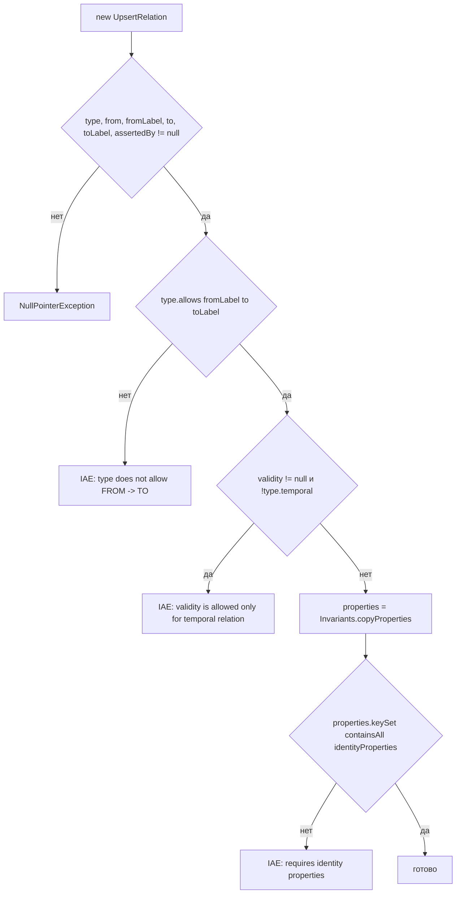

# relation-command-validation — Дизайн

> Ссылки на общий дизайн: [`../design.md`](../design.md) (таблицы `RelationType`, `GraphCommand`, `Invariants`). Здесь — только порядок проверок.

## Интерфейс

| Символ | Сигнатура | Исключения |
|---|---|---|
| `new UpsertRelation(...)` | `(RelationType type, SourceKey from, NodeLabel fromLabel, SourceKey to, NodeLabel toLabel, Map<String,Object> properties, Validity validity, SourceKey assertedBy)` (`CM/command/UpsertRelation.java:21-23`) | NPE, IAE |
| `new CloseAssertion(...)` | `(RelationType type, SourceKey from, SourceKey to, Instant validTo, SourceKey assertedBy)` (`CM/command/CloseAssertion.java:9-10`) | NPE, IAE |
| `new DeferRelation(UpsertRelation)` | (`CM/command/DeferRelation.java:12`) | NPE |
| `RelationType.allows(from,to)` | `boolean` (`CM/relation/RelationType.java:73`) | — |
| `Invariants.copyProperties(Map)` | `Map<String,Object>` (`CM/Invariants.java:49`) | NPE, IAE |

## Основной поток `UpsertRelation` (compact constructor, `CM/command/UpsertRelation.java:25-42`)

Порядок важен: `properties == null` даёт NPE только после проверок меток и `validity` (NPE выбрасывает `copyProperties` на `Objects.requireNonNull(properties, "properties")`, `CM/Invariants.java:50`) 🟢. `properties` не входит в явный список `requireNonNull` (`:26-31`) 🟢.

## `RelationType.allows`

`sources.stream().anyMatch(from::isA) && targets.stream().anyMatch(to::isA)` (`CM/relation/RelationType.java:74`). `isA` — рефлексивный подъём по `supertype` (`CM/node/NodeLabel.java:54-61`). `ASSERTS` имеет цели `NodeLabel.canonical()` — все 13 канонических меток (`CM/relation/RelationType.java:25`).

## `CloseAssertion`

`Objects.requireNonNull` для всех пяти полей, затем `type.temporal()` (`CM/command/CloseAssertion.java:13-20`). Метки концов в команде отсутствуют: пара меток здесь не проверяется 🟢. `validTo` не сравнивается с `validFrom` связи — это делает проектор (`docs/02-data-model.md` §4) 🟡.

## `DeferRelation`

Содержит валидный `UpsertRelation`; недостающий `gid` не требуется (`CM/command/DeferRelation.java:5-12`). Единственный известный производитель — `EventProcessor` (`ingestion/graph-projector/src/main/java/io/github/unlocker/archrag/graphprojector/EventProcessor.java:223`) 🟢.

## Зависимости

`SourceKey`, `NodeLabel`, `RelationType`, `Validity`, `Invariants` — внутри модуля. Потребители: нормализатор (`CommandSink`), проектор (`ProjectionRequest.java:84-85`, `GraphProjector.java:336, 347`) 🟢. См. «Зависит от» в [`../design.md`](../design.md).

## Решения

| Решение | Evidence | Уверенность |
|---|---|---|
| Проверка допустимой пары меток в конструкторе, чтобы проектор не получал неверных связей | `CM/command/UpsertRelation.java:32-34` | 🟢 |
| Identity-свойства связи — часть идентичности; без них команда не создаётся | `CM/command/UpsertRelation.java:39-41`, `CM/relation/RelationType.java:48-52` | 🟢 |
| Проверка ключей свойств отложена нормализатору | `CM/command/UpsertRelation.java:18-19` | 🟢 |

## Риски

- 🟡 `validity == null` допустим для темпоральных типов — поведение определяет проектор.
- 🟡 [R.8: решение принято, реализация — UNLOCKER-276 (п. 5)] `CloseAssertion` не имеет производителя в `main` (см. [`../questions.md`](../questions.md) Q-3).
- 🟡 Исключения не несут `cause`/значений источника, но сообщение `UpsertRelation` включает имена типа и меток (`CM/command/UpsertRelation.java:33`).
