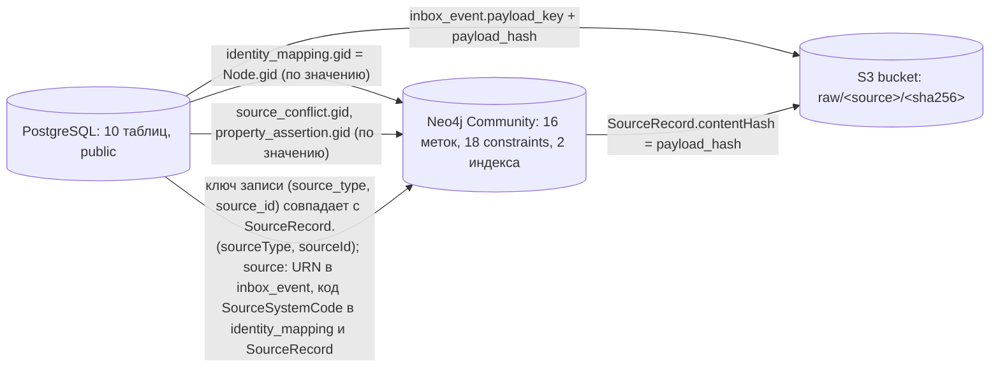
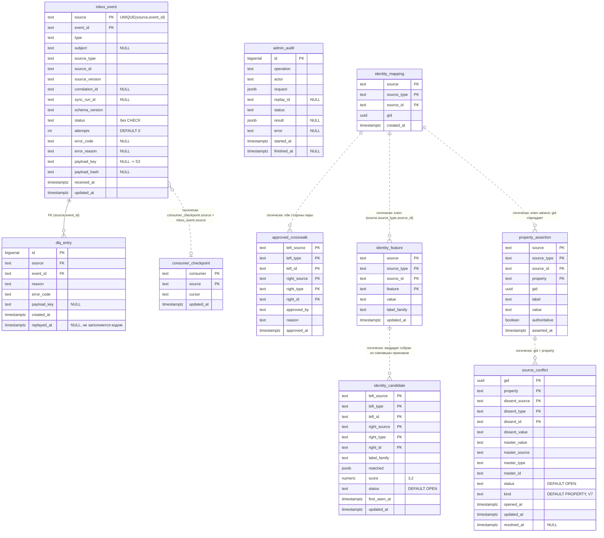
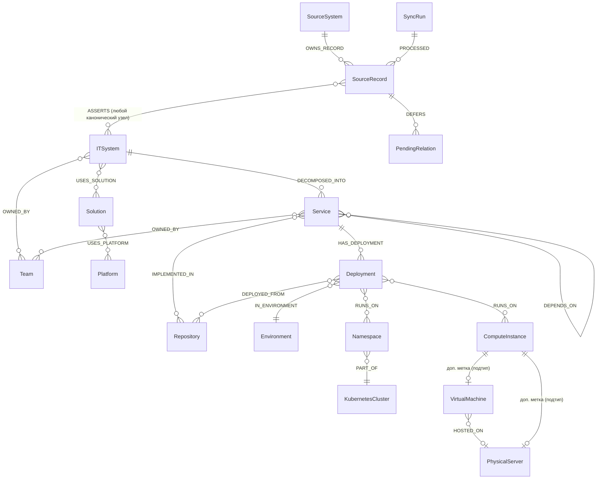

# ERD: граф Neo4j и реляционная часть PostgreSQL

> Data Master, этап R.3 (UNLOCKER-268). Диаграммы построены по коду и миграциям, а не по `docs/02-data-model.md`. Расхождения с документом собраны в [`data-dictionary.md`](data-dictionary.md#9-расхождения-с-docs02-data-modelmd). Метки уверенности: 🟢 прочитано в DDL/коде · 🟡 выведено · 🔴 расхождение или пробел.
> В R.5 Architect ссылается на этот файл и не рисует ERD заново.

## 1. Хранилища и связи между ними

В хранилищах нет внешних ключей друг в друга: связь идёт по значениям (`gid`, `source`, `source_type`, `source_id`, `payload_key`). Единственный FK на весь PostgreSQL — `dlq_entry → inbox_event` (`ingestion/event-journal/src/main/resources/db/migration/V1__event_journal.sql:44`) 🟢.

Источники связей: `ingestion/event-journal/src/main/java/io/github/unlocker/archrag/eventjournal/S3RawPayloadStore.java:74-78`, `ingestion/event-journal/src/main/java/io/github/unlocker/archrag/eventjournal/PostgresEventJournal.java:56-59` 🟢. Связь `identity_mapping.gid` → `Node.gid` логическая: при `rebuild` граф стирается (`ingestion/ingestion-service/src/main/java/io/github/unlocker/archrag/ingestionservice/RebuildService.java:18`), а `identity_mapping` остаётся, поэтому `gid` прежние 🟢.

## 2. PostgreSQL

Все 10 таблиц лежат в схеме `public`; время везде `timestamptz`. Версии миграций сквозные: V1 (event-journal), V2/V4/V5/V7 (identity-resolution), V3/V6 (ingestion-service); подробности порядка — [`data-dictionary.md`, §3](data-dictionary.md#3-flyway-порядок-применения-и-владельцы-версий).

Сплошная линия — FK (`ingestion/event-journal/src/main/resources/db/migration/V1__event_journal.sql:44`). Пунктир — связь по значению, в DDL её нет; это выведено из кода репозиториев 🟡 (`ingestion/identity-resolution/src/main/java/io/github/unlocker/archrag/identityresolution/PostgresSourceConflicts.java`, `PostgresIdentityCandidates.java`, `PostgresIdentityMapping.java`). В `inbox_event` PK нет: ключом служит `UNIQUE (source, event_id)`, поэтому на диаграмме эти колонки помечены `PK` условно 🟢 (`ingestion/event-journal/src/main/resources/db/migration/V1__event_journal.sql:21`).

## 3. Граф Neo4j

Метки и типы связей перечислены по `NodeLabel` и `RelationType`. Каждая каноническая метка (13) имеет UNIQUE на `gid`; провенанс-метки (3) — собственные ключи; `PendingRelation` — служебная метка вне enum.

Свойства связей: `DEPENDS_ON {kind, protocol, criticality}`, `DEPLOYED_FROM {commit}`, `ASSERTS {confidence, authority, conflicts}`; временные (`validFrom`, `validTo`) — `HAS_DEPLOYMENT`, `IN_ENVIRONMENT`, `DECOMPOSED_INTO`, `IMPLEMENTED_IN`, `DEPLOYED_FROM`, `RUNS_ON`, `DEPENDS_ON`, `OWNED_BY`, `USES_SOLUTION`, `USES_PLATFORM`; на бизнес-связях проектор пишет `assertedBySource/Type/Id`. Полный список свойств узлов и связей — [`_reversa_sdd/data-dictionary.md`](../data-dictionary.md), §A.1–A.3 и §Q.4. `HOSTED_ON`, `PART_OF`, `Namespace`, `KubernetesCluster` моделируются, но не наполняются (🟡, `docs/adr/0011-namespace-cluster-modeled-not-populated.md`).

### 3.1. Какой constraint стоит на каком узле

| Метка | Ключ `MERGE` | Constraint (имя) | Определение |
|---|---|---|---|
| 13 канонических | `gid` | `<snake>_gid` (по одному на метку) | `ingestion/graph-projector/src/main/java/io/github/unlocker/archrag/graphprojector/schema/Neo4jSchema.java:43-46` |
| `Environment` | `gid`; дополнительно `code` | `environment_code` | `ingestion/graph-projector/src/main/java/io/github/unlocker/archrag/graphprojector/schema/Neo4jSchema.java:54-55` |
| `SourceRecord` | `(source, sourceType, sourceId)` | `source_record_key` | `ingestion/graph-projector/src/main/java/io/github/unlocker/archrag/graphprojector/schema/Neo4jSchema.java:47-48` |
| `SourceSystem` | `code` | `source_system_code` | `ingestion/graph-projector/src/main/java/io/github/unlocker/archrag/graphprojector/schema/Neo4jSchema.java:49-50` |
| `SyncRun` | `runId` | `sync_run_id` | `ingestion/graph-projector/src/main/java/io/github/unlocker/archrag/graphprojector/schema/Neo4jSchema.java:51` |
| `PendingRelation` | `key` | `pending_relation_key` | `ingestion/graph-projector/src/main/java/io/github/unlocker/archrag/graphprojector/schema/Neo4jSchema.java:52-53` |
| `ITSystem` | — (поиск по `eamCode`) | индекс `it_system_eam_code` | `ingestion/graph-projector/src/main/java/io/github/unlocker/archrag/graphprojector/schema/Neo4jSchema.java:56` |
| `ITSystem`, `Service` | — | FULLTEXT `asset_text` по `name`, `description` | `ingestion/graph-projector/src/main/java/io/github/unlocker/archrag/graphprojector/schema/Neo4jSchema.java:57-58` |
