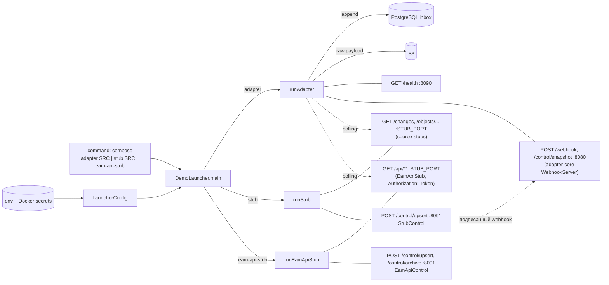

# platform/demo-launcher: требования

> Единый образ демо-стенда: одним `main` запускает адаптер мастер-системы, заглушку источника или заглушку EAM API. Пути в трассировке развёрнуты до корня репозитория. Дизайн: [`design.md`](design.md); внешние контракты: [`contracts.md`](contracts.md); открытые вопросы: [`questions.md`](questions.md); решения: [`decisions.md`](decisions.md). Блок-схемы: [`../flowcharts/demo-launcher.md`](../flowcharts/demo-launcher.md).
> Use case-спецификации: [`run-adapter/`](run-adapter/requirements.md), [`run-source-stub/`](run-source-stub/requirements.md), [`run-eam-api-stub/`](run-eam-api-stub/requirements.md).

## Визуальная схема



## Visão Geral

`demo-launcher` — plain Java (без Spring и без доступа к Neo4j) исполняемый jar `*-exec.jar`, из которого собирается один образ стенда. Адаптеры и заглушки в репозитории — библиотеки без `main`; роль выбирается аргументами `command:` сервиса compose: `adapter <EAM|SCM|CMDB|DEPLOY_MAP>`, `stub <EAM|SCM|CMDB|DEPLOY_MAP>` или `eam-api-stub`. В compose это восемь сервисов (четыре адаптера, четыре заглушки) плюс `eam-api-stub` из одного образа. Конфигурация берётся только из переменных окружения (секреты приходят как Docker secrets и экспортируются `entrypoint.sh`); неверные аргументы или пустые обязательные переменные завершают процесс с кодом 2 и сообщением без значений секретов 🟢 (`platform/demo-launcher/src/main/java/io/github/unlocker/archrag/demolauncher/package-info.java:1-6`, `platform/demo-launcher/src/main/java/io/github/unlocker/archrag/demolauncher/DemoLauncher.java:58-83`, `platform/docker/entrypoint.sh:1-10`).

## Responsabilidades

- Диспетчеризация роли по аргументам командной строки, коды выхода, usage 🟢 (`platform/demo-launcher/src/main/java/io/github/unlocker/archrag/demolauncher/DemoLauncher.java:58-83`).
- Разбор и валидация env в иммутабельные записи `Adapter`, `Stub`, `EamApiStub` 🟢 (`platform/demo-launcher/src/main/java/io/github/unlocker/archrag/demolauncher/LauncherConfig.java:49-204`).
- Роль «адаптер»: журнал PostgreSQL, S3-хранилище, `AdapterConfig`, запуск webhook, polling, reconciliation, `GET /health` 🟢 (`platform/demo-launcher/src/main/java/io/github/unlocker/archrag/demolauncher/DemoLauncher.java:108-135`).
- Роль «заглушка источника»: `StubSourceServer` + `StubControl` (`POST /control/upsert`, опционально подписанный webhook адаптеру) 🟢 (`platform/demo-launcher/src/main/java/io/github/unlocker/archrag/demolauncher/DemoLauncher.java:85-95`).
- Роль «заглушка EAM API»: `EamApiStub` + `EamApiControl` (`POST /control/upsert|archive`) 🟢 (`platform/demo-launcher/src/main/java/io/github/unlocker/archrag/demolauncher/DemoLauncher.java:97-106`).
- Ожидание SIGTERM/SIGINT и остановка 🟢 (`platform/demo-launcher/src/main/java/io/github/unlocker/archrag/demolauncher/DemoLauncher.java:162-167`).

## Regras de Negócio

- Один экземпляр адаптера на источник: замок snapshot действует только внутри процесса; в compose это `deploy.replicas: 1` 🟢 (`platform/demo-launcher/src/main/java/io/github/unlocker/archrag/demolauncher/DemoLauncher.java:44-47`; `platform/docker/docker-compose.yml:330, 349, 363, 377`).
- Миграции журнала адаптер не накатывает: их делает `ingestion-service`, поэтому адаптеры стартуют после него (`depends_on: ingestion: service_healthy`) 🟢 (`platform/demo-launcher/src/main/java/io/github/unlocker/archrag/demolauncher/DemoLauncher.java:44-47`; `platform/docker/docker-compose.yml:32-36`).
- Любой `IllegalArgumentException` на этапе разбора или старта роли → `configuration error: <сообщение>` в stderr и `System.exit(2)`; сообщения называют имена переменных, но не значения 🟢 (`platform/demo-launcher/src/main/java/io/github/unlocker/archrag/demolauncher/DemoLauncher.java:59-83`; `platform/demo-launcher/src/test/java/io/github/unlocker/archrag/demolauncher/LauncherConfigTest.java:48-58`).
- Пустая или пробельная обязательная переменная считается незаданной; все недостающие имена перечисляются одним исключением 🟢 (`platform/demo-launcher/src/main/java/io/github/unlocker/archrag/demolauncher/LauncherConfig.java:165-172, 107-125`).
- Порты — целое `1..65535`, интервалы — целое секунд `>= 1`; ошибка называет переменную, но не значение 🟢 (`platform/demo-launcher/src/main/java/io/github/unlocker/archrag/demolauncher/LauncherConfig.java:174-204`).
- `toString` записей конфигурации не раскрывает секреты (`secrets=***`, `token=***`) 🟢 (`platform/demo-launcher/src/main/java/io/github/unlocker/archrag/demolauncher/LauncherConfig.java:66-70, 82-84, 91-93`).
- Режим EAM: `ARCHRAG_EAM_MODE` пусто/`legacy` → только старая заглушка; `eam-api` → требуются `ARCHRAG_EAM_API_URL` и `ARCHRAG_EAM_API_TOKEN`; иное значение → ошибка; для не-EAM источников режим игнорируется 🟢 (`platform/demo-launcher/src/main/java/io/github/unlocker/archrag/demolauncher/LauncherConfig.java:128-139`; `platform/demo-launcher/src/test/java/io/github/unlocker/archrag/demolauncher/LauncherConfigTest.java:128-158`).
- Порт управляющего входа заглушек — 8091, зашит в код, не публикуется и не проксируется; вызов делается из контейнера (`docker compose exec … curl`) 🟢 (`platform/demo-launcher/src/main/java/io/github/unlocker/archrag/demolauncher/DemoLauncher.java:54`; `platform/docker/README.md:51`).
- Управляющий вход не аутентифицируется: защита — только сетевая граница стенда 🟡 (`platform/demo-launcher/src/main/java/io/github/unlocker/archrag/demolauncher/StubControl.java:16-21`; Q-02).
- Тело control-запросов — недоверенный ввод: размер ≤ 64 КиБ, ошибки разбора дают `400 {"error":"invalid request"}` без эха 🟢 (`platform/demo-launcher/src/main/java/io/github/unlocker/archrag/demolauncher/StubControl.java:31, 106-119`; `platform/demo-launcher/src/main/java/io/github/unlocker/archrag/demolauncher/EamApiControl.java:25, 100-106`).
- Секреты не логируются и не попадают в исключения: пароль PostgreSQL, ключи S3, секрет webhook, токен EAM API хранятся только в записях конфигурации 🟡 (`platform/demo-launcher/src/main/java/io/github/unlocker/archrag/demolauncher/LauncherConfig.java:49-95`; но `URI.create` может процитировать значение — Q-04).

## Requisitos Funcionais

| ID | Требование | Приоритет | Критерий приёмки |
|----|-----------|-----------|------------------|
| RF-01 | `DemoLauncher adapter <SRC>` запускает адаптер источника: webhook, polling, reconciliation, `/health` | Must | [`run-adapter`](run-adapter/requirements.md) AC-01 |
| RF-02 | `DemoLauncher stub <SRC>` запускает заглушку источника с управляющим входом | Must | [`run-source-stub`](run-source-stub/requirements.md) AC-01 |
| RF-03 | `DemoLauncher eam-api-stub` запускает заглушку EAM API | Must | [`run-eam-api-stub`](run-eam-api-stub/requirements.md) AC-01 |
| RF-04 | Конфигурация только из env; отсутствующие обязательные переменные → код 2 с именами | Must | AC-01; `LauncherConfigTest.missingRequiredFailsFastNamingVariablesOnly` |
| RF-05 | Неверные аргументы → `usage` и код 2 | Must | AC-02 |
| RF-06 | Секреты не попадают в `toString`, сообщения ошибок и stderr | Must | AC-03; `LauncherConfigTest.toStringHidesSecrets` |
| RF-07 | `GET /health` адаптера: 200 после старта трёх подсистем, иначе 503 | Must | [`run-adapter`](run-adapter/requirements.md) AC-02 |
| RF-08 | Управляющие входы заглушек: только `POST`, ограничение тела, `400` без эха | Must | [`run-source-stub`](run-source-stub/requirements.md) AC-02..AC-05 |
| RF-09 | Исполняемый jar с классификатором `exec`, основной артефакт — обычный jar | Should | AC-04 |

## Requisitos Não Funcionais

| Тип | Требование | Evidence | Уверенность |
|-----|------------|----------|-------------|
| Безопасность | Сообщения конфигурации содержат только имена переменных | `platform/demo-launcher/src/main/java/io/github/unlocker/archrag/demolauncher/LauncherConfig.java:107-125, 165-172` | 🟢 |
| Безопасность | Управляющий вход слушает все интерфейсы контейнера (`new InetSocketAddress(8091)`), без аутентификации; защита — непубликуемый порт | `platform/demo-launcher/src/main/java/io/github/unlocker/archrag/demolauncher/DemoLauncher.java:90, 100` | 🟡 |
| Безопасность | Входной webhook адаптера защищён подписью (секрет `ARCHRAG_WEBHOOK_SECRET`), `/control/snapshot` без аутентификации | `adapters/adapter-core/src/main/java/io/github/unlocker/archrag/adaptercore/WebhookServer.java:13-26` | 🟡 (П-15) |
| Disponibilidade | Остановка по SIGTERM: защёлка снимается, ресурсы закрывает `try-with-resources`/ОС; гарантии корректного закрытия адаптера нет | `platform/demo-launcher/src/main/java/io/github/unlocker/archrag/demolauncher/DemoLauncher.java:162-167` | 🟡 |
| Disponibilidade | Healthcheck compose: адаптер — `GET :8090/health`; заглушка — `GET :8080/changes?limit=1`; `eam-api-stub` — `GET /api/platforms/?page_size=1` с токеном | `platform/docker/docker-compose.yml:331-336, 390-395, 440-445` | 🟢 |
| Escalabilidade | Адаптер строго один экземпляр на источник; масштабирование не поддержано | `platform/docker/docker-compose.yml:330` | 🟢 |
| Observabilidade | Только `System.Logger` (INFO/WARNING), метрик нет | `platform/demo-launcher/src/main/java/io/github/unlocker/archrag/demolauncher/DemoLauncher.java:51, 91, 128` | 🟢 |
| Эксплуатация | Параметры, не вынесенные в env: порт 8091, размер страницы polling 100, окно replay 5 мин, `RetryPolicy.defaults()` | `platform/demo-launcher/src/main/java/io/github/unlocker/archrag/demolauncher/DemoLauncher.java:54, 114-116` | 🟢 |

> Inferido a partir do código. SLO не заданы: модуль — демо-инфраструктура 🔴 (см. [`questions.md`](questions.md) Q-10).

## Критерии приёмки (сквозные)

```gherkin
# AC-01: конфигурация, негатив (LauncherConfigTest.missingRequiredFailsFastNamingVariablesOnly)
Дано роль adapter EAM и env без ARCHRAG_PG_PASSWORD, ARCHRAG_WEBHOOK_SECRET = "  " (пробелы)
Когда разбирается конфигурация
Тогда IllegalArgumentException перечисляет ARCHRAG_PG_PASSWORD и ARCHRAG_WEBHOOK_SECRET и не содержит значений секретов
      процесс печатает "configuration error: ..." в stderr и завершается с кодом 2

# AC-02: аргументы, негатив
Дано запуск DemoLauncher без аргументов, с одним аргументом (не eam-api-stub), с тремя, с первым аргументом не adapter/stub, либо с кодом источника в нижнем регистре
Когда выполняется main
Тогда в stderr "usage: ..." (или "configuration error: unknown source system ...") и System.exit(2)      # LauncherConfigTest.unknownSourceIsRejected (parseSystem); сам main тестом не покрыт

# AC-03: секреты (LauncherConfigTest.toStringHidesSecrets; eamApiStubRequiresTokenAndHidesItInToString; stubWebhookTargetWithSecretIsParsedAndSecretIsHidden)
Дано полная конфигурация адаптера, заглушки и EAM API с секретами
Когда вызывается toString записей
Тогда пароль PG, ключ S3, секрет webhook и токен EAM API отсутствуют в тексте

# AC-04: сборка
Дано профиль package
Когда выполняется сборка модуля
Тогда создаётся обычный jar (зависимость для тестов) и исполняемый demo-launcher-*-exec.jar с mainClass DemoLauncher
```

## Prioridade (MoSCoW)

| Требование | MoSCoW | Justificativa |
|-----------|--------|---------------|
| RF-01..RF-08 | Must | Демо-стенд PoC (ADR 0021) держится на одном образе |
| RF-09 | Should | Упаковка для compose |
| Аутентификация управляющего входа | Won't | Только сетевая граница (🟡 Q-02) |
| Настройка порта 8091 и размера страницы polling через env | Won't | Зашиты в код (🟡 Q-06) |
| Unit-тесты `DemoLauncher.main` и `/health` | Won't | Нет тестов (🔴 Q-05) |

## Зависит от / Связанные спецификации

См. раздел «Зависит от / Связанные спецификации» в [`design.md`](design.md).

## Rastreabilidade de Código

| Файл | Класс | Покрытие |
|------|-------|----------|
| `platform/demo-launcher/src/main/java/io/github/unlocker/archrag/demolauncher/DemoLauncher.java` | `DemoLauncher` | 🟢 |
| `platform/demo-launcher/src/main/java/io/github/unlocker/archrag/demolauncher/LauncherConfig.java` | `LauncherConfig` | 🟢 |
| `platform/demo-launcher/src/main/java/io/github/unlocker/archrag/demolauncher/StubControl.java` | `StubControl` | 🟢 |
| `platform/demo-launcher/src/main/java/io/github/unlocker/archrag/demolauncher/EamApiControl.java` | `EamApiControl` | 🟢 |
| `platform/demo-launcher/src/main/java/io/github/unlocker/archrag/demolauncher/package-info.java` | Javadoc пакета | 🟢 |
| `platform/demo-launcher/pom.xml` | сборка (`exec`) | 🟢 |
