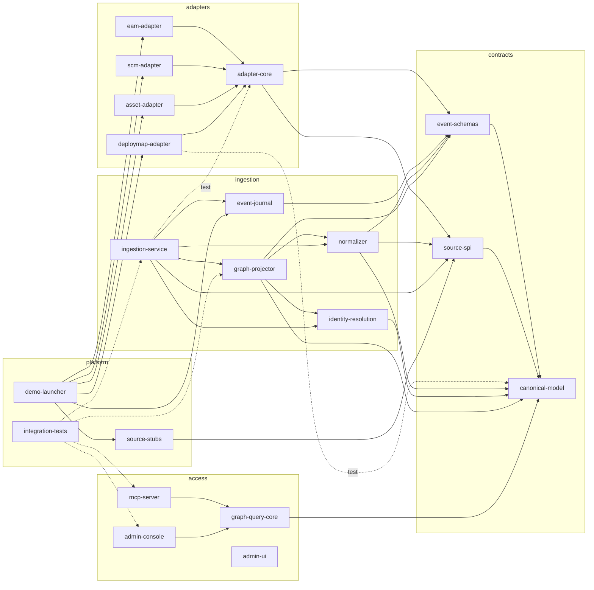

# Зависимости architecture-rag

> Сгенерировано Scout. Источник: корневой `pom.xml` (BOM/`dependencyManagement`), `*/pom.xml`, `access/admin-ui/package.json`. 🟢 — прочитано из манифеста.

## 1. Управление версиями (корневой `pom.xml`)

Версии заданы только в корне (`pom.xml:28-39`, `dependencyManagement` `pom.xml:44-`); в дочерних `pom.xml` версий у BOM-зависимостей нет.

| Что | Версия |
|---|---|
| Java (`maven.compiler.release`) | 21 |
| Spring Boot (`spring-boot-dependencies`) | 4.1.1 |
| Spring AI (`spring-ai-bom`) | 2.0.1 |
| Testcontainers (`testcontainers-bom`) | 2.0.5 |
| AWS SDK v2 (`software.amazon.awssdk:bom`) | 2.55.11 |
| maven-compiler-plugin | 3.14.0 |
| maven-surefire-plugin / failsafe | 3.5.6 |
| maven-enforcer-plugin | 3.5.0 (Java ≥ 21, Maven ≥ 3.9) |
| frontend-maven-plugin | 1.15.1 |
| Maven (wrapper) | 3.9.11 |

Порядок импорта BOM важен: `testcontainers-bom` и AWS BOM стоят раньше `spring-boot-dependencies`, иначе версию переопределил бы Boot (комментарии `pom.xml:45-56`).

Для всех модулей в корне подключены `junit-jupiter` и `assertj-core` (test).

## 2. Внешние библиотеки по модулям

| Модуль | Ключевые внешние зависимости |
|---|---|
| `contracts/*` | нет внешних (только JDK) |
| `adapters/*` | нет внешних; `source-stubs` в test |
| `ingestion/event-journal` | `postgresql`, `flyway-core`, `flyway-database-postgresql`, AWS `s3` (`netty-nio-client` и `apache-client` — `<exclusions>` у `s3`, `ingestion/event-journal/pom.xml:37-46`; `url-connection-client` — зависимость) |
| `ingestion/identity-resolution` | `postgresql` |
| `ingestion/graph-projector` | `neo4j-java-driver` |
| `ingestion/normalizer` | нет внешних |
| `ingestion/ingestion-service` | `spring-boot-starter-webmvc`, `-security-oauth2-resource-server`, `-jdbc`, `-actuator`, `micrometer-registry-otlp`, `spring-boot-opentelemetry` |
| `access/graph-query-core` | `neo4j-java-driver`, `jackson-databind` |
| `access/mcp-server` | `spring-ai-starter-mcp-server-webmvc`, `neo4j-java-driver`, `-actuator`, `micrometer-registry-otlp`, `spring-boot-opentelemetry`, `spring-boot-starter-aspectj`, `-security-oauth2-resource-server` |
| `access/admin-console` | `neo4j-java-driver`, `spring-boot-starter-webmvc`, `-jdbc`, `postgresql`, `-actuator`, `-security-oauth2-resource-server` |
| `platform/integration-tests` | `testcontainers-junit-jupiter`, `testcontainers-neo4j`, `testcontainers-postgresql`, `spring-boot-starter-test`, `neo4j-java-driver`, `postgresql` |
| `platform/demo-launcher` | `postgresql`, адаптеры, `source-stubs` |

Версии `neo4j-java-driver`, `postgresql`, `flyway`, `jackson` в манифестах не указаны — приходят из Spring Boot BOM; точные числа в Scout не вычислялись (🟡, нужен `mvn dependency:tree`).

## 3. Внутренний граф зависимостей модулей

Проверка правил направления (`access/*` не зависит от `ingestion/*`, `contracts/*` не зависят от остальных): `access/*` не зависит от `ingestion/*` и `adapters/*` 🟢; `contracts/*` ни от чего проектного (кроме друг друга) не зависят 🟢; `ingestion/ingestion-service` зависит от `adapters/adapter-core` и `source-spi` 🟡 (оркестрация управления адаптерами, `AdapterControlClient`) — для Archaeologist R.2c.

## 4. Frontend (`access/admin-ui/package.json`)

| Пакет | Версия |
|---|---|
| react / react-dom | 18.3.1 |
| cytoscape | 3.30.4 |
| oidc-client-ts | 3.1.0 |
| typescript | 5.7.2 |
| webpack / webpack-cli / webpack-dev-server | 5.111.1 / 5.1.4 / 6.0.0 |
| jest / ts-jest / jest-environment-jsdom | 29.7.0 / 29.2.5 / 29.7.0 |
| @testing-library/react | 16.1.0 |

Пакетный менеджер: npm (`package-lock.json` присутствует).

## 5. Образы инфраструктуры (`platform/docker/docker-compose.yml`)

`neo4j:5-community`, `postgres:16`, `chrislusf/seaweedfs:4.48`, `quay.io/keycloak/keycloak:26.4`, `nginx:1.27-alpine`, `alpine/openssl:3.5.4`, `otel/opentelemetry-collector-contrib:0.140.1`, `prom/prometheus:v3.7.3`, `grafana/grafana:12.2.1`.
