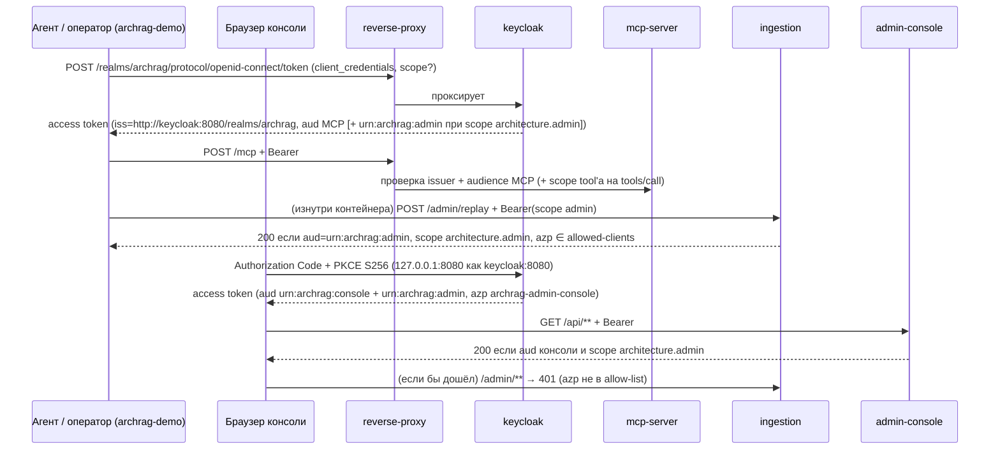

# keycloak-oidc: дизайн

> Модульный дизайн: [`../design.md`](../design.md). Контракты: [`../contracts.md`](../contracts.md) §4, §5, §8. Блок-схема: [`../../flowcharts/docker.md`](../../flowcharts/docker.md) §2.

## Interface

| Артефакт | Содержание | Трассировка |
|----------|------------|-------------|
| `archrag-realm.json` | realm, client scopes, роль, пользователь, два клиента | `platform/docker/keycloak/archrag-realm.json:1-113` 🟢 |
| Сервис `keycloak` | `start-dev --import-realm`; окружение для подстановок; порт на loopback; сети `edge`, `backend` | `platform/docker/docker-compose.yml:137-175` 🟢 |
| Proxy-маршрут OIDC | `/realms/archrag/protocol/openid-connect/` → `keycloak:8080` | `platform/docker/proxy/nginx.conf:35-40` 🟢 |

Подстановки в JSON и их источник в окружении Keycloak (`platform/docker/docker-compose.yml:149-155`) 🟢: `${KEYCLOAK_CLIENT_SECRET}` (секрет `archrag-demo`, `platform/docker/keycloak/archrag-realm.json:56`), `${ARCHRAG_MCP_RESOURCE_URI}` (`platform/docker/keycloak/archrag-realm.json:69`), `${ARCHRAG_ADMIN_RESOURCE_URI}` (`platform/docker/keycloak/archrag-realm.json:22`), `${ARCHRAG_CONSOLE_PORT}` (`platform/docker/keycloak/archrag-realm.json:87-88`), `${ARCHRAG_CONSOLE_RESOURCE_URI}` (`platform/docker/keycloak/archrag-realm.json:98`), `${KEYCLOAK_CONSOLE_USER}`/`${KEYCLOAK_CONSOLE_PASSWORD}` (`platform/docker/keycloak/archrag-realm.json:37, 40, 44`).

## Fluxo Principal

Шаги 🟢: (1) токен-endpoint открыт через proxy (`platform/docker/proxy/nginx.conf:36-40`; `platform/docker/smoke.sh:21-23`); (2) `iss` фиксирован `KC_HOSTNAME` (`platform/docker/docker-compose.yml:143-145`); (3) audience MCP добавляет mapper клиента `archrag-demo` (`platform/docker/keycloak/archrag-realm.json:62-74`); (4) audience админки добавляет mapper client scope `architecture.admin` (`platform/docker/keycloak/archrag-realm.json:12-27`), поэтому его получают и `archrag-demo` при `scope=architecture.admin`, и клиент консоли при том же scope; (5) audience консоли добавляет mapper клиента `archrag-admin-console` (`platform/docker/keycloak/archrag-realm.json:92-102`); (6) отсечение токена консоли в ingestion — по `azp` (`platform/docker/README.md:125`; `platform/docker/console-smoke.sh:85-95`).

Матрица «токен × потребитель» (🟢 по `_reversa_sdd/permissions.md` §8 и скриптам):

| Токен | `mcp-server` `/mcp` | `ingestion` `/admin/**` | `admin-console` `/api/**` |
|-------|---------------------|--------------------------|----------------------------|
| `archrag-demo`, scope `architecture.read` | 200 (tool'ы — по scope) | 401 (нет audience админки) | 401 (нет audience консоли) |
| `archrag-demo`, scope `architecture.admin` | 200 | 200 | 401 (нет audience консоли) |
| `archrag-admin-console`, scope `architecture.admin` | 401 (audience консоли ≠ MCP) 🟡 | 401 (`azp`) | 200 |
| `archrag-admin-console`, только `architecture.read` | 401 🟡 | 401 | 403 (нет `architecture.admin`) |

(🟡 для клиентов консоли на `/mcp`: прямая проверка в скриптах отсутствует; следует из несовпадения audience.)

## Fluxos Alternativos

- **Direct grant.** `grant_type=password` для клиента консоли отклонён (400/401): `directAccessGrantsEnabled=false` (`platform/docker/keycloak/archrag-realm.json:84`; `platform/docker/console-smoke.sh:53-56`) 🟢.
- **Redirect URI вне `127.0.0.1:<порт консоли>`.** Keycloak не выдаст `code`; `console-smoke.sh` ловит это как «no authorization code in redirect» (`platform/docker/console-smoke.sh:36-37`; `platform/docker/keycloak/archrag-realm.json:87`) 🟢.
- **Открытие консоли по `localhost`.** PKCE S256 требует secure context, поэтому README требует `127.0.0.1`, а не `localhost`; а браузеру нужно имя `keycloak` в hosts (`platform/docker/README.md:121-122`) 🟢.
- **Смена realm.** После правки JSON нужен `up -d --force-recreate keycloak` (`platform/docker/README.md:127`) 🟢.
- **Токен для скриптов.** Внутри сетей стенда токен запрашивается по `http://keycloak:8080/...` (тот же issuer), а снаружи — через proxy по TLS (`platform/docker/scripts/lib.sh:17-18`; `platform/docker/smoke.sh:21-23`) 🟢.
- **Healthcheck.** Если management-порт 9000 не отвечает `"status": "UP"`, сервис не healthy, и зависимые (`mcp-server`, `admin-console`, `reverse-proxy`) не стартуют (`platform/docker/docker-compose.yml:164-175, 244, 298, 459`) 🟢.

## Dependências

Образ `quay.io/keycloak/keycloak:26.4` (`platform/docker/docker-compose.yml:138`); потребители токенов — `mcp-server`, `ingestion` ([`../../ingestion-service/design.md`](../../ingestion-service/design.md), проверка `azp`), `admin-console` ([`../../admin-ui/oidc-login/design.md`](../../admin-ui/oidc-login/design.md)); значения audience должны совпадать у Keycloak и потребителей ([`../contracts.md`](../contracts.md) §5). Матрица влияния §3 «Новый scope или роль»: `mcp-server`, `ingestion-service`, `admin-console`, Keycloak realm (`../../traceability/spec-impact-matrix.md:62`).

## Decisões de Design Identificadas

| Решение | Evidence | Уверенность |
|---------|----------|-------------|
| Audience-mapper на client scope `architecture.admin`, а не на клиенте | `platform/docker/keycloak/archrag-realm.json:12-27`; ADR [0026](../../../docs/adr/0026-admin-console-readonly-loopback.md) (строка «Перенос audience-mapper… Отклонён»: `docs/adr/0026-admin-console-readonly-loopback.md:31`) | 🟢 |
| `azp` allow-list в ingestion как вторая защита поверх scope | `platform/docker/README.md:125`; ADR 0026 | 🟢 |
| Клиент консоли публичный, без секрета, PKCE S256 | `platform/docker/keycloak/archrag-realm.json:76-90` | 🟢 |
| Один scope `architecture.admin` на консоль и admin REST (различаются audience и `azp`) | П-9 `../../detective-gaps.md:38`; `../../permissions.md` §5 | 🟡 |
| Фиксированный `KC_HOSTNAME` вместо `X-Forwarded-*` | `platform/docker/docker-compose.yml:143-145` | 🟢 |

## Riscos e Lacunas

- 🟡 Роль `archrag-console-admin` не проверяется (Q-04); один scope на консоль и admin REST (П-10: внутри `architecture.admin` нет ролей).
- 🟡 Состояние Keycloak не персистентно (Q-20); `start-dev`, `sslRequired: none`, секреты в `environment` (Q-09).
- 🟡 Порт Keycloak на loopback открывает и master-админку (Q-15).
- 🟡 Проверки токенов консоли на `/mcp` скриптами не покрыты.
