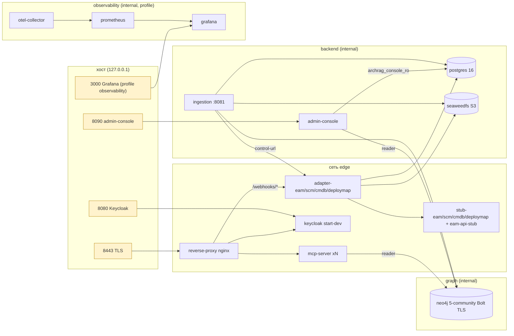

# platform/docker: требования

> Демо-стенд PoC на Docker Compose (не Maven-модуль): `docker-compose.yml`, Dockerfile и entrypoint, конфигурации nginx/Keycloak/Neo4j/PostgreSQL/OTel/Prometheus/Grafana, скрипты проверки, backup и замеров. Пути в трассировке развёрнуты до корня репозитория. Дизайн: [`design.md`](design.md); внешние контракты: [`contracts.md`](contracts.md); открытые вопросы: [`questions.md`](questions.md); решения: [`decisions.md`](decisions.md).
> Use case-спецификации: [`stand-startup/`](stand-startup/requirements.md), [`network-secrets/`](network-secrets/requirements.md), [`keycloak-oidc/`](keycloak-oidc/requirements.md), [`backup-restore/`](backup-restore/requirements.md), [`observability-measure/`](observability-measure/requirements.md).
> Блок-схемы: [`../flowcharts/docker.md`](../flowcharts/docker.md). Таблицы значений: [`../data-dictionary.md`](../data-dictionary.md) §W.1.

## Визуальная схема



Стрелки показывают направление запроса; принадлежность сервисов сетям — `platform/docker/docker-compose.yml:528-543` и поле `networks` каждого сервиса 🟢.

## Visão Geral

Стенд поднимает все компоненты PoC одной командой `docker compose up -d --wait`: инфраструктуру (Neo4j, PostgreSQL, SeaweedFS, Keycloak), приложения репозитория (`ingestion`, `mcp-server`, `admin-console`, четыре `adapter-*`), заглушки мастер-систем, TLS reverse-proxy и профиль наблюдаемости. Образы приложений собираются из готовых `*-exec.jar` одним Dockerfile; секреты раздаются как Docker secrets из `.env` 🟢 (`platform/docker/docker-compose.yml:1-4, 38-526`; `platform/docker/Dockerfile:1-14`). Решение — ADR [0021](../../docs/adr/0021-compose-demo-stand.md): Compose вместо Kubernetes, Docker secrets вместо Vault, раздельные сети вместо NetworkPolicy, `neo4j-admin dump/load` вместо online backup 🟢. Наружу на хост публикуются только четыре порта на `127.0.0.1`: TLS-proxy, Keycloak, admin-console и (с профилем) Grafana 🟢 (`platform/docker/docker-compose.yml:160-161, 292-293, 450-451, 515-516`).

## Responsabilidades

- Собрать и запустить сервисы в правильном порядке по `depends_on` с `service_healthy`/`service_completed_successfully` и `healthcheck` каждого сервиса 🟢.
- Разделить сети (`edge`, `backend`, `graph`, `observability`, `obs-edge`, `console-edge`) и не публиковать Neo4j, PostgreSQL, S3, admin REST ingestion и `/control/snapshot` адаптеров 🟢.
- Выдать каждому сервису только его секреты (Docker secrets → переменные окружения через `entrypoint.sh`) и раздельные учётки Neo4j reader/writer, PostgreSQL владелец/`archrag_console_ro` 🟢.
- Терминировать TLS на одной внешней точке (nginx) и на Bolt Neo4j (демо-CA из тома `certs`) 🟢.
- Импортировать realm Keycloak `archrag` с клиентами агента и консоли, scope'ами и audience-mapper'ами 🟢.
- Проверять границы и приёмку скриптами: `smoke.sh`, `console-smoke.sh`, `backup-restore-check.sh`, `deployment-commit-check.sh`, `measure.sh` 🟢.
- Делать холодный backup/restore Neo4j + replay журнала 🟢.
- Опционально поднять OTel Collector, Prometheus и Grafana (профиль `observability`) 🟢.

## Regras de Negócio

- Один `Dockerfile` для всех Java-образов: `eclipse-temurin:21-jre`, пользователь `uid 10001`, `ARG JAR`, `ENTRYPOINT ["/app/entrypoint.sh"]`; сборки внутри образа нет — jar собирает Maven до `docker build` 🟢 (`platform/docker/Dockerfile:1-14`; `platform/docker/Dockerfile.dockerignore:1-4`).
- `entrypoint.sh` экспортирует каждый файл `/run/secrets/<ИМЯ>` в переменную `<ИМЯ>` и делает `exec java -XX:MaxRAMPercentage=75 -jar /app/app.jar "$@"`; аргументы команды (`adapter EAM`, `stub SCM`, `eam-api-stub`) идут в `main` 🟢 (`platform/docker/entrypoint.sh:5-11`; `platform/docker/docker-compose.yml:313, 383`).
- Адаптер каждого источника — ровно один экземпляр (`deploy: { replicas: 1 }`): замок snapshot действует только внутри процесса 🟢 (`platform/docker/docker-compose.yml:307-309, 330`).
- `mcp-server` масштабируется `--scale mcp-server=N`: у него нет `container_name` и публикуемых портов; nginx резолвит `mcp-server` на каждый запрос через DNS Docker 🟢 (`platform/docker/docker-compose.yml:229`; `platform/docker/proxy/nginx.conf:1-4, 18-26`).
- Админ REST ingestion (`:8081`) недоступен с proxy: `ingestion` не в сети `edge` 🟢 (`platform/docker/docker-compose.yml:207-208`).
- `mcp-server` не видит PostgreSQL и S3 и получает единственный секрет `ARCHRAG_NEO4J_READER_PASSWORD` 🟢 (`platform/docker/docker-compose.yml:237-240`; `platform/docker/smoke.sh:42-53`).
- `admin-console` получает reader-пароль Neo4j и пароль роли `archrag_console_ro`; writer-секретов и S3 у неё нет; порт — только на `127.0.0.1`, в `edge` её нет 🟢 (`platform/docker/docker-compose.yml:272-293`; `platform/docker/console-smoke.sh:114-124`).
- Neo4j принимает Bolt только по TLS (`tls_level=REQUIRED`); клиенты используют `bolt+ssc://` (без проверки цепочки сертификата — допущение демо) 🟢/🟡 (`platform/docker/docker-compose.yml:62-67, 191, 233, 284`).
- Realm Keycloak импортируется только при первом старте контейнера; правка `archrag-realm.json` требует пересоздания `keycloak` 🟢 (`platform/docker/docker-compose.yml:139, 157`; `platform/docker/README.md:127`).
- PostgreSQL при restore не восстанавливается: журнал — источник replay; удаления reconcile после backup replay не повторяет — после restore нужен `POST /admin/reconcile/{source}` 🟢 (`platform/docker/scripts/restore.sh:8-12`; `platform/docker/README.md:181-186`).
- Образы с плавающим тегом: `neo4j:5-community` (дважды), `postgres:16` (дважды), `eclipse-temurin:21-jre`; остальные образы указаны тегом с версией (`seaweedfs:4.48`, `keycloak:26.4`, `nginx:1.27-alpine`, `otel/opentelemetry-collector-contrib:0.140.1`, `prometheus:v3.7.3`, `grafana:12.2.1`, `alpine/openssl:3.5.4`, `amazon/aws-cli:2.27.50`), `latest` не используется 🟢 (`platform/docker/docker-compose.yml:42, 52, 90, 103, 120, 138, 257, 449, 475, 485, 503`; `platform/docker/Dockerfile:3`; `platform/docker/scripts/lib.sh:15-16`) — Q-01.
- Все секреты, пароли и токены на стенде — демо-значения из `.env.example`; в Git не попадает только `.env` и каталог `measurements/` 🟢 (`.gitignore:31-32`; `platform/docker/.env.example:1-54`).

## Requisitos Funcionais

| ID | Требование | Приоритет | Критерий приёмки |
|----|-----------|-----------|------------------|
| RF-01 | `docker compose up -d --wait` поднимает стенд; возвращается, когда все сервисы healthy | Must | [`stand-startup`](stand-startup/requirements.md) AC-01, AC-02 |
| RF-02 | Одноразовые сервисы (`certs`, `neo4j-init`, `console-pg-init`) идемпотентны и завершаются кодом 0 | Must | `stand-startup` AC-03 |
| RF-03 | Сетевые границы: наружу только 4 порта loopback; Neo4j/PostgreSQL/S3/admin REST/`control` не публикуются | Must | [`network-secrets`](network-secrets/requirements.md) AC-01..AC-03 |
| RF-04 | Сервисы получают только свои секреты | Must | `network-secrets` AC-04 |
| RF-05 | TLS на внешней точке и на Bolt | Must | `network-secrets` AC-05 |
| RF-06 | Realm `archrag`: клиенты `archrag-demo` и `archrag-admin-console`, audience-mapper'ы | Must | [`keycloak-oidc`](keycloak-oidc/requirements.md) AC-01..AC-04 |
| RF-07 | Токен консоли не проходит в admin REST ingestion (проверка `azp`) | Must | `keycloak-oidc` AC-05 |
| RF-08 | Backup: dump Neo4j + pg_dump → S3 с manifest и sha256 | Must | [`backup-restore`](backup-restore/requirements.md) AC-01 |
| RF-09 | Restore: проверка sha256 и версии, load, replay по четырём источникам, ожидание пустой очереди | Must | `backup-restore` AC-02, AC-03 |
| RF-10 | Сквозная приёмка backup → изменение → restore → эквивалентный граф | Must | `backup-restore` AC-04 |
| RF-11 | Профиль наблюдаемости: метрики OTLP → collector → Prometheus → Grafana | Should | [`observability-measure`](observability-measure/requirements.md) AC-01 |
| RF-12 | Замеры критерия 9 (`measure.sh`) с кодом выхода 1 при нарушении порогов | Should | `observability-measure` AC-02, AC-03 |
| RF-13 | Приёмка сценария смены commit развёртывания | Should | `observability-measure` AC-04 |

## Requisitos Não Funcionais

| Тип | Требование | Evidence | Уверенность |
|-----|------------|----------|-------------|
| Безопасность | Публикация только на `127.0.0.1`; plain HTTP на TLS-порту не отдаёт 200; хост-порты 7474/7687/5432 закрыты | `platform/docker/docker-compose.yml:161, 293, 451, 516`; `platform/docker/smoke.sh:33-40` | 🟢 |
| Безопасность | Секреты не в `docker inspect` (Docker secrets из `environment:` источника); исключения — ключи SeaweedFS и bootstrap-админ/секреты клиентов Keycloak в `environment` | `platform/docker/docker-compose.yml:122-125, 140-155, 545-564`; `platform/docker/README.md:215` | 🟢 / 🟡 (Q-09) |
| Безопасность | Образы запускаются не от root (`uid 10001`) | `platform/docker/Dockerfile:6, 10` | 🟢 (для Java-образов; сторонние образы — по умолчанию) |
| Надёжность | Старт устойчив к порядку: `up --wait` ждёт healthy всей цепочки, proxy стартует последним | `platform/docker/docker-compose.yml:456-463` | 🟢 |
| Надёжность | Нет `restart`-политик у долгоживущих сервисов (упавший контейнер сам не поднимется) | `platform/docker/docker-compose.yml:38-526` (директивы `restart` только `"no"` у one-shot) | 🟡 (gap 1.1) |
| Масштабируемость | `mcp-server` — N экземпляров; адаптеры и `ingestion` — по одному | `platform/docker/docker-compose.yml:229, 330` | 🟢 |
| Производительность | Healthcheck Neo4j `interval 10s / timeout 30s / retries 12 / start_period 20s`; Keycloak `start_period 60s / retries 60`; прочие 3–5 с | `platform/docker/docker-compose.yml:79-85, 164-175` | 🟢 |
| Наблюдаемость | Метрики OTLP выключены по умолчанию (`ARCHRAG_OBSERVABILITY=false`); Prometheus хранит 2 суток, скрейп 10 с | `platform/docker/docker-compose.yml:200, 486`; `platform/docker/observability/prometheus.yml:3` | 🟢 |
| Эксплуатация | Нет лимитов ресурсов (`mem_limit`, `cpus`), нет расписания и ротации backup, нет PITR | `platform/docker/docker-compose.yml:38-526`; `platform/docker/README.md:189` | 🟡 |

> Inferido a partir do código. Validar с эксплуатацией: SLO, RPO/RTO, лимиты ресурсов стенда не заданы 🟢 [R.8: ответ владельца, вопрос 12] (см. [`questions.md`](questions.md) Q-12).

## Критерии приёмки (сквозные)

```gherkin
# AC-01: стенд поднимается, позитив
Дано собраны jar (./mvnw -B -ntp package -DskipTests) и создан .env из .env.example
Когда выполнено docker compose build && docker compose up -d --wait --wait-timeout 300
Тогда все сервисы healthy, а ./smoke.sh завершается "smoke ok"          # CI: .github/workflows/ci.yml:73-78

# AC-02: стенд не поднимается без обязательных переменных, негатив
Дано в .env нет POSTGRES_DB (или POSTGRES_USER, S3_BUCKET, KEYCLOAK_ADMIN, KEYCLOAK_CLIENT_SECRET, KEYCLOAK_CONSOLE_USER)
Когда выполнено docker compose config / up
Тогда compose завершается ошибкой подстановки "${VAR:?}"                 # platform/docker/docker-compose.yml:17-18, 105-106, 141-155 (проверка по коду; отдельного теста нет 🟡)

# AC-03: сквозная приёмка backup/restore
Дано стенд работает, очередь журнала пуста
Когда выполнен scripts/backup-restore-check.sh
Тогда F1 != F0 (изменения дошли), F2 == F1 (restore + replay дал эквивалентный граф), код 0   # CI: .github/workflows/ci.yml:83-85

# AC-04: граница MCP
Дано стенд работает
Когда POST https://localhost:<порт>/mcp без токена
Тогда 401; с токеном archrag-demo — 200                                  # platform/docker/smoke.sh:18-25

# AC-05: граница консоли
Дано стенд работает
Когда запрошен /api/graph/stats без токена / с токеном architecture.read / с токеном агента
Тогда 401 / 403 / 401                                                    # platform/docker/console-smoke.sh:58-71 (в CI не запускается, Q-07)
```

## Prioridade (MoSCoW)

| Требование | MoSCoW | Justificativa |
|-----------|--------|---------------|
| Старт, сети, секреты, TLS, Keycloak (RF-01..RF-07) | Must | Критерий 6 PoC и приёмка внешней границы |
| Backup/restore (RF-08..RF-10) | Must | Критерий 8 PoC (E5.4) |
| Наблюдаемость, замеры, сценарий commit (RF-11..RF-13) | Should | Критерий 9, фича UNLOCKER-248 |
| Kubernetes/Helm, внешний IdP/Vault, HA, PITR, расписание backup | Won't | Production delta (ADR 0021, `docs/05-production-gap-list.md`) |
| Запуск `console-smoke.sh`, `deployment-commit-check.sh`, `measure.sh` в CI | Won't | Не включены в `docker-stand` (Q-07) |

## Зависит от / Связанные спецификации

См. раздел «Зависит от / Связанные спецификации» в [`design.md`](design.md).

## Rastreabilidade de Código

| Файл | Назначение | Покрытие |
|------|------------|----------|
| `platform/docker/docker-compose.yml` | топология, сети, секреты, тома, healthcheck | 🟢 |
| `platform/docker/Dockerfile`, `platform/docker/Dockerfile.dockerignore`, `platform/docker/entrypoint.sh` | образ приложений, контекст сборки, секреты → env | 🟢 |
| `platform/docker/.env.example` | имена и демо-значения переменных стенда | 🟢 |
| `platform/docker/proxy/nginx.conf` | внешняя TLS-точка | 🟢 |
| `platform/docker/certs/gen-certs.sh`, `platform/docker/neo4j/init-reader.sh`, `platform/docker/postgres/init-console-ro.sh` | одноразовые сервисы | 🟢 |
| `platform/docker/keycloak/archrag-realm.json` | realm | 🟢 |
| `platform/docker/observability/otel-collector.yml`, `platform/docker/observability/prometheus.yml`, `platform/docker/observability/grafana/provisioning/dashboards/archrag.yml`, `platform/docker/observability/grafana/provisioning/datasources/prometheus.yml`, `platform/docker/observability/grafana/dashboards/archrag-poc.json` | профиль observability | 🟢 |
| `platform/docker/smoke.sh`, `platform/docker/console-smoke.sh` | проверки границ | 🟢 |
| `platform/docker/scripts/lib.sh`, `platform/docker/scripts/backup.sh`, `platform/docker/scripts/restore.sh`, `platform/docker/scripts/backup-restore-check.sh`, `platform/docker/scripts/graph-fingerprint.sh` | backup/restore | 🟢 |
| `platform/docker/scripts/measure.sh`, `platform/docker/scripts/deployment-commit-check.sh` | замеры и сценарий commit | 🟢 |
| `platform/docker/README.md` | документация стенда | 🟢 |
| `.github/workflows/ci.yml` | job `docker-stand` | 🟢 |
