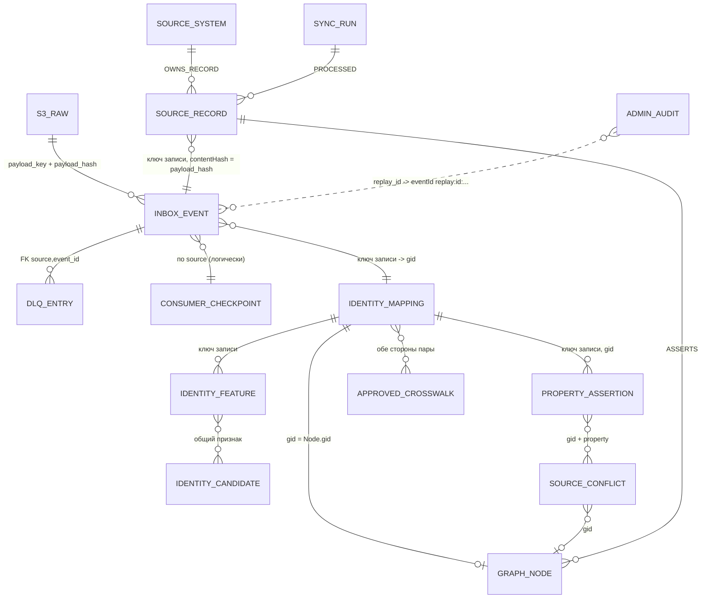
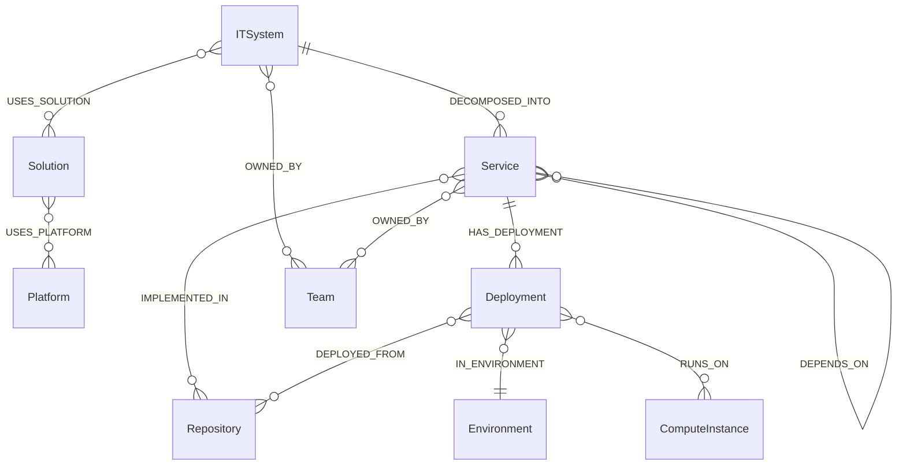

# Итоговый ERD: три хранилища одним взглядом

> Architect, этап R.5 (UNLOCKER-270). Атрибуты, типы и ключи таблиц PostgreSQL и меток Neo4j **не повторяются**: их ведёт Data Master в [`database/erd.md`](database/erd.md) (диаграммы), [`database/relationships.md`](database/relationships.md) (кардинальности), [`database/data-dictionary.md`](database/data-dictionary.md) (словарь), а концептуальную модель — `docs/02-data-model.md`. Здесь — то, чего в них нет: единая карта сущностей и ключей **поперёк** хранилищ, владельцы записи и расхождения. Метки: 🟢 DDL/код · 🟡 выведено · 🔴 расхождение.

## 1. Что хранится где

| Хранилище | Что | Кто пишет | Кто читает | Ключ связи с соседями |
|---|---|---|---|---|
| S3 (SeaweedFS) | сырой payload изменения и маркера `snapshot-complete`, `raw/<source>/<sha256>` | адаптеры (`InboxWriter`), `Reconciler` (tombstone) | `ingestion` (диспетчер, replay) | `inbox_event.payload_key`, `payload_hash` ↔ `SourceRecord.contentHash` |
| PostgreSQL: журнал (3 таблицы) | `inbox_event`, `dlq_entry`, `consumer_checkpoint` | адаптеры и `ingestion` | `ingestion`, консоль (SELECT) | `source` + `event_id`; единственный FK базы: `dlq_entry → inbox_event` |
| PostgreSQL: идентичность (6 таблиц) | `identity_mapping`, `approved_crosswalk`, `identity_feature`, `identity_candidate`, `property_assertion`, `source_conflict` | `ingestion` | `ingestion`, консоль (кандидаты и конфликты) | `gid`, ключ записи `(source, source_type, source_id)` |
| PostgreSQL: аудит (1 таблица) | `admin_audit` | `ingestion` | консоль | `replay_id` |
| Neo4j | 13 канонических меток + `SourceSystem`, `SourceRecord`, `SyncRun`, служебная `PendingRelation` | только `ingestion` (projector) | `mcp-server`, `admin-console` | `gid`; `SourceRecord(source, sourceType, sourceId)` |

Источник состава: `database/erd.md` §1–3 и миграции `V1`…`V7`; число таблиц (10), меток (16), constraints (18) и индексов (2) — `.reversa/state.json` (чекпоинт `data_master`) 🟢. PostgreSQL-часть собирается из трёх модулей (`ingestion/event-journal/src/main/resources/db/migration/V1__event_journal.sql:21-21`, `ingestion/identity-resolution/src/main/resources/db/migration/V2__identity_mapping.sql:14-14`, `ingestion/ingestion-service/src/main/resources/db/migration/V3__admin_audit.sql:1-1`).

## 2. Сквозные связи по значению

Внешних ключей между хранилищами нет; единство держится на значениях и на коде приложения 🟢 (`database/erd.md` §1).

Условные обозначения сущностей диаграммы: `S3_RAW` — объект S3; `GRAPH_NODE` — любой канонический узел Neo4j (`ITSystem`, `Service`, `Deployment`, …); остальные имена — таблицы PostgreSQL и узлы провенанса. Кардинальности «`||--o{`» между PostgreSQL и Neo4j — 🟡: ограничений ни в одной из СУБД нет (`database/relationships.md` §1–3).

## 3. Ключи идентичности и их форма в каждом хранилище

Одна и та же запись источника выглядит по-разному в разных местах; это источник скрытых расхождений ([`traceability/spec-impact-matrix.md`](traceability/spec-impact-matrix.md) §2).

| Хранилище | Как записывается источник | Пример | Основание |
|---|---|---|---|
| `inbox_event.source`, `consumer_checkpoint.source` | URN | `urn:corp:eam` | `adapters/adapter-core/src/main/java/io/github/unlocker/archrag/adaptercore/EventMapper.java:46-48` 🟢 |
| `identity_mapping.source`, `SourceRecord.source`, `SyncRun.adapter` | имя `SourceSystemCode` в верхнем регистре | `EAM`, `DEPLOYMAP` | `ingestion/graph-projector/src/main/java/io/github/unlocker/archrag/graphprojector/GraphProjector.java:697-698` 🟢 |
| ответы консоли и журнала, UI | код в нижнем регистре | `eam`, `deploymap` | `access/admin-console/src/main/java/io/github/unlocker/archrag/adminconsole/pg/SyncSources.java:19-19` 🟢 |
| ключ записи без префикса системы | `(source_type, source_id)` | `IT_SYSTEM`, `5101` | ADR [0024](../docs/adr/0024-open-source-id-format.md) 🟢 |

`gid` — единственный сквозной идентификатор канонического узла: назначается `identity_mapping` один раз (`UUID.randomUUID()`), переживает `rebuild`, потому что граф стирается, а таблица нет (`ingestion/ingestion-service/src/main/java/io/github/unlocker/archrag/ingestionservice/RebuildService.java:18-18`) 🟢. 🟡 Потеря `identity_mapping` необратима: `gid` не вычисляется из ключа (`_reversa_sdd/code-analysis.md:538-538`; `ingestion/identity-resolution/src/main/java/io/github/unlocker/archrag/identityresolution/PostgresIdentityMapping.java:50-50`).

## 4. Ключевые сущности графа и их кардинальности

Метки и допустимые пары заданы `RelationType` (`contracts/canonical-model/src/main/java/io/github/unlocker/archrag/canonicalmodel/relation/RelationType.java:13-27`); полная диаграмма — `database/erd.md` §3, свойства связей — `database/relationships.md` §2. Ядро иерархии:

Кардинальности — 🟡: на связи в Community нет constraint'ов, множественность следует из домена и данных заглушек (`database/relationships.md` §2). Мастер каждой сущности и связи определяет `AuthorityMatrix` (ADR [0008](../docs/adr/0008-authority-matrix-field-level.md)); временные связи (`validFrom`/`validTo`) — ADR [0020](../docs/adr/0020-tombstone-instead-of-hard-delete.md), [0028](../docs/adr/0028-structural-relations-temporal.md).

## 5. Расхождения ERD с документами

| № | Что | Ссылки |
|---|---|---|
| 🟡 [R.8: решение принято, реализация — UNLOCKER-276 (п. 2)] Э-1 | `dlq_entry.replayed_at` присутствует в схеме, но кодом не изменяется (Р-3); `identity_candidate.status` закрывается подтверждением оператора (🟢 UNLOCKER-282, Р-4) | `ingestion/event-journal/src/main/resources/db/migration/V1__event_journal.sql:47-48`; [`detective-gaps.md`](detective-gaps.md) §2 |
| 🟢 [UNLOCKER-280: реализовано] Э-2 | `SyncRun` создаётся `RUNNING`; `endedAt`, итог и счётчики пишет закрытие прогона по маркеру (`SyncRunWriter`), зависшие и retention — `HousekeepingJob` (Р-5) | `ingestion/graph-projector/src/main/java/io/github/unlocker/archrag/graphprojector/GraphProjector.java:695-700` |
| 🟡 Э-3 | `inbox_event.status` без `CHECK`: допустимые значения держит только `ProcessingStatus` в Java | `ingestion/event-journal/src/main/resources/db/migration/V1__event_journal.sql:13-13`; `database/data-dictionary.md` §3 |
| 🟡 Э-4 | Свойства, пропущенные в частичной записи, исчезают из `property_assertion`, но остаются в графе (конфликт «рассасывается» без изменения графа) | `ingestion/identity-resolution/src/main/java/io/github/unlocker/archrag/identityresolution/PostgresSourceConflicts.java:81-103`; `_reversa_sdd/code-analysis.md:619-619` |
| 🟡 Э-5 | `ASSERTS.confidence` всегда `1.0` — поле не несёт информации | `ingestion/graph-projector/src/main/java/io/github/unlocker/archrag/graphprojector/GraphProjector.java:462-462` |
| 🟡 Э-6 | Обычный crosswalk меняет `identity_mapping` сразу, граф переписывается только следующим replay/rebuild (П-12); подтверждение кандидата (UNLOCKER-282) перепроецирует запись сразу | `ingestion/ingestion-service/src/main/java/io/github/unlocker/archrag/ingestionservice/CrosswalkService.java:17-20` |
