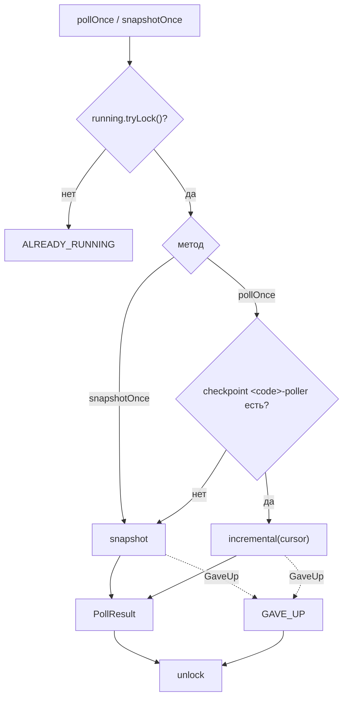
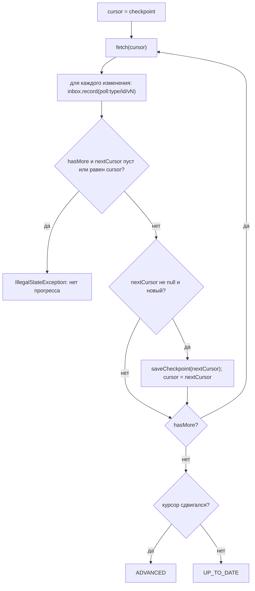
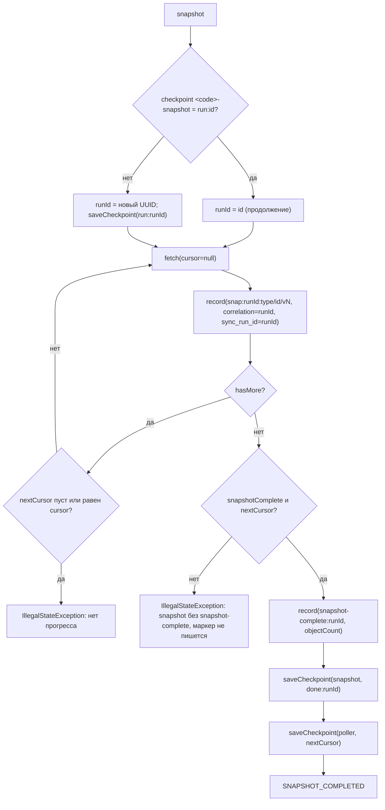
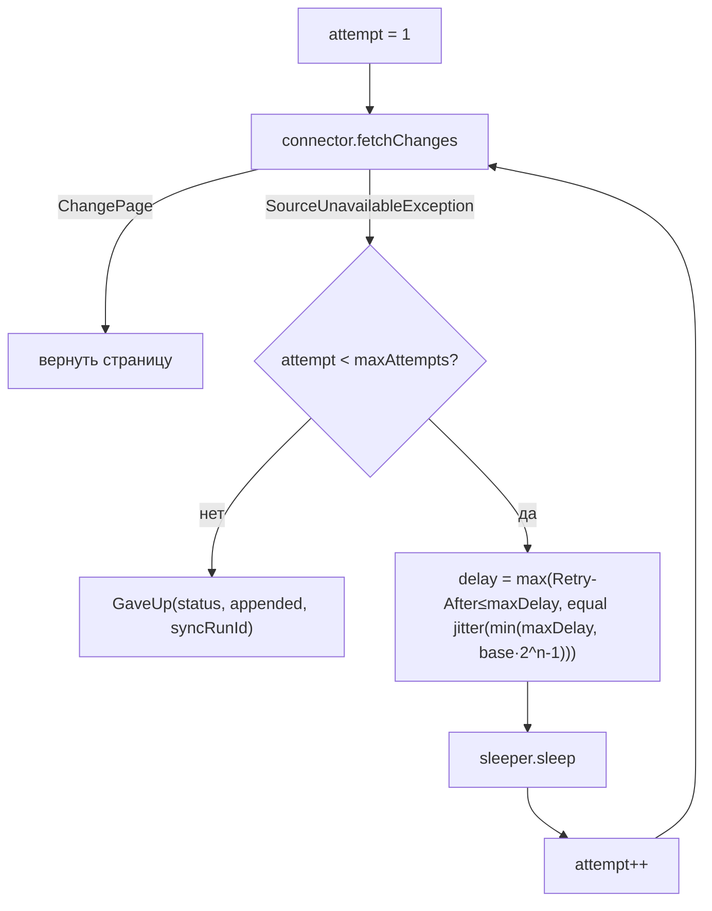
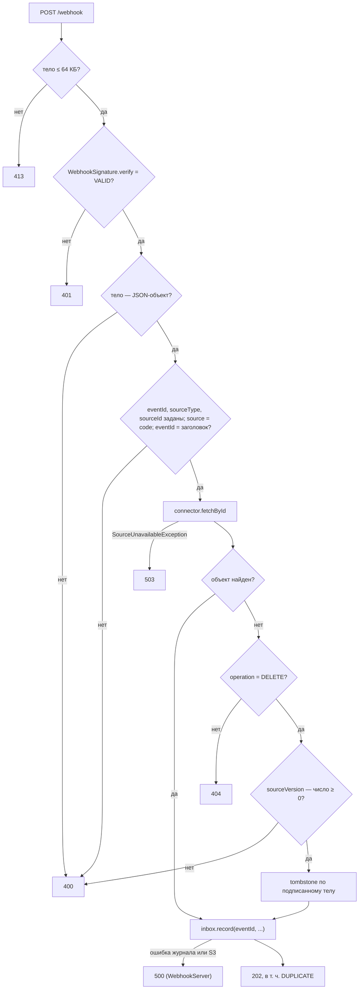
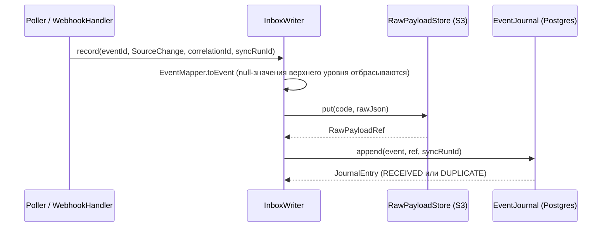
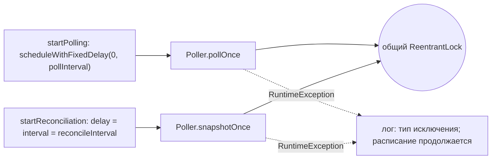

# Блок-схемы: adapters/adapter-core

> Archaeologist, R.2b. Пути относительно `adapters/adapter-core/src/main/java/io/github/unlocker/archrag/adaptercore/`.

## 1. `Poller.pollOnce` и `snapshotOnce` (`Poller.java:89-118`) 🟢

## 2. Инкрементальный polling (`Poller.incremental`, `Poller.java:120-145`) 🟢

Курсор сохраняется только после `record` всей страницы (ловушка 6) 🟢.

## 3. Полный snapshot с маркером (`Poller.snapshot`, `Poller.java:147-188`) 🟢

Порядок «маркер → done → курсор» — `Poller.java:168-172`; без маркера missing set не считается (ловушка 9) 🟢.

## 4. Повторы при недоступности (`Poller.fetch` + `RetryPolicy.delay`, `Poller.java:191-204`, `RetryPolicy.java:40-50`) 🟢

## 5. Приём webhook (`WebhookHandler.handle`, `WebhookHandler.java:56-107`) 🟢

Проверка размера выполняется в `WebhookServer.process` до обработчика (`WebhookServer.java:108-115`); `500` — `WebhookServer.java:119-122` 🟢.

## 6. Запись в inbox (`InboxWriter.record`, `InboxWriter.java:34-48`) 🟢

Ошибки S3 и журнала не перехватываются: вызывающий не должен считать событие принятым 🟢.

## 7. Расписание в `SourceAdapter` (`SourceAdapter.java:72-115`) 🟢

