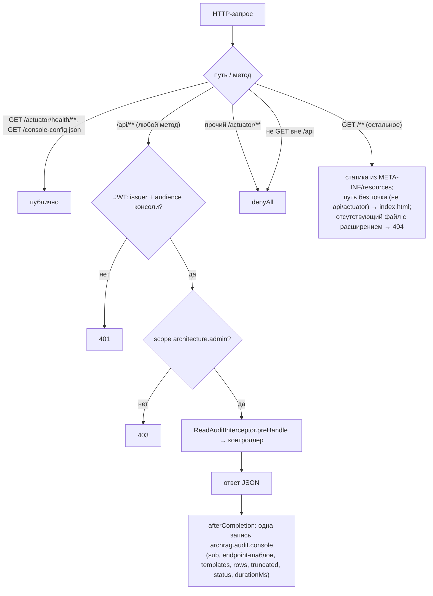
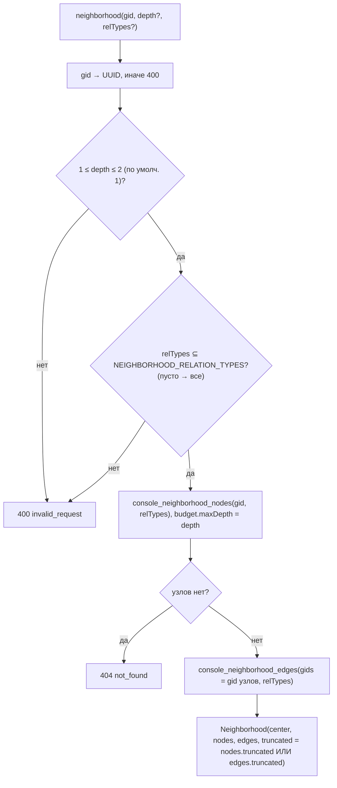
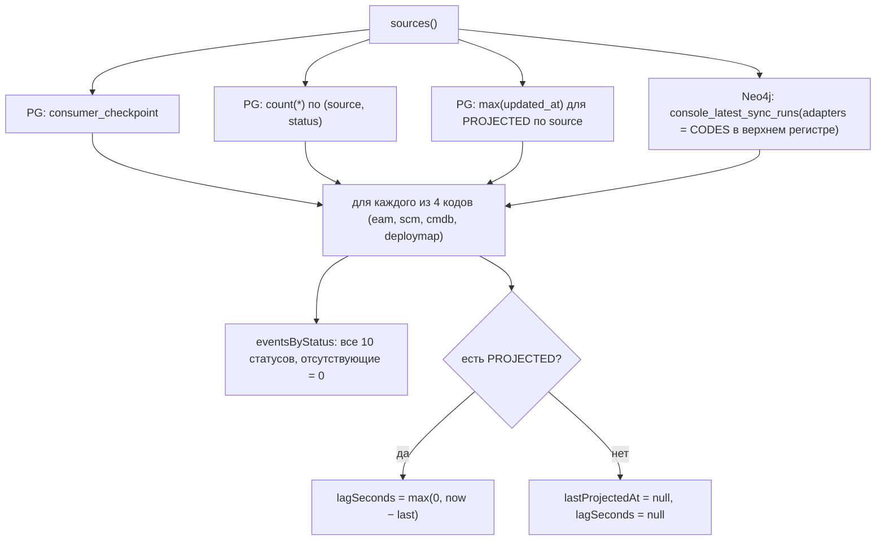
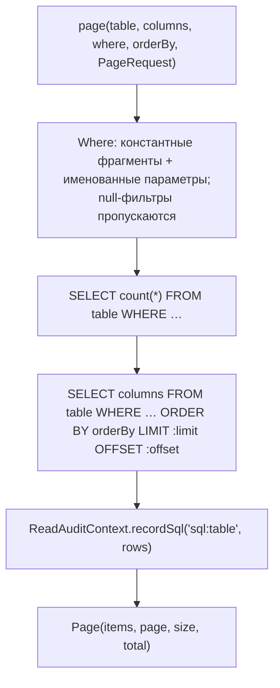

# Блок-схемы: access/admin-console

> Archaeologist, R.2d. Пути относительно `access/admin-console/src/main/java/io/github/unlocker/archrag/adminconsole/`. Шаблоны графа — `flowcharts/graph-query-core.md`. REST-таблица и ответы — `code-analysis.md` §X3.1, `data-dictionary.md` §X.3.

## Авторизация и маршрутизация запроса (`security/ConsoleSecurityConfiguration.java:38-53`, `config/SpaWebConfiguration.java:48-71`) 🟢

## `GET /api/graph/nodes/{gid}/neighborhood` (`api/GraphController.java:127-167`) 🟢

## `GET /api/sync/sources` (`api/SyncController.java:56-75`) 🟢

## Страница из PostgreSQL (`pg/ConsoleReadRepository.java:271-290`) 🟢

