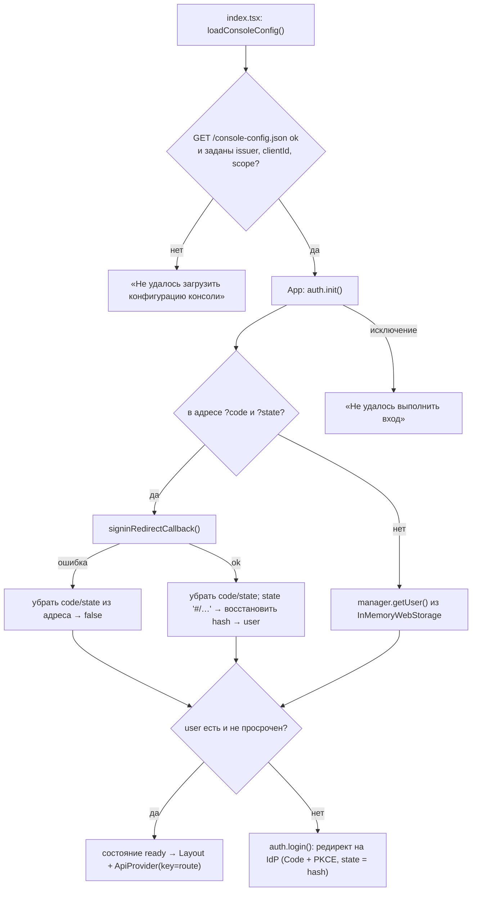
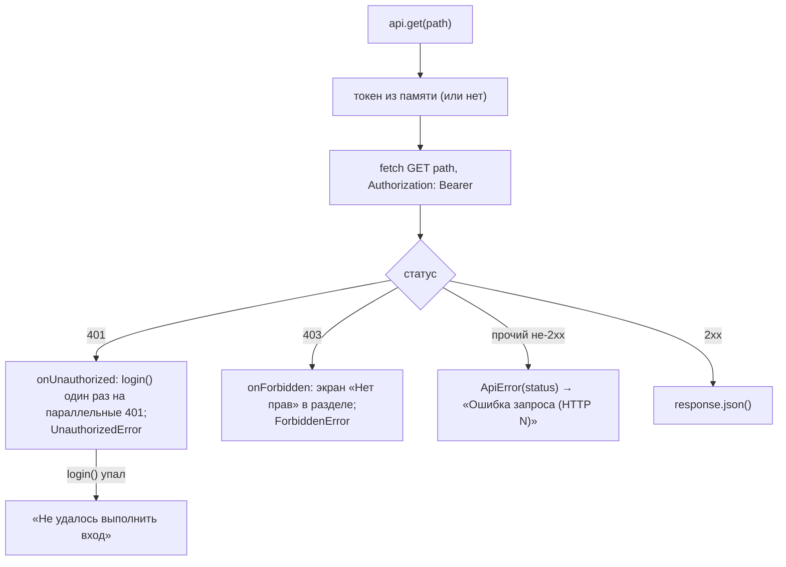
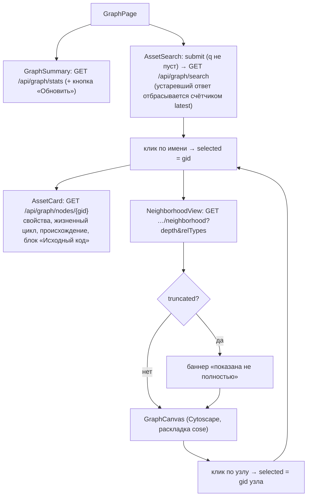
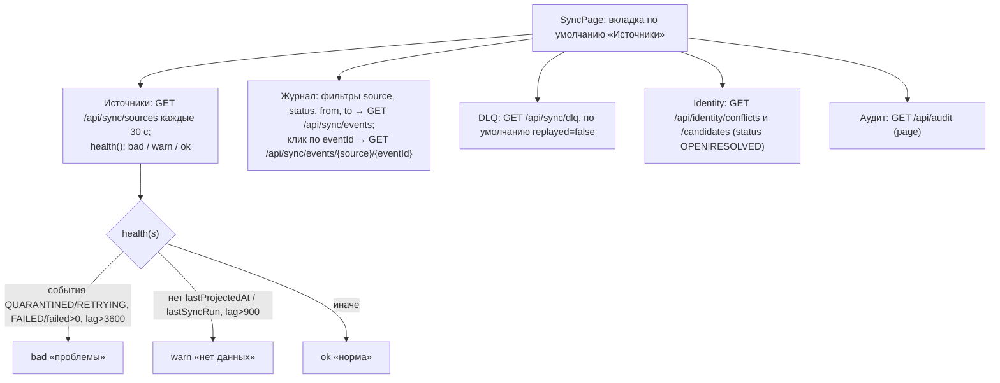

# Блок-схемы: access/admin-ui

> Archaeologist, R.2d. Пути относительно `access/admin-ui/src/`. Маршруты и API — `code-analysis.md` §X4.1; REST-сторона — `flowcharts/admin-console.md`.

## Старт и вход (`index.tsx:8-10`, `App.tsx:16-33`, `auth/authService.ts:53-75`) 🟢

## Запрос к API и реакция на 401/403 (`api/apiClient.ts:43-69`, `api/ApiContext.tsx:12-37`) 🟢

## Раздел «Граф» (`pages/GraphPage.tsx`, `pages/graph/*`) 🟢

## Раздел «Синхронизация» (`pages/SyncPage.tsx`, `pages/sync/*`) 🟢

