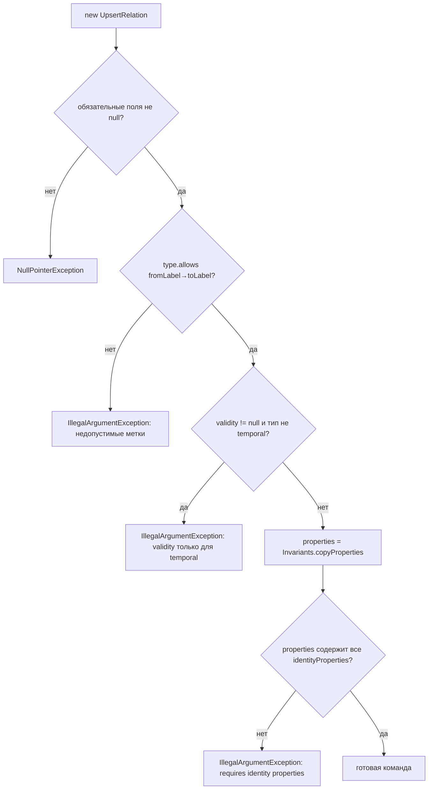
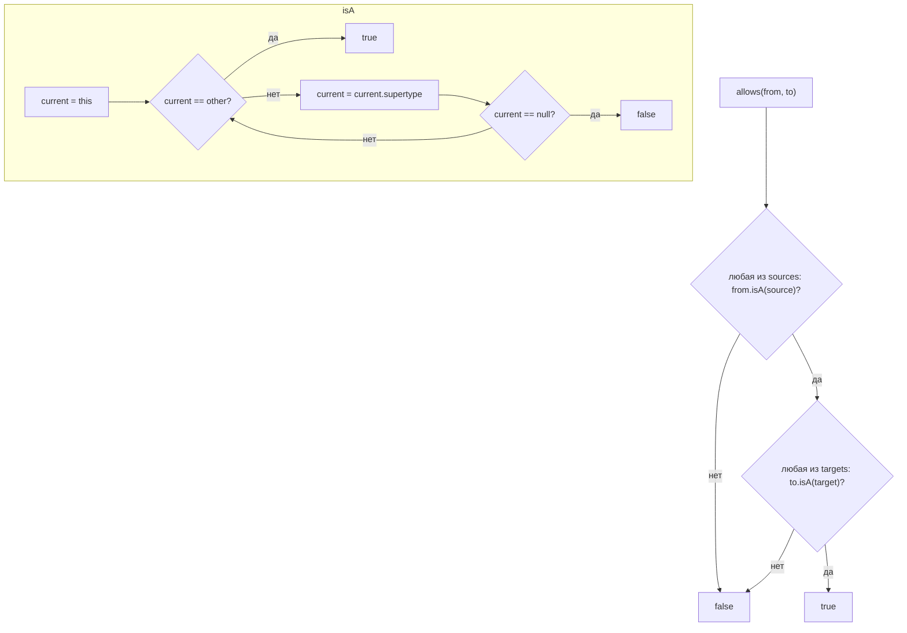
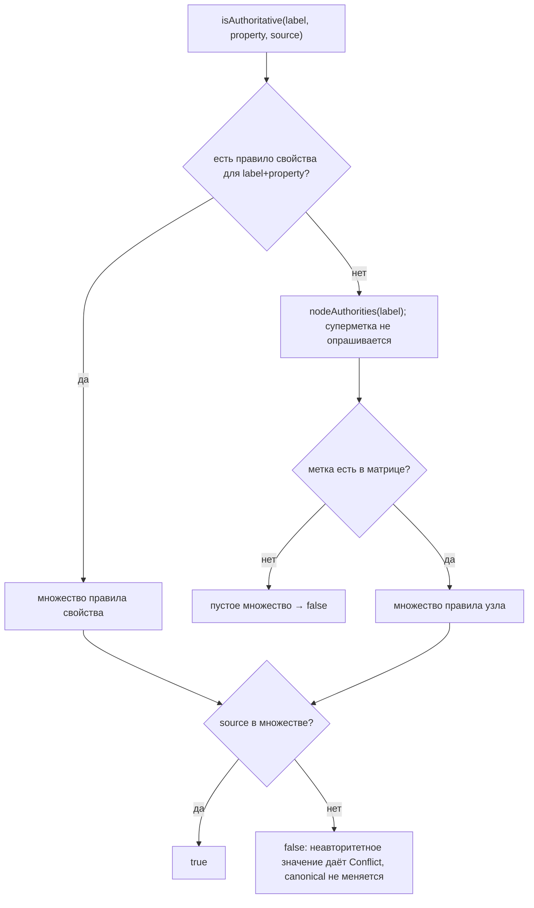
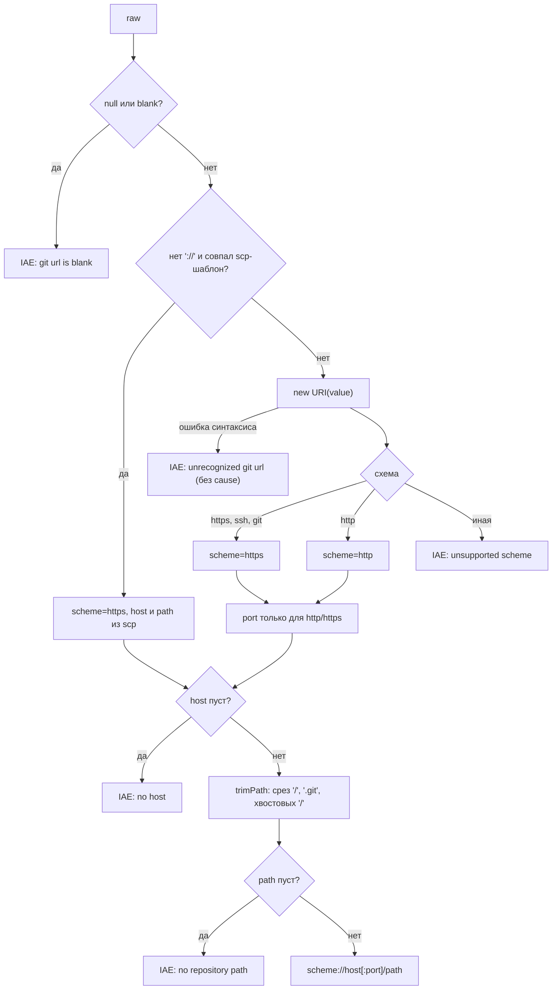
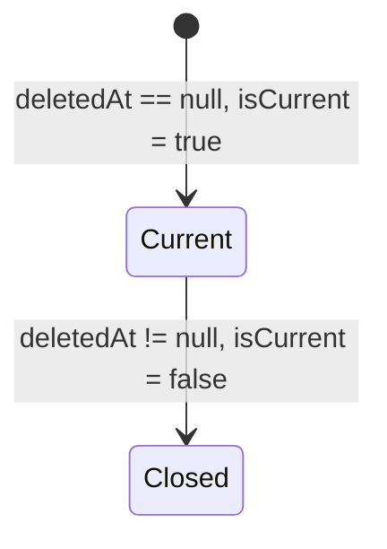

# Блок-схемы: contracts/canonical-model

> Archaeologist, R.2a. Метки: 🟢 код · 🟡 выведено. Пути относительно `contracts/canonical-model/src/main/java/io/github/unlocker/archrag/canonicalmodel/`.

## 1. Проверка `UpsertRelation` (`command/UpsertRelation.java:25-42`) 🟢

## 2. `RelationType.allows` и иерархия меток (`relation/RelationType.java:73-75`, `node/NodeLabel.java:54-61`) 🟢

## 3. Поиск авторитетности свойства (`authority/AuthorityMatrix.java:48-75`) 🟢

## 4. `GitUrls.normalize` (`node/GitUrls.java:30-91`) 🟢

## 5. Жизненный цикл `Lifecycle` (🟢, `node/Lifecycle.java:14-21`)

Переходы между состояниями выполняет проектор (R.2c); сам `Lifecycle` — иммутабельная запись, фиксирующая только допустимые сочетания полей 🟡.
