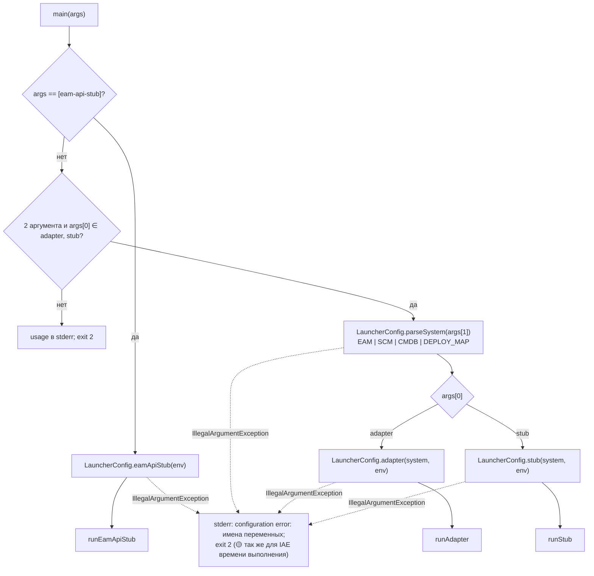
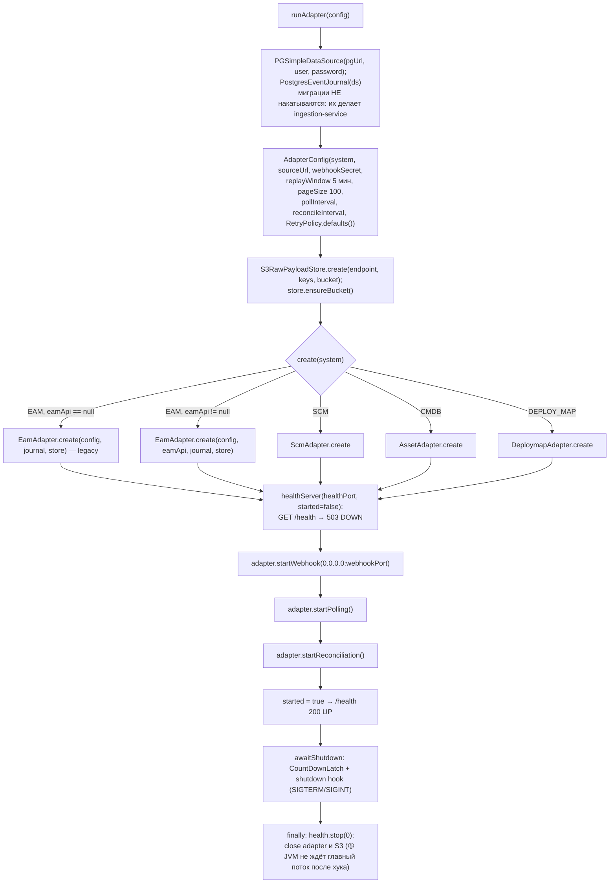
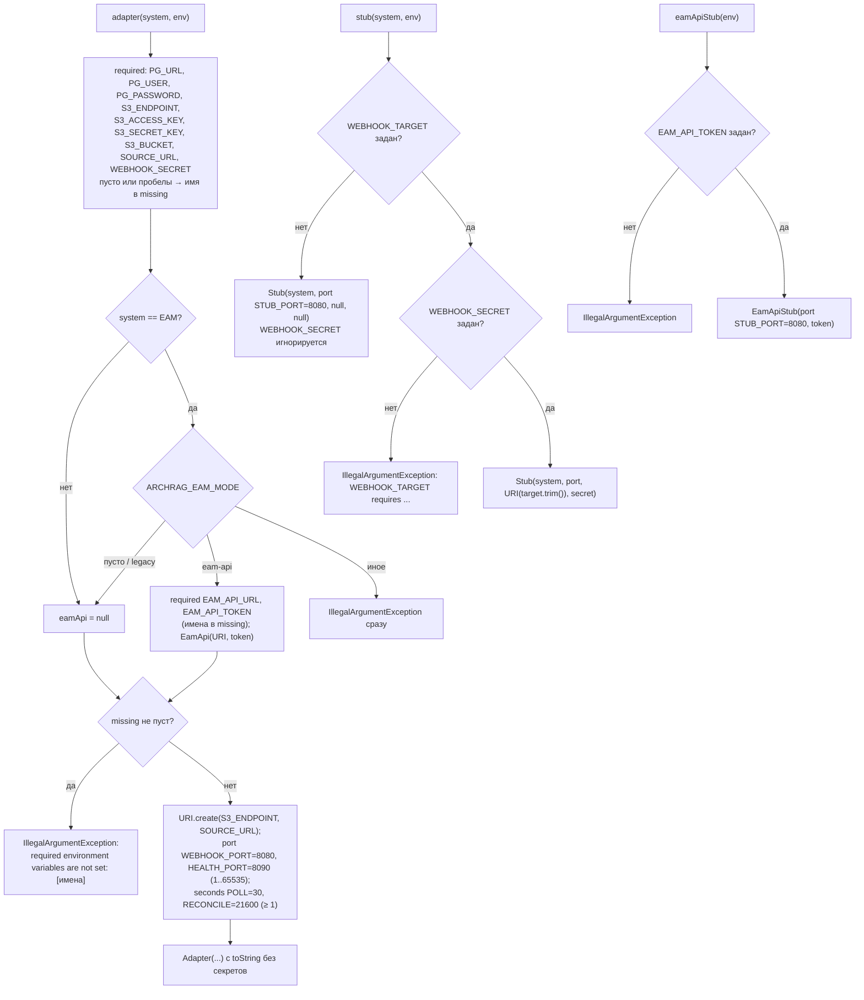
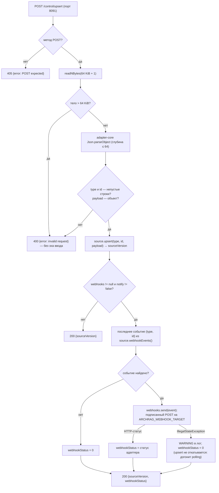
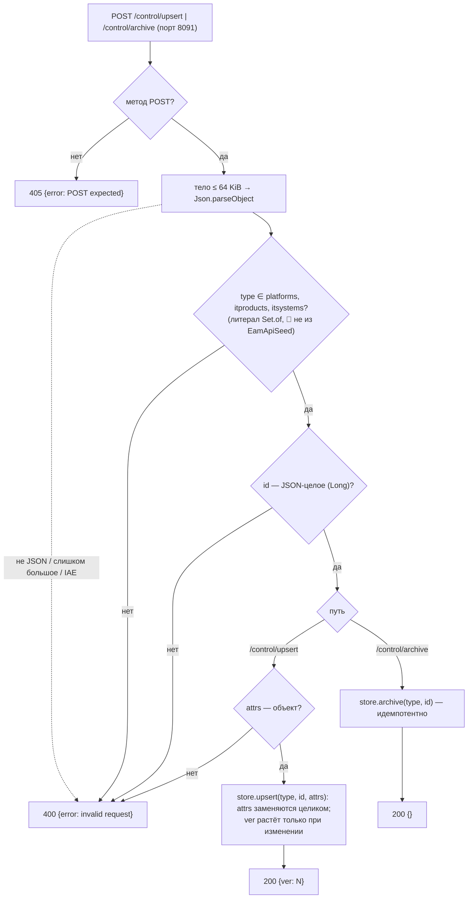

# Блок-схемы: platform/demo-launcher

> Archaeologist, R.2e. Пути относительно `platform/demo-launcher/src/main/java/io/github/unlocker/archrag/demolauncher/`. Разбор — `code-analysis.md` §Y2, env и эндпоинты — `data-dictionary.md` §Y.2. Топология compose — `platform/docker/docker-compose.yml`.

## Диспетчер `DemoLauncher.main` (`DemoLauncher.java:58-83`) 🟢

## Старт адаптера `runAdapter` (`DemoLauncher.java:108-160`) 🟢

## Разбор env: `LauncherConfig` (`LauncherConfig.java:107-203`) 🟢

## `POST /control/upsert` заглушки источника (`StubControl.java:52-104`) 🟢

## Управление заглушкой EAM API `EamApiControl` (`EamApiControl.java:33-98`) 🟢

