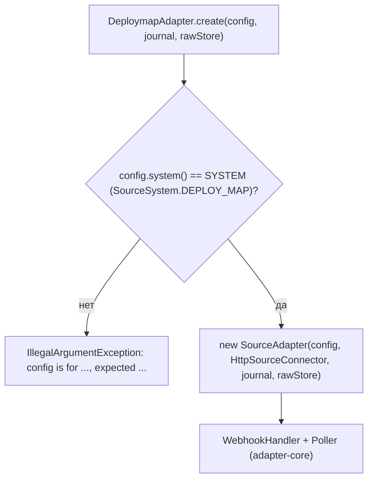

# Блок-схемы: adapters/deploymap-adapter

> Archaeologist, R.2b. Пути относительно `adapters/deploymap-adapter/src/main/java/`. Модуль — тонкая привязка (`DeploymapAdapter.java:15-39`); поток данных после сборки описан в [`adapter-core.md`](adapter-core.md).

## Сборка адаптера (`DeploymapAdapter.create`, `DeploymapAdapter.java:32-38`) 🟢

Код источника `deploymap` → `source` событий `urn:corp:deploymap` (`SourceSystem.java:5-9`, `EventMapper.java:47-49`). Формат payload deploy map (`deploymap-poc-0/1`) модулем не разбирается: он определён в `platform/source-stubs/.../DeployMapFormat.java` и читается `ingestion/normalizer/.../DeployMapMapper.java`; модуль хранит только контрактные тесты и fixtures (`code-analysis.md`, §P5, §P7.1).
