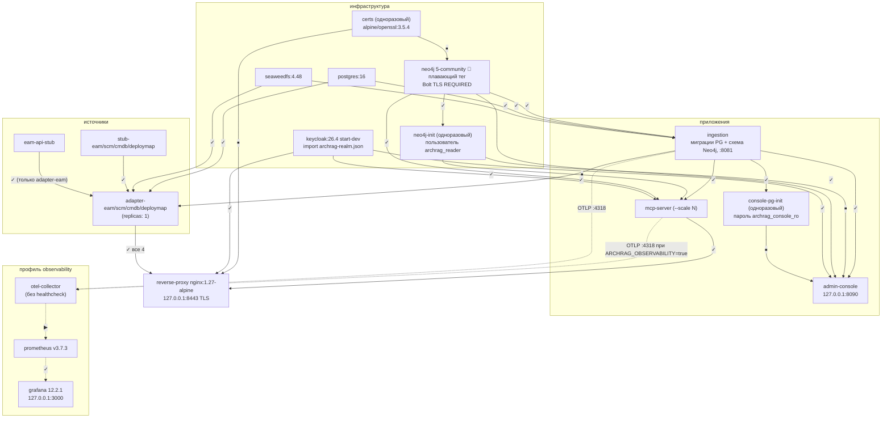
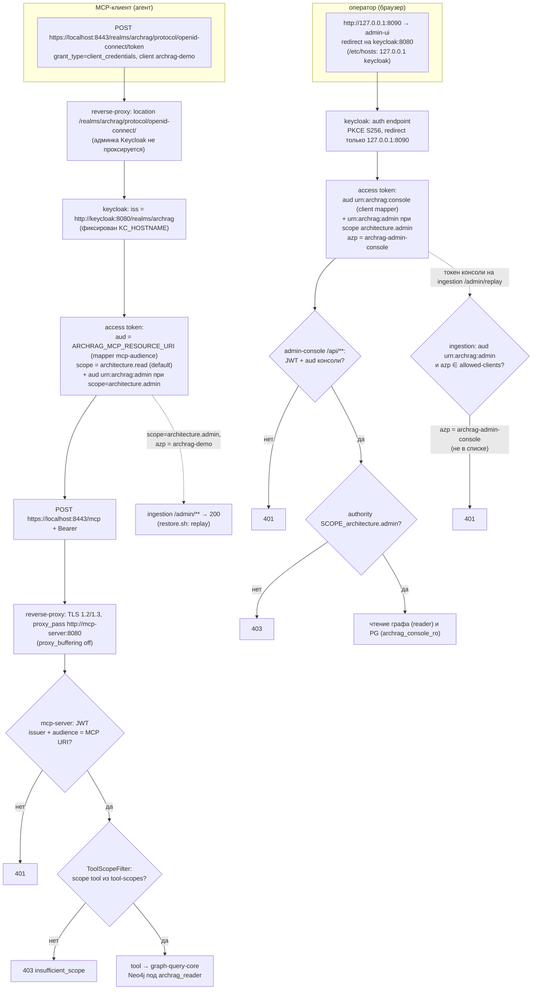
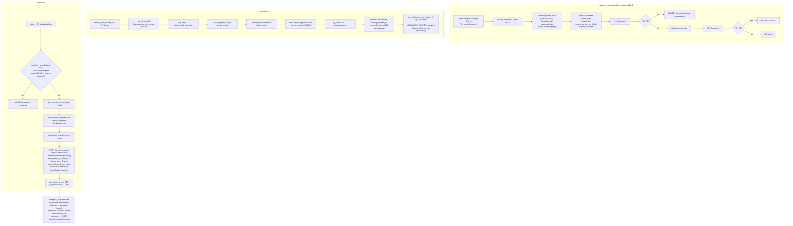
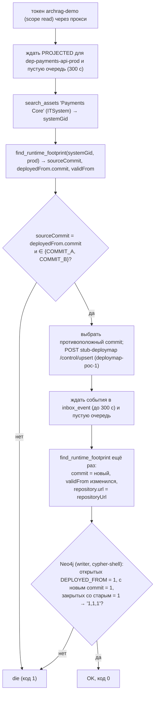

# Блок-схемы: platform/docker

> Archaeologist, платформа стенда. Пути относительно `platform/docker/` (`DC` = `docker-compose.yml`). Подробности и сомнения — `code-analysis.md` §W1, значения — `data-dictionary.md` §W.1. Метки 🟢/🟡/🔴 как в остальных блок-схемах.

## 1. Топология сервисов и порядок запуска (`DC:41-526`) 🟢

Стрелка «A → B» читается «B ждёт A»; `✓` — `service_healthy`, `⏹` — `service_completed_successfully`, `▶` — `service_started`. Профильные сервисы (`observability`) выделены пунктиром.

Сети: `edge` (прокси, MCP, Keycloak, адаптеры, заглушки), `backend`/`graph`/`observability` — `internal`, `obs-edge`/`console-edge` — только для публикации портов (`DC:528-543`). Прокси стартует последним: `up --wait` возвращается, когда вся цепочка healthy. 🟡 Прокси ждёт всех четырёх адаптеров (`DC:460-463`), хотя проксирует к ним лишь вебхуки.

## 2. Поток аутентификации: Keycloak → прокси → приложения 🟢

Для агента (`archrag-demo`, `client_credentials`) и оператора консоли (`archrag-admin-console`, Authorization Code + PKCE). Конфигурация: `keycloak/archrag-realm.json:5-109`, `proxy/nginx.conf:18-40`, `DC:137-163`.

🔴 Роль `archrag-console-admin` присвоена пользователю (`realm.json:37-46`), но нигде не проверяется: токен консоли получает любой пользователь realm (ADR 0026, `docs/05-production-gap-list.md:33`).

## 3. `scripts/backup.sh`, `restore.sh`, `backup-restore-check.sh` 🟢

Коды: `die` → 1. 🟡 `trap ERR` не срабатывает на сбой внутри функций `lib.sh` (нет `set -E`, проверено локальным экспериментом): после ошибки dump/load сервисы могут остаться остановленными.

## 4. Smoke-проверки: `smoke.sh` и `console-smoke.sh` 🟢

В CI запускается только `smoke.sh` (`.github/workflows/ci.yml:60-101`) 🔴; `console-smoke.sh` — вручную.

```mermaid
flowchart TD
  subgraph s1["smoke.sh (внешняя граница, критерий 6)"]
    S0["ca.crt из тома certs (без -k)"] --> S1{"POST /mcp без токена = 401?"}
    S1 -- нет --> SF["smoke FAILED (код 1)"]
    S1 -- да --> S2{"токен client_credentials → /mcp = 200\nи tools/call ping возвращает result?"}
    S2 -- нет --> SF
    S2 -- да --> S3{"plain HTTP на TLS-порт ≠ 200?\n7474, 7687, 5432 закрыты на хосте?"}
    S3 -- нет --> SF
    S3 -- да --> S4{"mcp-server: нет ARCHRAG_PG_*, NEO4J_PASSWORD,\nARCHRAG_NEO4J_USER, ARCHRAG_S3_*, WEBHOOK_SECRET;\n/run/secrets = только reader;\nконтроль: neo4j резолвится и достижим; postgres нет"}
    S4 -- нарушено --> SF
    S4 -- ок --> S5{"proxy не резолвит ingestion\n(контроль: резолвит mcp-server)"}
    S5 -- нет --> SF
    S5 -- да --> S6{"admin REST изнутри ingestion:\nscope admin = 200, scope read = 401"}
    S6 -- нет --> SF
    S6 -- да --> S7{"plain Bolt к neo4j:7687 закрывается без ответа (CLOSED)?"}
    S7 -- нет --> SF
    S7 -- да --> SOK["smoke ok, код 0"]
  end

  subgraph s2["console-smoke.sh (консоль, U.5)"]
    K1["console-config.json называет клиент консоли;\nлогин Authorization Code + PKCE S256 на curl\n(curl --connect-to вместо /etc/hosts)"] --> K2{"direct grant для публичного клиента: 400/401?"}
    K2 -- нет --> KF["console-smoke FAILED (код 1)"]
    K2 -- да --> K3{"/api/* без токена = 401;\nтокен только architecture.read = 403;\nтокен archrag-demo (aud MCP) = 401"}
    K3 -- нет --> KF
    K3 -- да --> K4{"admin-токен: /api/graph/stats = 200,\n/api/sync/sources = 200 и ровно 4 источника"}
    K4 -- нет --> KF
    K4 -- да --> K5{"токен консоли (aud admin, azp консоли)\nна ingestion /admin/replay = 401"}
    K5 -- нет --> KF
    K5 -- да --> K6{"публикация на 127.0.0.1; на внешнем IP хоста\nпорты консоли и Keycloak закрыты (skip без IP);\nproxy не резолвит admin-console"}
    K6 -- нет --> KF
    K6 -- да --> K7{"/run/secrets консоли = reader + console_ro;\nнет writer/S3 окружения; контроль: neo4j и postgres достижимы"}
    K7 -- нет --> KF
    K7 -- да --> KOK["console-smoke ok, код 0"]
  end
```

## 5. Сценарий смены commit развёртывания: `scripts/deployment-commit-check.sh` (UNLOCKER-248) 🟢

Замечание: схемы 3–5 описывают скрипты; `measure.sh` (замеры критерия 9, код 1 при превышении порогов/росте DLQ/ошибке tool) описан в `code-analysis.md` §W1.7 таблицей и отдельной блок-схемой не оформлен — это линейный сбор метрик без ветвления, кроме проверок порогов.
