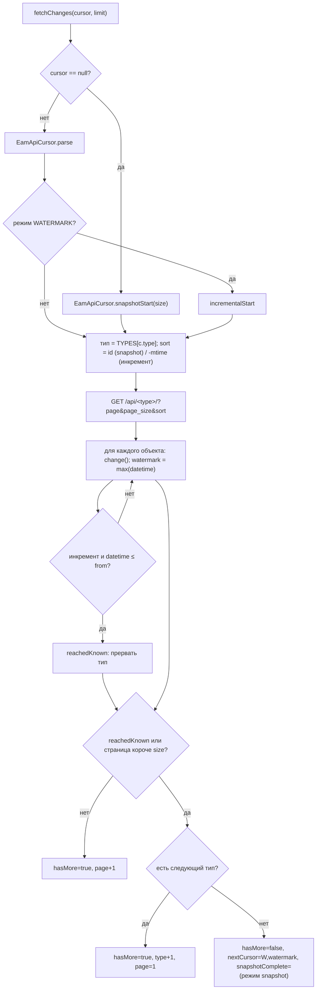
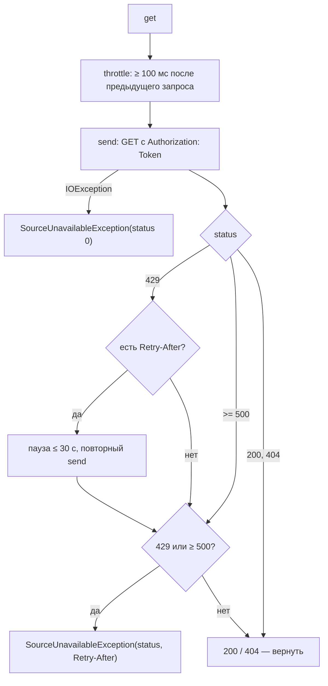
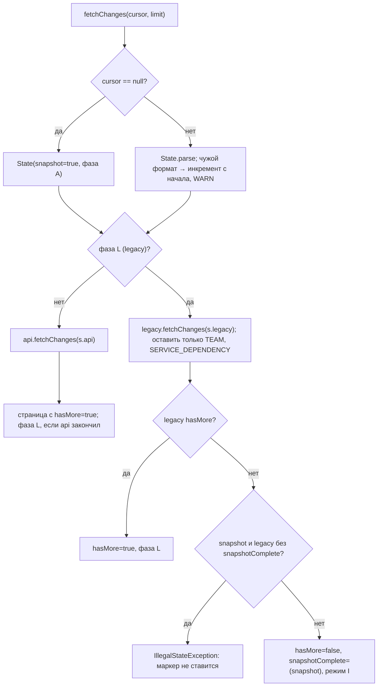
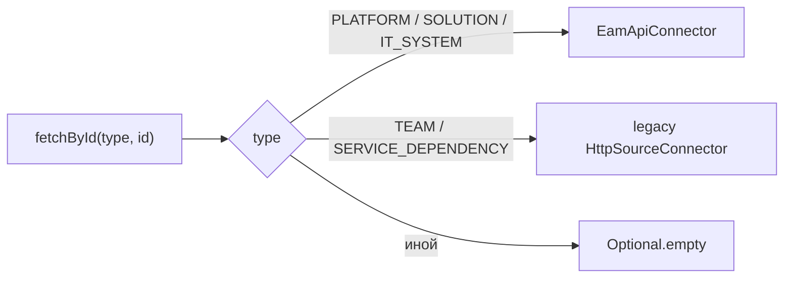
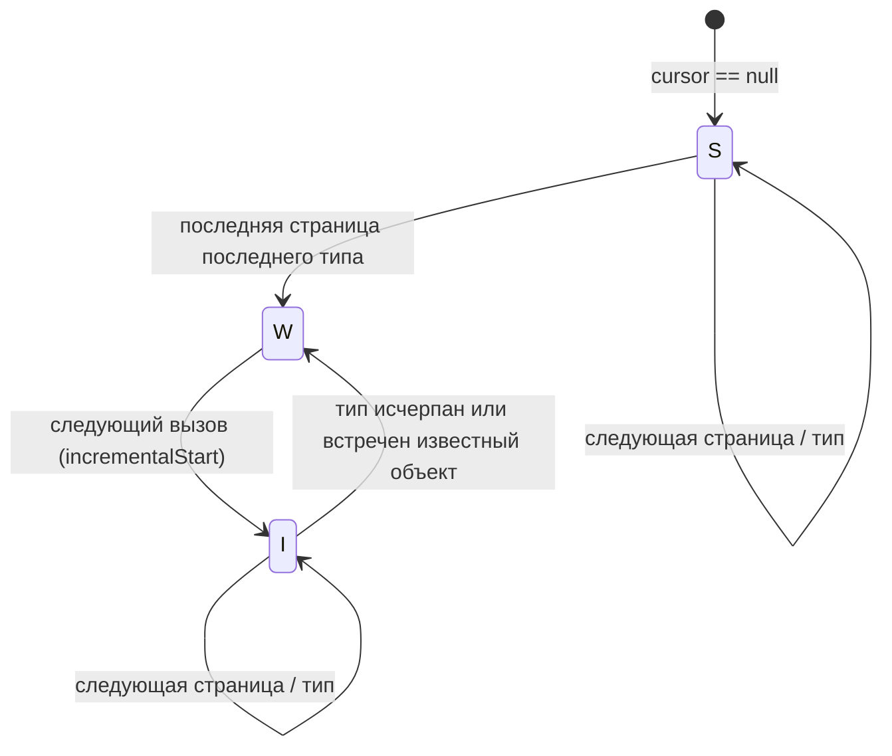

# Блок-схемы: adapters/eam-adapter

> Archaeologist, R.2b. Пути относительно `adapters/eam-adapter/src/main/java/io/github/unlocker/archrag/eamadapter/`. Формат и допущения — `docs/06-eam-integration.md`, `docs/eam-api.yaml`.

## 1. `EamApiConnector.fetchChanges` (`EamApiConnector.java:93-132`) 🟢

## 2. Запрос к EAM API (`EamApiConnector.get/send/throttle`, `:205-260`) 🟢

Любой другой статус (в т. ч. 401/403) вызывающий превращает в `IllegalStateException` без тела (`requireOk`, `:241-246`) 🟢.

## 3. `CompositeEamConnector.fetchChanges` (`CompositeEamConnector.java:50-70`) 🟢

## 4. `fetchById` составного коннектора (`CompositeEamConnector.java:88-96`) 🟢

## 5. Жизненный цикл курсора (`EamApiCursor`, `EamApiCursor.java:10-14`) 🟢

