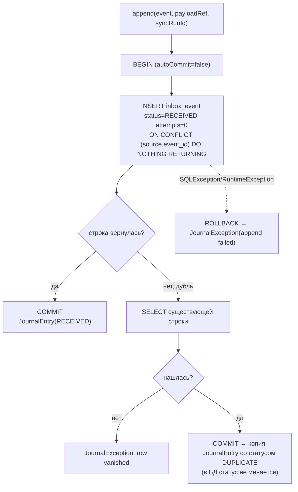
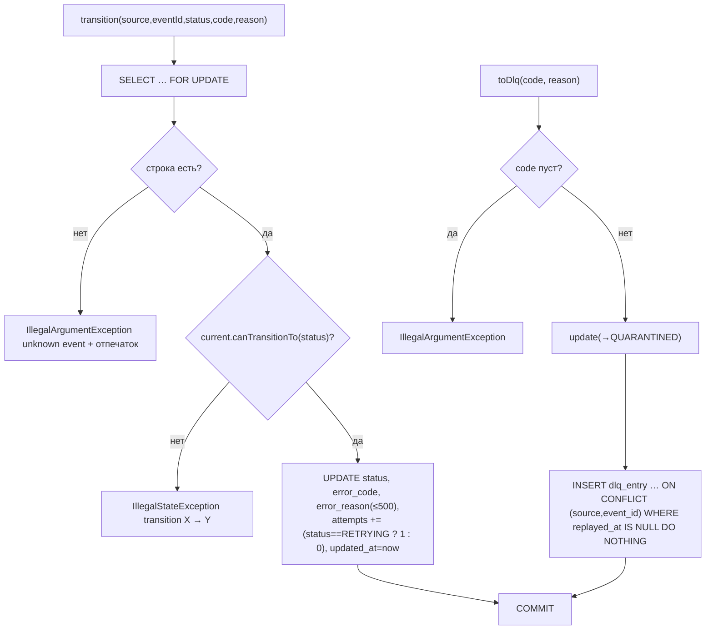
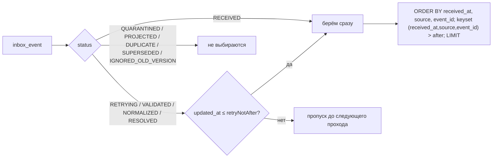
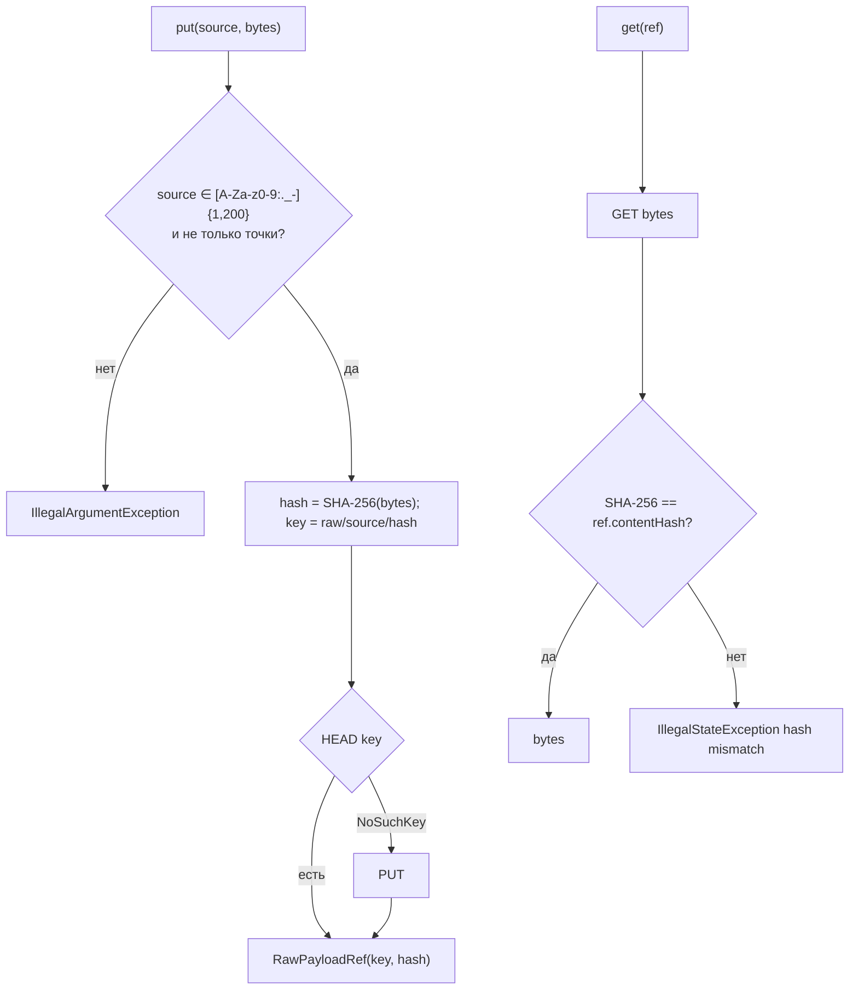

# Блок-схемы: ingestion/event-journal

> Archaeologist, R.2c. Пути относительно `ingestion/event-journal/src/main/java/io/github/unlocker/archrag/eventjournal/`. Статусы — `ProcessingStatus` (`contracts/event-schemas`), см. `flowcharts/event-schemas.md`.

## `append`: запись события в inbox (`PostgresEventJournal.java:53-97`) 🟢

`publish` = `append(...).status() != DUPLICATE` (`:99-102`).

## `transition` / `toDlq` (`:113-160`, `:320-354`) 🟢

## Выборка для диспетчера `pending` (`:209-237`) 🟢

## S3: `put` / `get` (`S3RawPayloadStore.java:68-99`) 🟢

