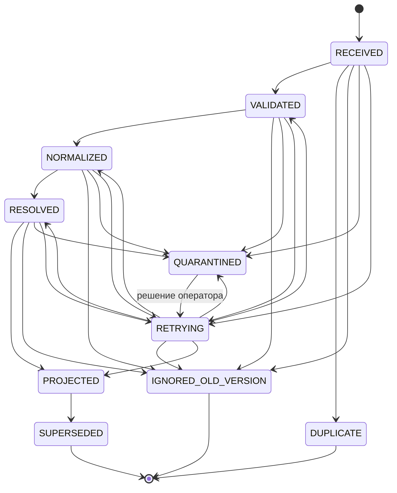
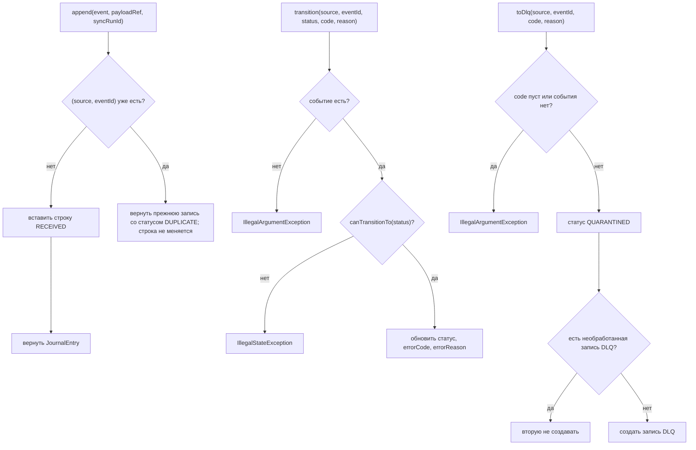
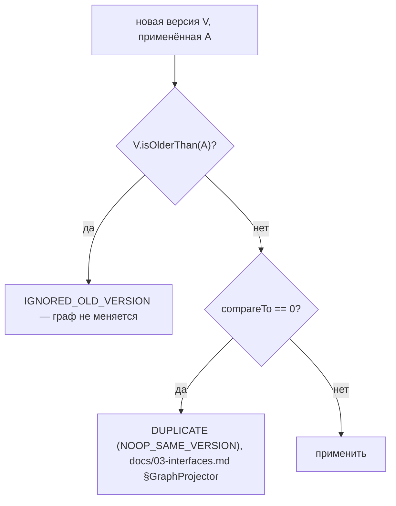
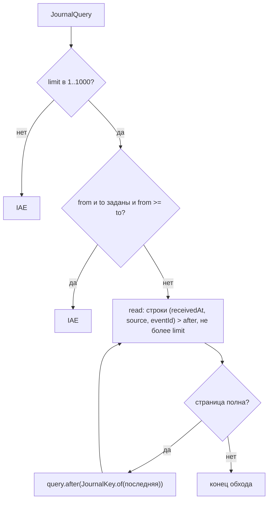
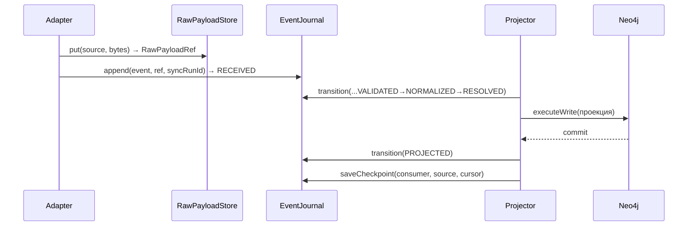

# Блок-схемы: contracts/event-schemas

> Archaeologist, R.2a. Пути относительно `contracts/event-schemas/src/main/java/io/github/unlocker/archrag/eventschemas/`.

## 1. Автомат `ProcessingStatus` (`ProcessingStatus.java:26-42`) 🟢

Переход «в себя» разрешён из любого состояния (`:27-29`) 🟢. Диаграмма совпадает с `docs/02-data-model.md:239-270` (проверено построчно) 🟢.

## 2. Контракт `EventJournal.append` / `transition` / `toDlq` (`EventJournal.java:15-41`) 🟢

## 3. Сравнение версий и решение о применении (`SourceVersion.java:18-26`; решение принимает `GraphProjector`, не контракт) 🟡

Контракт содержит только `compareTo`/`isOlderThan`; ветка «равная версия» и исключение для tombstone описаны в `docs/03-interfaces.md` (общая семантика `GraphProjector.write`) и проверяются в R.2c 🟡.

## 4. Keyset-чтение журнала (`JournalReader.java:12-28`, `JournalQuery.java:27-39`) 🟢

## 5. Порядок записи и сдвиг checkpoint (контракт; вызывающий код — R.2c) 🟡

Последовательность выведена из Javadoc `RawPayloadStore.put` («уже сохранённый raw», `EventJournal.java:19`) и `saveCheckpoint` («только после коммита проекции», `:46-47`) 🟡.
