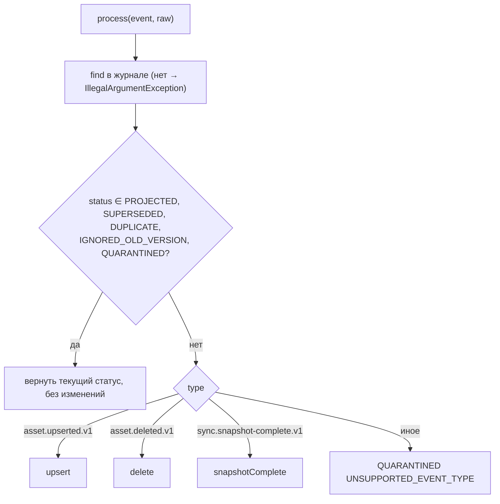
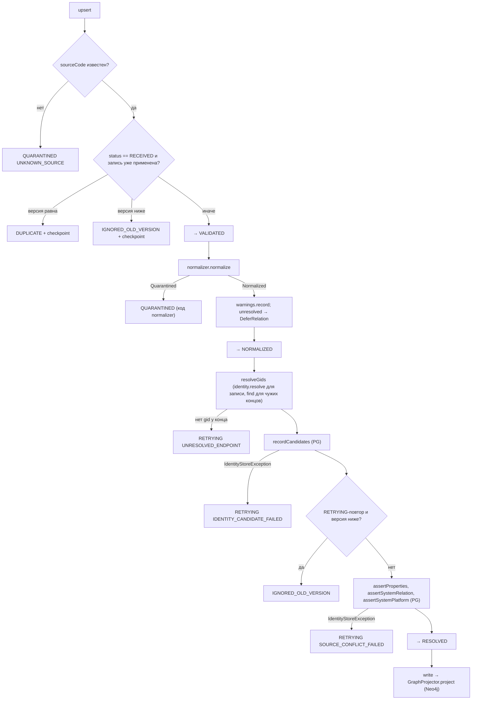
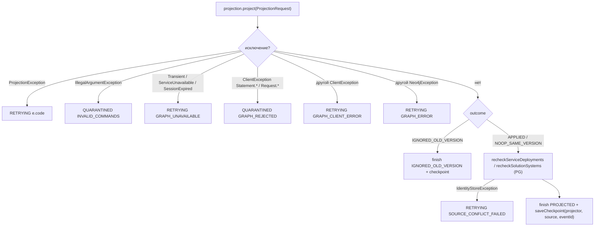
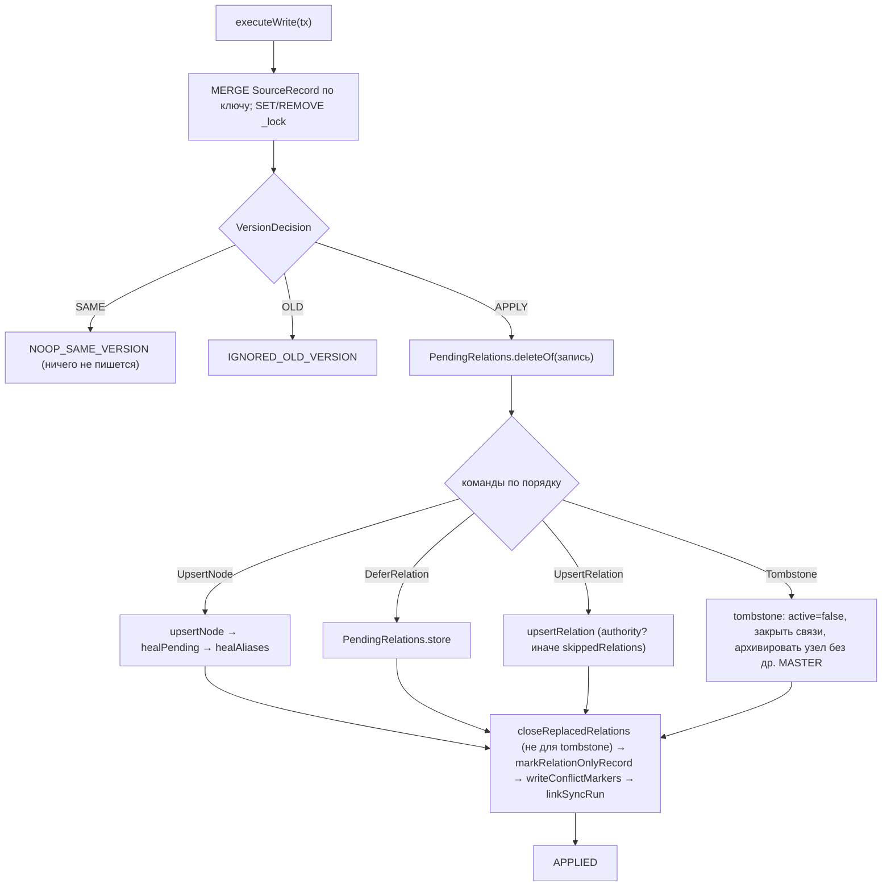
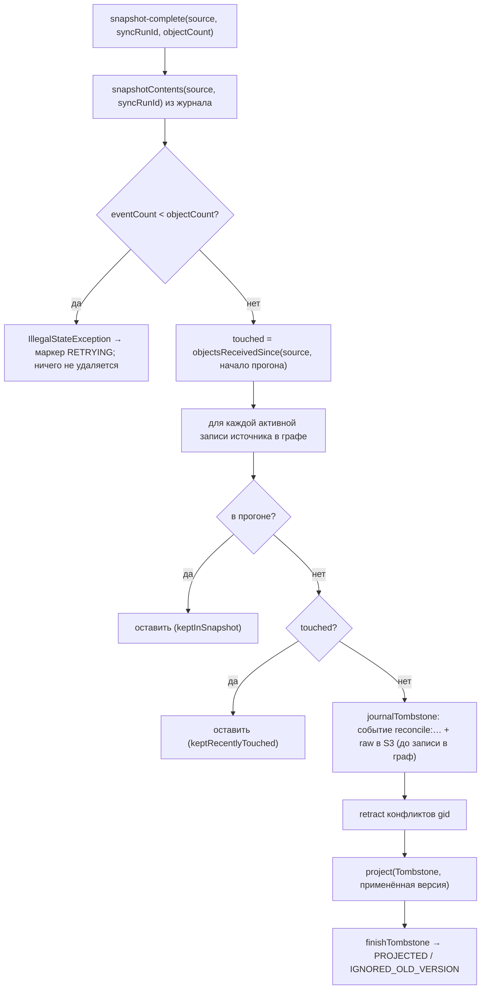
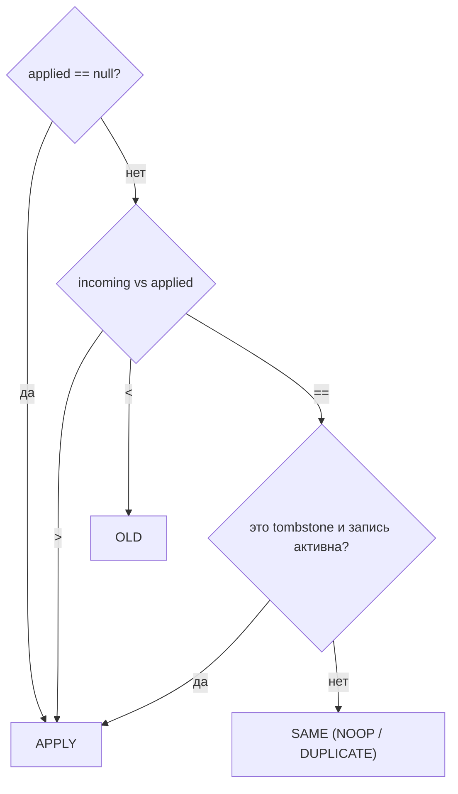

# Блок-схемы: ingestion/graph-projector

> Archaeologist, R.2c. Пути относительно `ingestion/graph-projector/src/main/java/io/github/unlocker/archrag/graphprojector/`. Статусы журнала — `data-dictionary.md` §E.3.

## `EventProcessor.process` (`EventProcessor.java:185-199`) 🟢

## `upsert` (`EventProcessor.java:201-252`) 🟢

## `write` и обработка ошибок (`EventProcessor.java:346-388`) 🟢

## Транзакция проекции `GraphProjector.write` (`GraphProjector.java:302-359`) 🟢

## `Reconciler.reconcile` — missing set (`Reconciler.java:100-144`) 🟢

## Решение по версии (`VersionDecision.java:20-38`) 🟢

