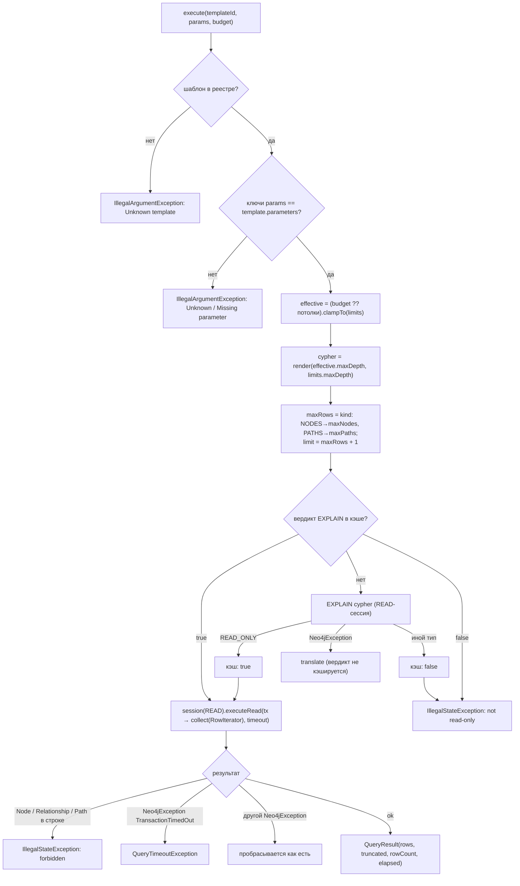
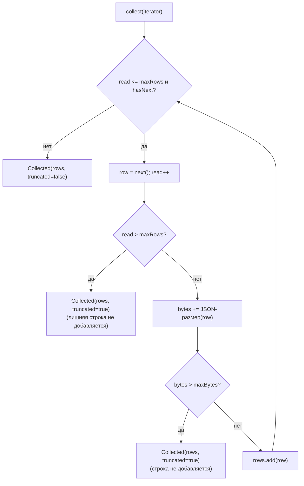
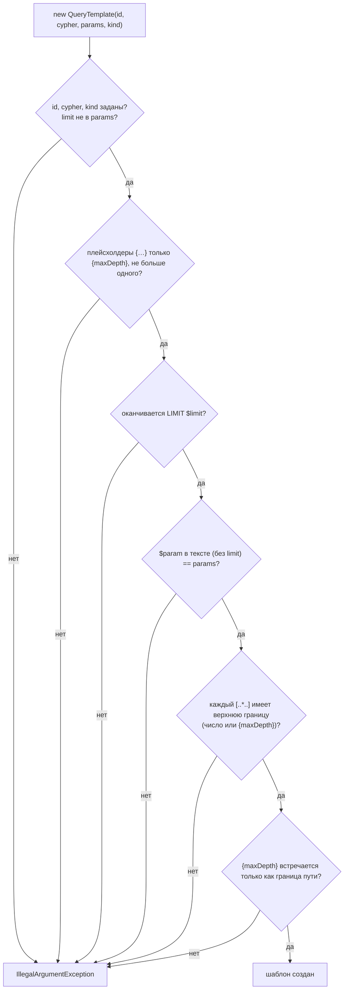

# Блок-схемы: access/graph-query-core

> Archaeologist, R.2d. Пути относительно `access/graph-query-core/src/main/java/io/github/unlocker/archrag/graphquerycore/`. Шаблоны и их параметры — `code-analysis.md` §X1.3.

## `GraphQueryExecutor.execute` (`GraphQueryExecutor.java:60-97`) 🟢

## `BudgetedCollector.collect` (`BudgetedCollector.java:41-58`) 🟢

## Валидация `QueryTemplate` (`QueryTemplate.java:42-105`) 🟢

В реестре дополнительно: `maxLiteralDepth() ≤ limits.maxDepth` и уникальность ID (`QueryTemplateRegistry.java:32-45`). `render` отвергает `depth ∉ 1..ceiling` (`QueryTemplate.java:133-138`).
