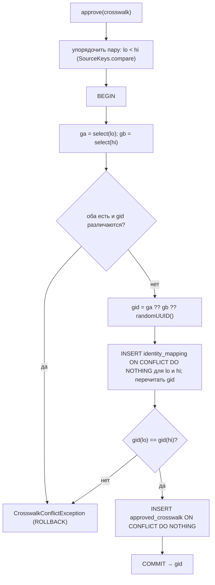
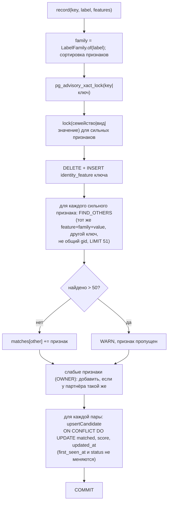
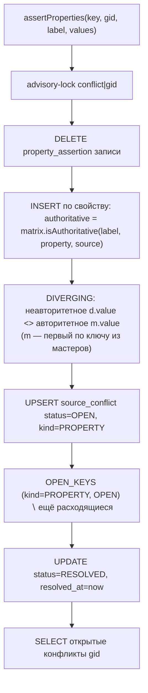
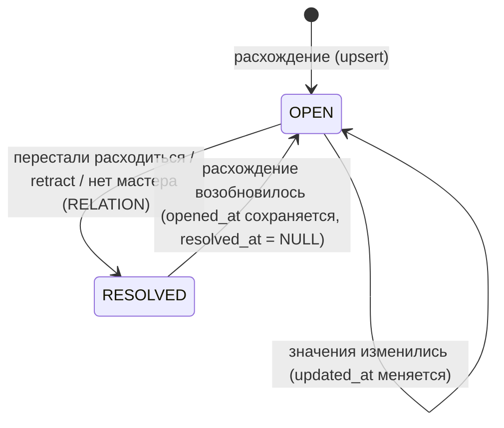

# Блок-схемы: ingestion/identity-resolution

> Archaeologist, R.2c. Пути относительно `ingestion/identity-resolution/src/main/java/io/github/unlocker/archrag/identityresolution/`.

## `approve(Crosswalk)` (`PostgresIdentityMapping.java:80-122`) 🟢

## `IdentityCandidates.record` (`PostgresIdentityCandidates.java:78-102, 190-239`) 🟢

## Пересчёт конфликтов свойств (`PostgresSourceConflicts.java:81-103, 210-271`) 🟢

## Состояния `source_conflict` 🟢

