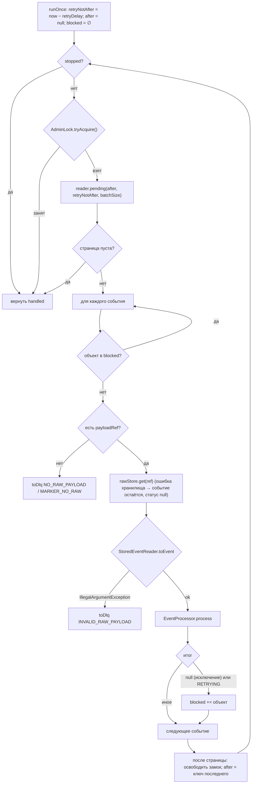
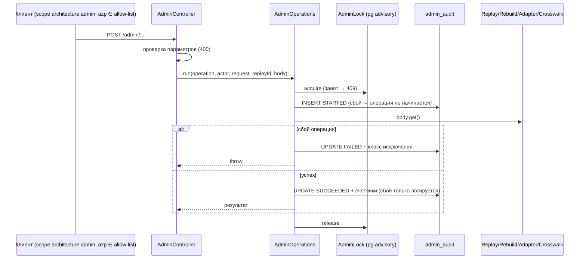
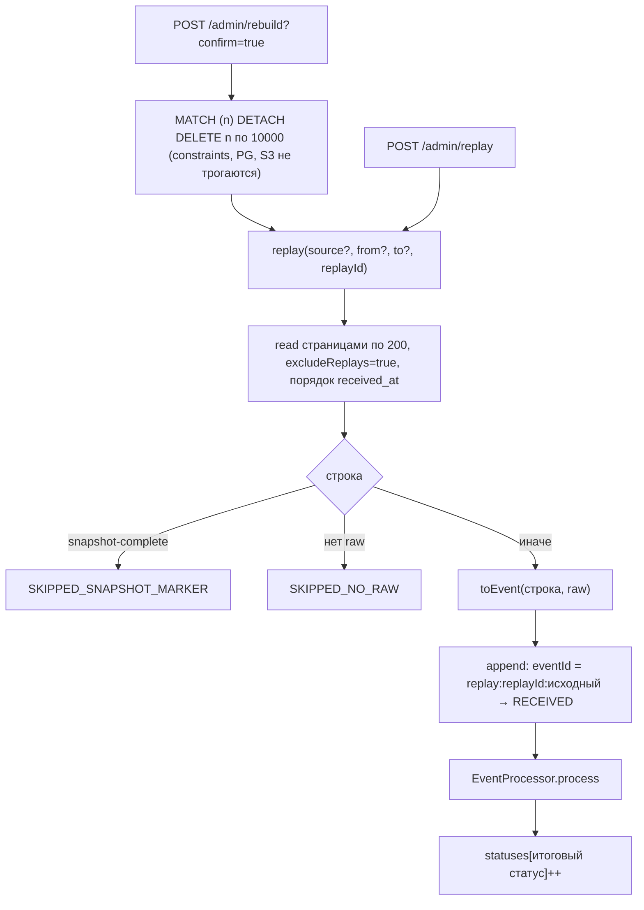
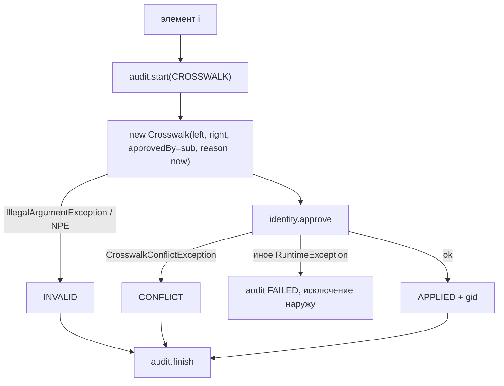

# Блок-схемы: ingestion/ingestion-service

> Archaeologist, R.2c. Пути относительно `ingestion/ingestion-service/src/main/java/io/github/unlocker/archrag/ingestionservice/`.

## Проход диспетчера (`JournalDispatcher.java:94-163`) 🟢

## Админская операция (`AdminOperations.java:38-61`) 🟢

## Replay и Rebuild (`ReplayService.java:63-100`, `RebuildService.java:33-39`) 🟢

## Загрузка crosswalk (`CrosswalkService.java:35-64`) 🟢

## Жизненный цикл `inbox_event` — кто двигает статус 🟢

```mermaid
stateDiagram-v2
  [*] --> RECEIVED: adapter / replay / reconcile → EventJournal.append
  RECEIVED --> DUPLICATE: версия равна применённой (EventProcessor)
  RECEIVED --> IGNORED_OLD_VERSION: версия ниже
  RECEIVED --> VALIDATED
  VALIDATED --> NORMALIZED
  NORMALIZED --> RESOLVED
  RESOLVED --> PROJECTED: Neo4j закоммитил + saveCheckpoint
  VALIDATED --> RETRYING: сбой PG / Neo4j
  NORMALIZED --> RETRYING
  RESOLVED --> RETRYING
  RECEIVED --> QUARANTINED: нет raw / битый raw / ошибка нормализации (DLQ)
  VALIDATED --> QUARANTINED
  RETRYING --> VALIDATED: повтор диспетчером после retry-delay
  RETRYING --> PROJECTED
  RETRYING --> QUARANTINED
  QUARANTINED --> RETRYING: допустим контрактом; вызова нет ни в одном модуле (выход — replay новой строкой)
  PROJECTED --> SUPERSEDED: допустим контрактом; вызова нет ни в одном модуле
```

