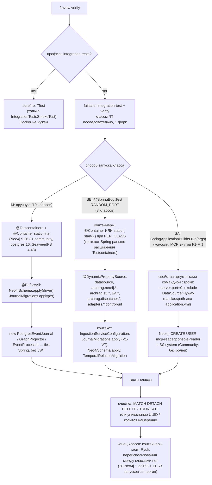
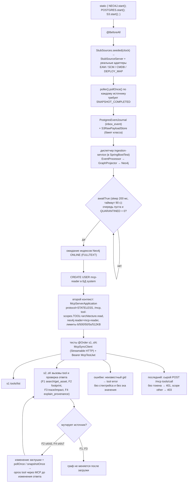
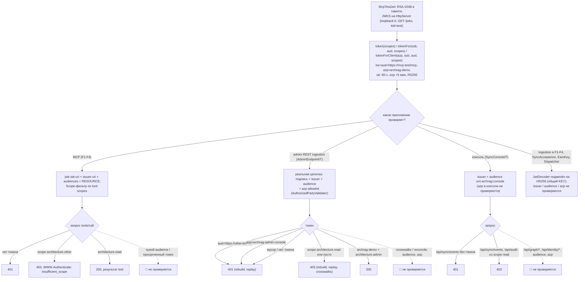
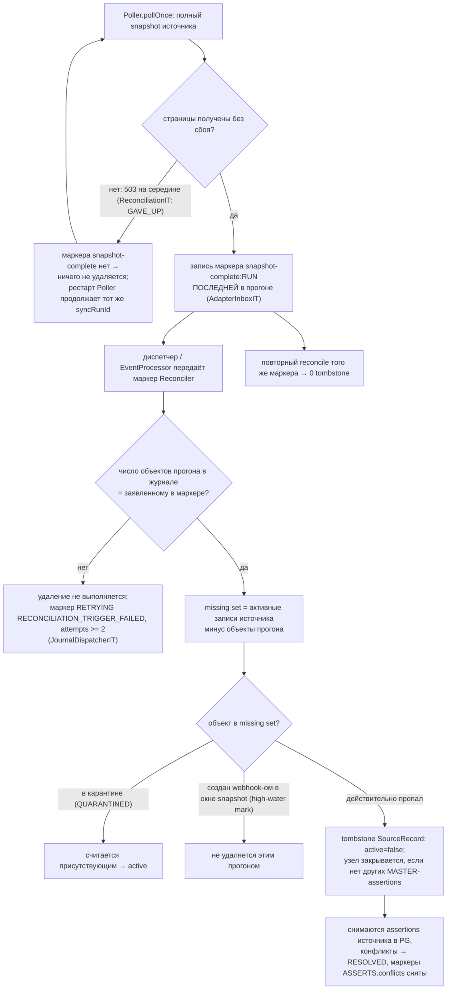
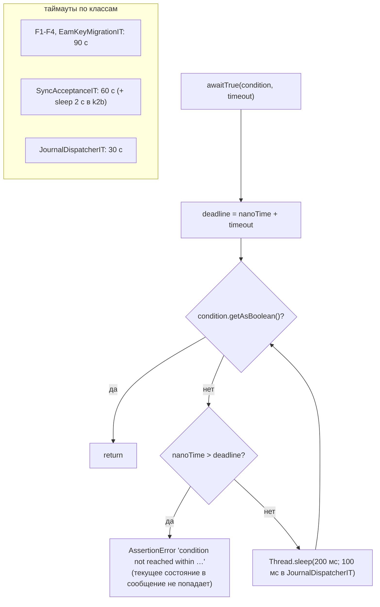

# Блок-схемы: platform/integration-tests

> Archaeologist, R.2e. Пути относительно `platform/integration-tests/src/test/java/io/github/unlocker/archrag/integrationtests/` (`IT/`), если не указано иное. Поведение тестов — `code-analysis.md` §Z1, константы и форматы — `data-dictionary.md` §Z.1. Тесты не запускались: схемы описывают то, что делает код тестов. Метки 🟢 код · 🟡 выведено · 🔴 пробел.

## Запуск и поднятие окружения IT (`pom.xml:136-157`, `.github/workflows/ci.yml:35-55`, `IT/F1AcceptanceIT.java:87-97,141-185`) 🟢

Профиль: обычный `verify` не требует Docker (комментарий `pom.xml:136`); CI запускает job `integration-tests` отдельно от `build` и выгружает `failsafe-reports` при падении. Три класса не вызывают `Neo4jSchema.apply` напрямую (`GraphQueryCoreIT`, `RuntimeFootprintIT` — вообще без схемы; `SB`-классы — через приложение) 🟡.

## Типовая приёмка F1–F4 (`IT/F1AcceptanceIT.java:75-97,141-221,242-358`, критерий 5) 🟢

Один сквозной сценарий с общим состоянием на класс (`@TestInstance(PER_CLASS)`, `@TestMethodOrder(OrderAnnotation)`).

F3 в конце замеряет задержки (s8: холодный impact ≤ 15 с, p95 ≤ 5 с по 10 вызовам — p95 при n=10 равен максимуму, 🟡), F4 перед сценарием связывает два актива через `POST /admin/crosswalks` и подставляет `ScmItSystemMapper` (`@Primary EventProcessor`). `SyncAcceptanceIT` устроен так же, но без MCP: webhook-ами и `POST /admin/reconcile|rebuild` проверяются критерии 2, 3, 4 (`k1…k4`).

## Проверка доступа 401/403 в IT (`IT/McpTestJwt.java:40-88`, `IT/F1AcceptanceIT.java:350-358`, `IT/AdminEndpointIT.java:375-401`, `IT/SyncConsoleIT.java:211-218`) 🟢

`McpTestJwt.exp` фиксирован (+5 мин): просроченный токен получить нельзя; `jwkSetUri()` отдаёт `localhost`, а сервер привязан к `getLoopbackAddress()` (`IT/McpTestJwt.java:45,59`, 🟡).

## Reconcile: удаление только после полного snapshot (`IT/ReconciliationIT.java:161-290`, `IT/JournalDispatcherIT.java:172-240`) 🟢

Негативы «на середине загрузки» закреплены `ReconciliationIT.failureInTheMiddleOfSnapshotDeletesNothingAndRestartCompletesTheSameRun` и `JournalDispatcherIT.markerClaimingMoreObjectsThanJournalHoldsDeletesNothing`; в `SourceConflictIT:295-299` и `ExplainProvenanceIT:241-255` маркер подделан (событие `TYPE_ASSET_UPSERTED` / прямой вызов `Reconciler`) 🟡. Правило закрытия узла «нет активных MASTER-assertions» (`F4AcceptanceIT:432-433`) уже, чем текст ADR 0020 («других активных assertions», `docs/adr/0020-tombstone-instead-of-hard-delete.md:14`) 🟡.

## Ожидание в сквозных тестах: `awaitTrue` и порядок `@Order` (`IT/F1AcceptanceIT.java:413-427`, `IT/SyncAcceptanceIT.java:524-538`, `IT/JournalDispatcherIT.java:282-293`) 🟢

Опрос заменяет Awaitility, который в проект не входит. Порядок методов `@Order` обязателен для `F1–F4`, `SyncAcceptanceIT`, `EamKeyMigrationIT`; в `F2AcceptanceIT` два метода с `@Order(2)` (`:255`, `:360`) 🔴.
