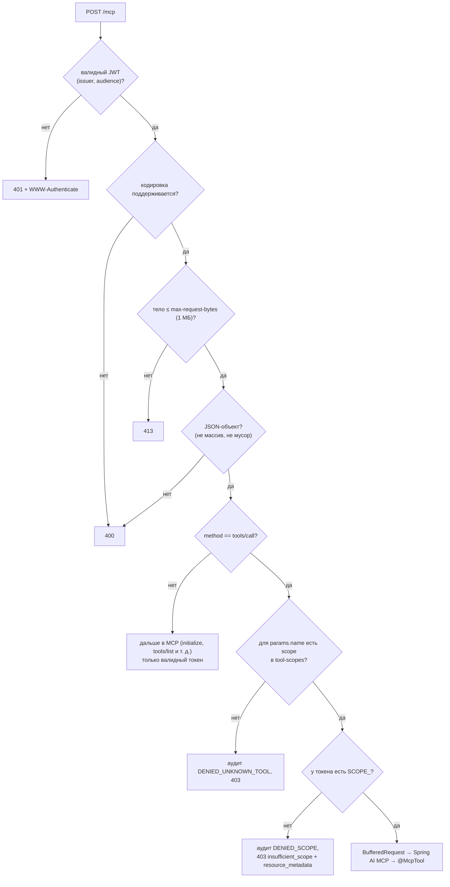
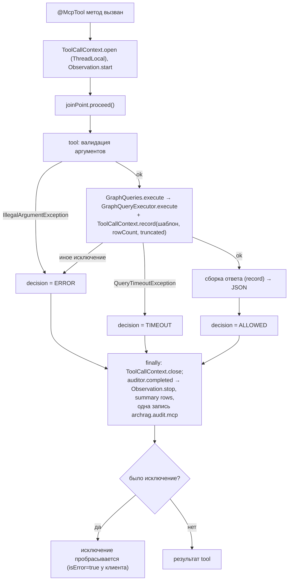
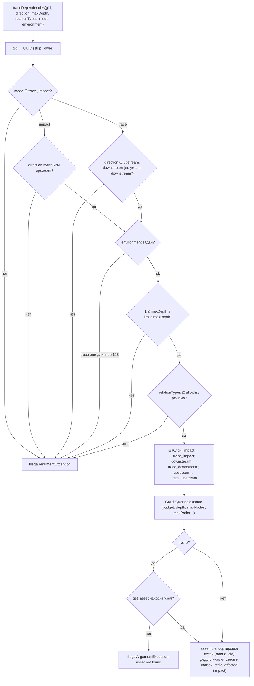
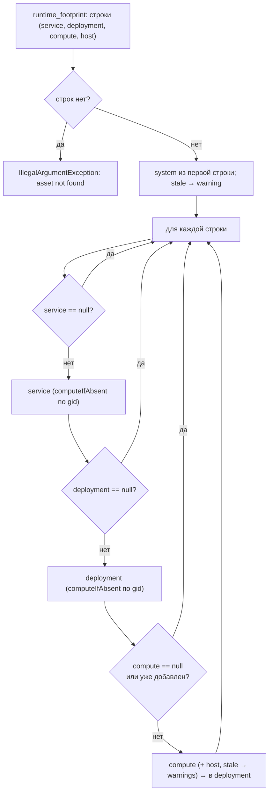
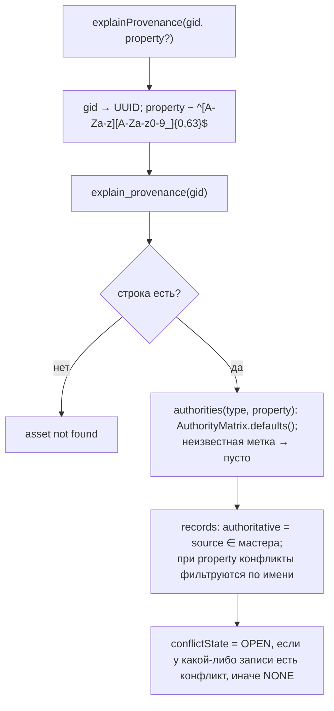

# Блок-схемы: access/mcp-server

> Archaeologist, R.2d. Пути относительно `access/mcp-server/src/main/java/io/github/unlocker/archrag/mcpserver/`. Шаблоны и исполнитель — `flowcharts/graph-query-core.md`. Конфигурация — `code-analysis.md` §X2.4.

## Прохождение `POST /mcp` (`security/McpSecurityConfiguration.java:37-62`, `security/ToolScopeFilter.java:56-98`) 🟢

## Вызов tool под аспектом аудита (`audit/ToolCallAuditAspect.java:29-60`) 🟢

## `trace_dependencies` (`tools/TraceDependenciesTool.java:101-158`) 🟢

## `find_runtime_footprint` — сборка (`tools/FindRuntimeFootprintTool.java:79-150`) 🟢

## `explain_provenance` (`tools/ExplainProvenanceTool.java:55-88`) 🟢

