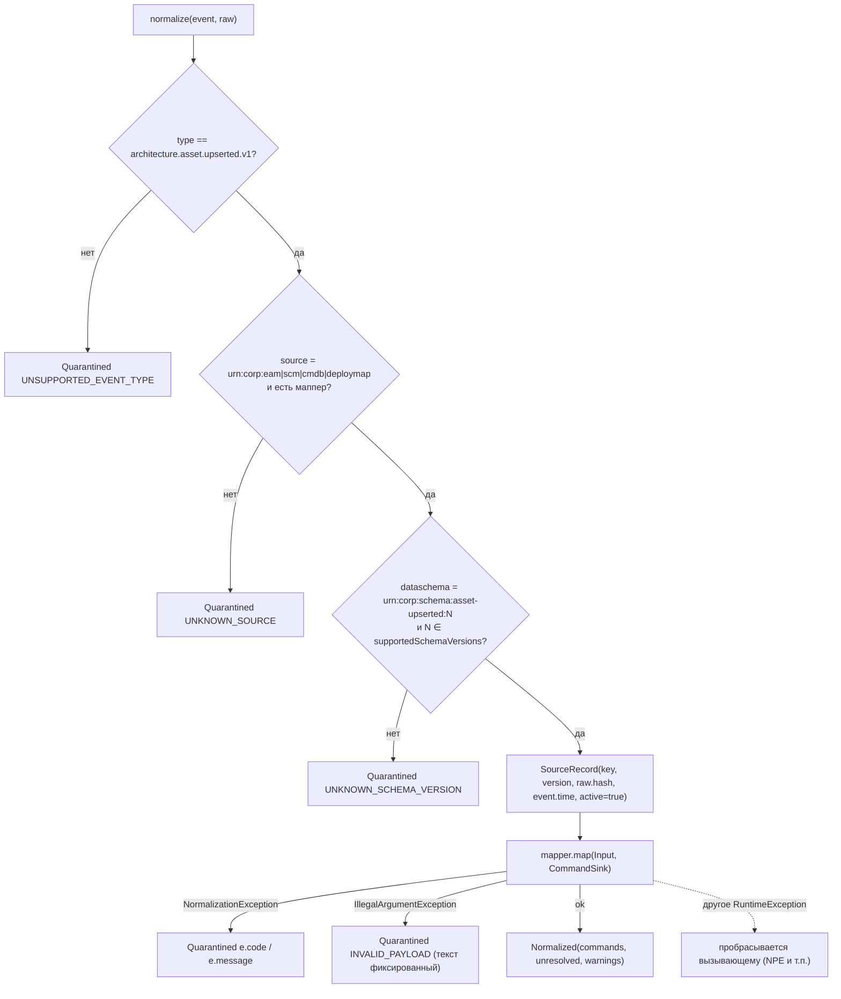
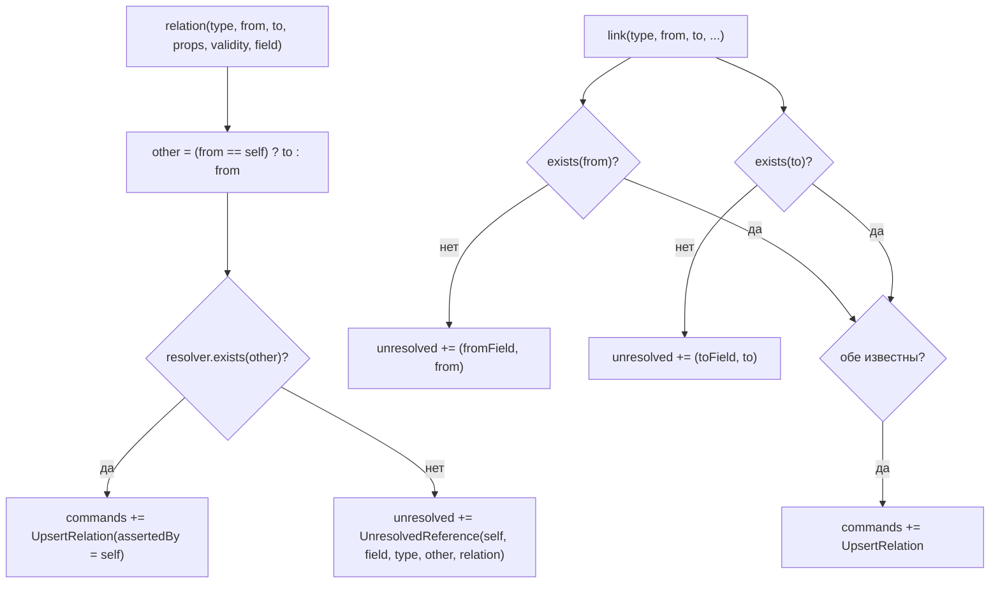
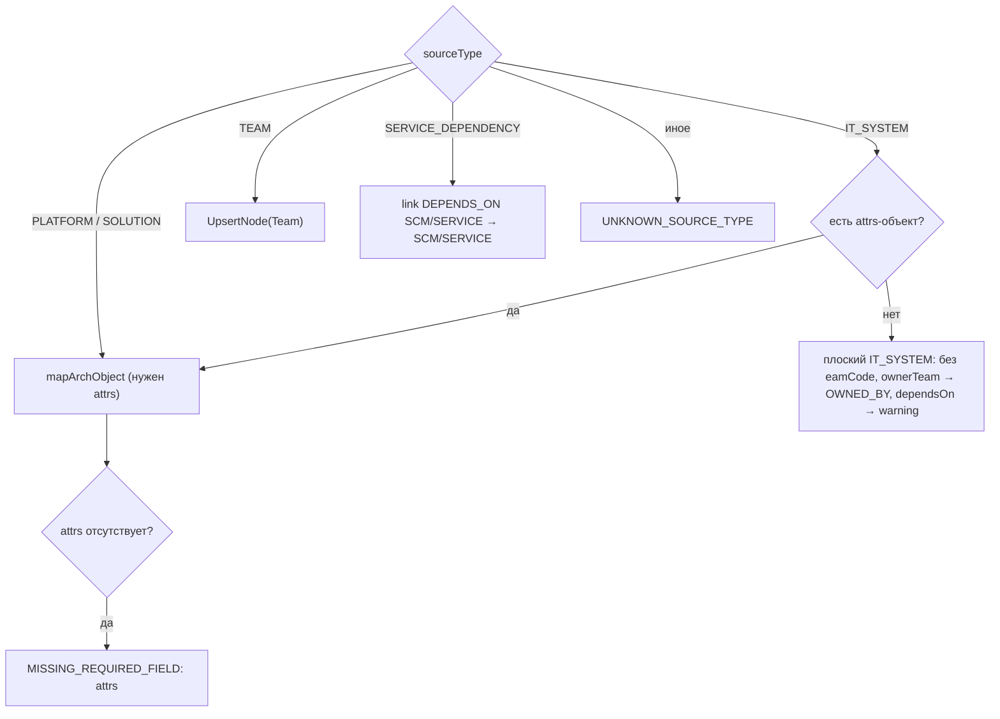
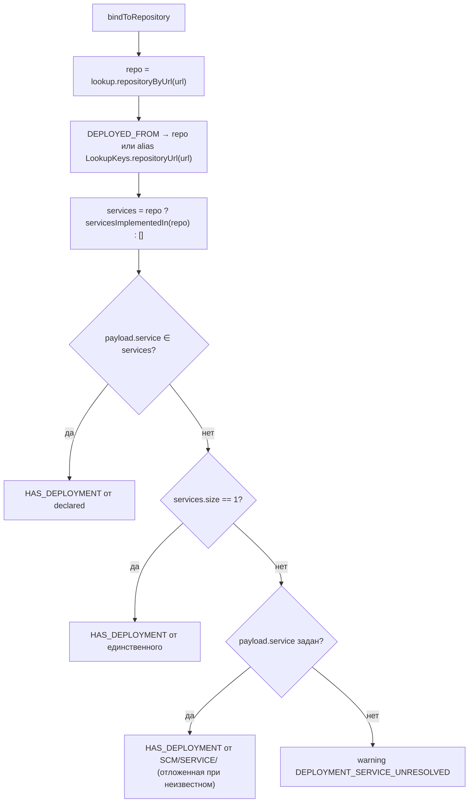

# Блок-схемы: ingestion/normalizer

> Archaeologist, R.2c. Пути относительно `ingestion/normalizer/src/main/java/io/github/unlocker/archrag/normalizer/`.

## `Normalizer.normalize` (`Normalizer.java:54-86`) 🟢

## Добавление связи: `CommandSink.relation` / `link` (`CommandSink.java:53-102`) 🟢

## EAM: выбор формата (`EamMapper.java:66-118`) 🟢

## Deploy map: привязка Deployment к сервису (`DeployMapMapper.java:193-225`, `format = deploymap-poc-1`) 🟢

