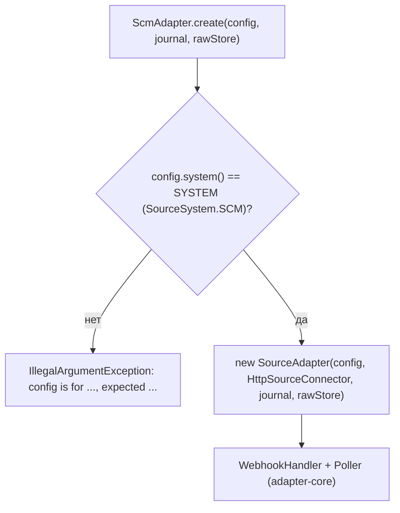

# Блок-схемы: adapters/scm-adapter

> Archaeologist, R.2b. Пути относительно `adapters/scm-adapter/src/main/java/`. Модуль — тонкая привязка (`ScmAdapter.java:15-39`); поток данных после сборки описан в [`adapter-core.md`](adapter-core.md).

## Сборка адаптера (`ScmAdapter.create`, `ScmAdapter.java:32-38`) 🟢

Код источника `scm` → `source` событий `urn:corp:scm` (`SourceSystem.java:5-9`, `EventMapper.java:47-49`). Собственной логики нет.
