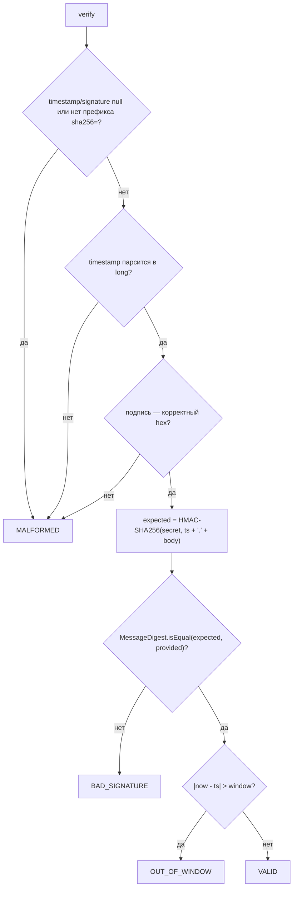
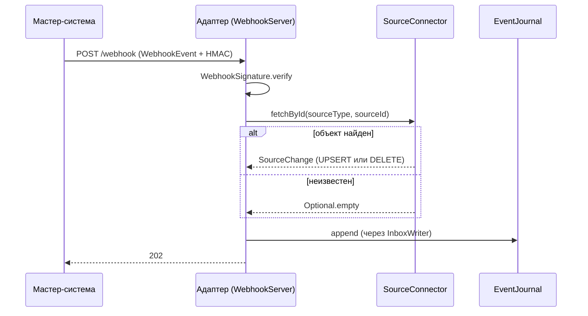
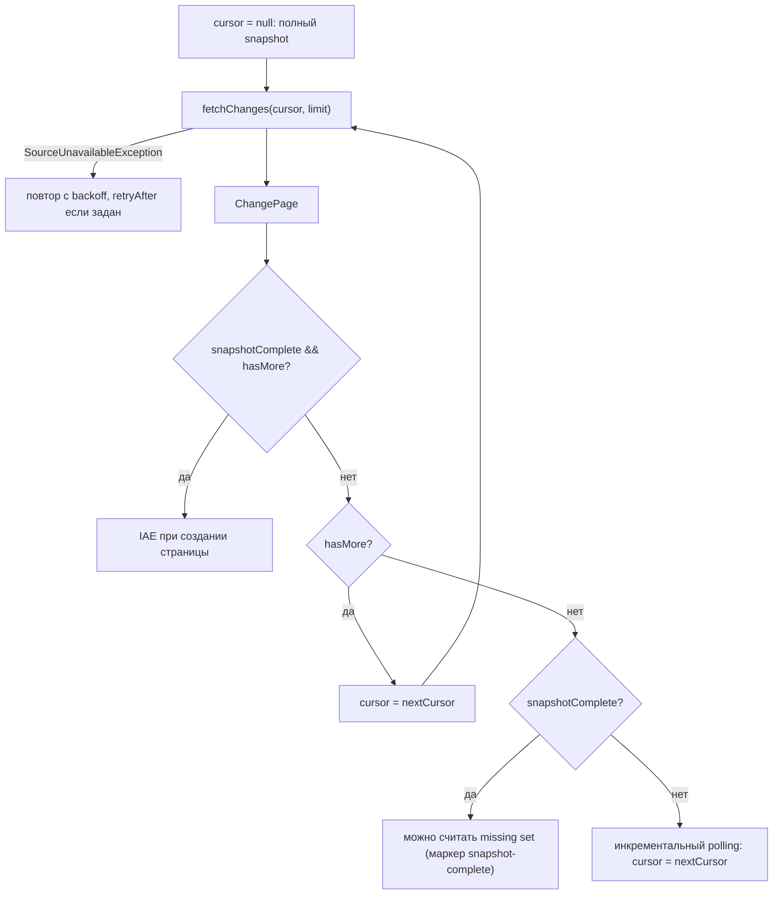

# Блок-схемы: contracts/source-spi

> Archaeologist, R.2a. Пути относительно `contracts/source-spi/src/main/java/io/github/unlocker/archrag/sourcespi/`.

## 1. `WebhookSignature.verify` (`WebhookSignature.java:58-86`) 🟢

Вызывающая сторона (`WebhookHandler`, R.2b) сводит три отказа к одному `401` без тела (`docs/03-interfaces.md`, «Подпись, timestamp, replay window») 🟢.

## 2. Сценарий webhook → follow-up (`SourceConnector.fetchById`, `WebhookEvent.java:6-7`) 🟡

Верхняя часть — контракт SPI 🟢; шаги `InboxWriter`/`202` взяты из `docs/03-interfaces.md` и проверяются в R.2b 🟡.

## 3. Постраничное чтение и полнота snapshot (`SourceConnector.fetchChanges`, `ChangePage.java:17-26`) 🟢

Пустая страница означает «изменений нет», а не «всё удалено» (`SourceConnector.java:8-10`); обработка missing set — только после `snapshotComplete` (ловушка 9) 🟢.
