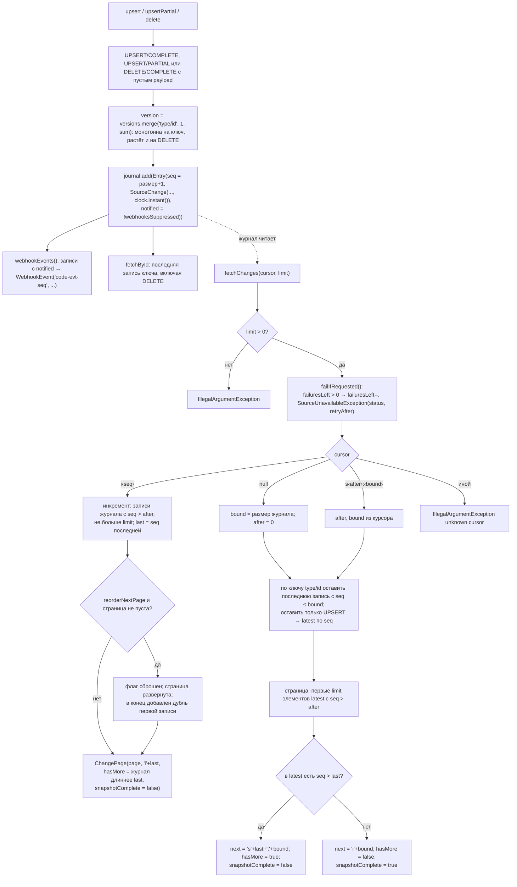
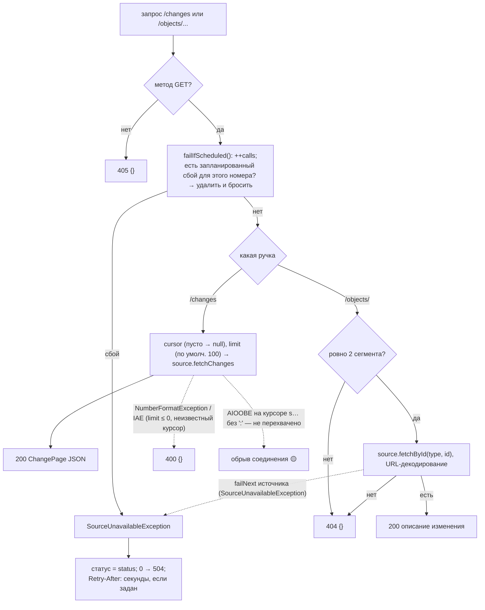
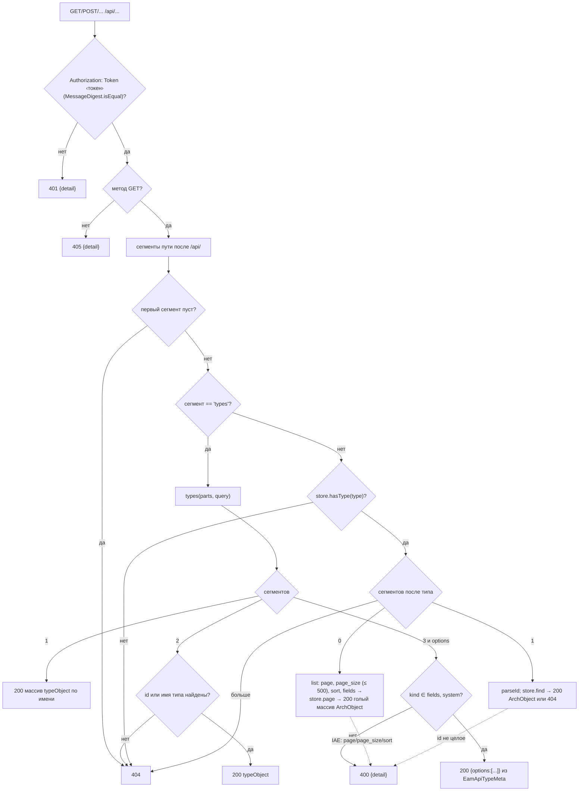
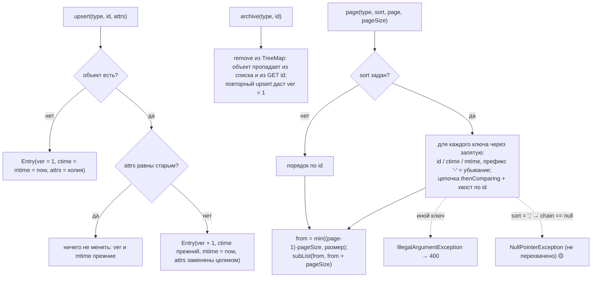
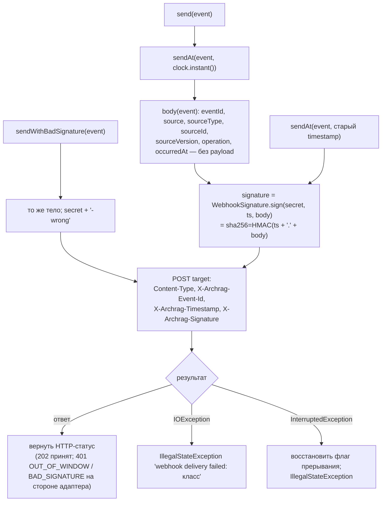

# Блок-схемы: platform/source-stubs

> Archaeologist, R.2e. Пути относительно `platform/source-stubs/src/main/java/io/github/unlocker/archrag/sourcestubs/`. Разбор — `code-analysis.md` §Y1, форматы и эндпоинты — `data-dictionary.md` §Y.1. Форматы deploy map / EAM `ArchObject` — §P7.

## Журнал `StubSource`: запись и `fetchChanges(cursor, limit)` (`StubSource.java:54-70,108-168,182-202`) 🟢

## HTTP-обработка `StubSourceServer.respond` (`StubSourceServer.java:79-134`) 🟢

## Маршрутизация `EamApiStub.route` (`EamApiStub.java:92-156`) 🟢

## `EamApiStore`: upsert, архив, страница (`EamApiStore.java:28-93`) 🟢

## `StubWebhookSender` и проверка на стороне адаптера (`StubWebhookSender.java:40-90`) 🟢

