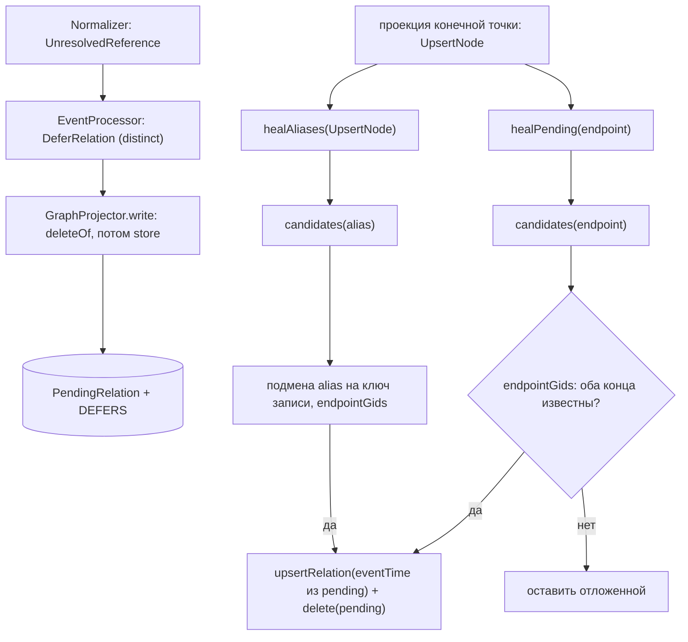

# graph-projector / deferred-relations: дизайн

> Сокращения путей как в [`../requirements.md`](../requirements.md). Требования: [`requirements.md`](requirements.md); модульный дизайн: [`../design.md`](../design.md); формат узла: [`../contracts.md`](../contracts.md) §6.3.

## Интерфейс (пакетно-приватный `PendingRelations`, `GP/PendingRelations.java:32`)

Все методы статические, принимают `TransactionContext`, вызываются только внутри транзакции проекции.

| Метод | Сигнатура | Действие |
|---|---|---|
| `deleteOf` | `(tx, SourceKey key)` | `MATCH (:SourceRecord {…key})-[:DEFERS]->(p:PendingRelation) DETACH DELETE p` (`GP/PendingRelations.java:42-45`) |
| `delete` | `(tx, String key)` | `MATCH (p:PendingRelation {key: $key}) DETACH DELETE p` (`GP/PendingRelations.java:48-50`) |
| `store` | `(tx, SourceKey referrer, String referrerVersion, Instant eventTime, UpsertRelation r)` | `MATCH (r:SourceRecord …) MERGE (p:PendingRelation {key: $key}) SET p += $props MERGE (r)-[:DEFERS]->(p)` (`GP/PendingRelations.java:53-80`) |
| `candidates` | `(tx, SourceKey endpoint)` → `List<Pending>` | см. DR-06 (`GP/PendingRelations.java:86-106`) |
| `endpointGids` | `(tx, UpsertRelation r)` → `Optional<UUID[2]>` | `gid` обоих концов или пусто (`GP/PendingRelations.java:112-134`) |
| `keyOf` | `(UpsertRelation)` → hex SHA-256 | ключ узла (`GP/PendingRelations.java:174-197`) |

`record Pending(String key, UpsertRelation relation, Instant eventTime)` (`GP/PendingRelations.java:39`).

`store` кладёт в `props`: `type`, `fromLabel`, `toLabel` (имена enum), `fromSource/fromType/fromId`, `toSource/toType/toId`, `props` = `PropertyJson.write(r.properties())`, `validFrom`/`validTo` (UTC, если есть `Validity`), `referrerVersion`, `eventTime` (UTC) (`GP/PendingRelations.java:53-72`). Утверждающая запись связи берётся не из узла, а из ребра `DEFERS` (`r.source/sourceType/sourceId` в `candidates`) (`GP/PendingRelations.java:96-98`).

## Поток

### `healPending(tx, endpoint, skipped)` (`GP/GraphProjector.java:361-375`)

Для каждого `Pending` из `candidates(tx, endpoint)`: `endpointGids(tx, pending.relation())`; пусто → `continue`; иначе `upsertRelation(tx, pending.relation(), gids[0], gids[1], pending.eventTime(), skipped)` и `PendingRelations.delete(tx, pending.key())`. Вызывается из ветки `UpsertNode` с `upsert.record().key()` (`GP/GraphProjector.java:331-335`).

### `healAliases(tx, upsert, skipped)` (`GP/GraphProjector.java:377-415`)

`ALIAS_RULES` (`AliasRule(label, source, property, alias-функция)`) 🟢 (`GP/GraphProjector.java:88-95`):

| Метка | Источник | Свойство | Alias |
|---|---|---|---|
| `REPOSITORY` | `SCM` | `url` | `LookupKeys.repositoryUrl(url)` = `SourceKey(SCM, "REPOSITORY_URL", url)` |
| `IT_SYSTEM` | `EAM` | `eamCode` | `LookupKeys.itSystemCode(code)` = `SourceKey(EAM, "IT_SYSTEM_CODE", code)` |

Шаги: пропуск, если `upsert.data().label() ≠ rule.label` или `record.source() ≠ rule.source`; значение — `NodeProperties.of(upsert.data()).get(property)` должно быть `String` (иначе пропуск); `alias = rule.alias.apply(text)`; для каждого `Pending` из `candidates(tx, alias)`, у которого `from` или `to` равен alias: создаётся `UpsertRelation` с подменённым концом (`from.equals(alias) ? record : r.from()`, аналогично `to`) и прежними `type`, метками, `properties`, `validity`, `assertedBy`; `endpointGids` пусто → `continue`; иначе `upsertRelation(…, pending.eventTime(), skipped)` и `delete(pending.key())`. Значение alias берётся из свойств узла **этой же** проекции; если запись свойство не передала (`null` не пишется), достраивать нечего 🟢.

## Зависимости

Граф Neo4j (констрейнт `pending_relation_key`, `GP/schema/Neo4jSchema.java:52-53`), `UpsertRelation`/`DeferRelation`/`LookupKeys`/`Validity` (`contracts/canonical-model`), `UnresolvedReference` (`ingestion/normalizer`). Узлы `SourceRecord`, которые ищет `endpointGids`, должны быть `active: true` и иметь `ASSERTS` на узел нужной корневой метки (`GP/PendingRelations.java:112-134`).

## Решения и ограничения

| Решение | Evidence | Уверенность |
|---|---|---|
| Отложенная связь заменяется целиком при каждой применённой проекции записи, а не обновляется точечно | `GP/GraphProjector.java:327-328` | 🟢 |
| Свойства связи — JSON-строка: Neo4j не хранит map, библиотеку JSON не добавляли | `GP/PendingRelations.java:24-30`, `GP/PropertyJson.java:9-11` | 🟢 |
| Закрытие старых рёбер при отложенном новом конце: `DeferRelation` включается в `kept` пустым множеством для типа | `GP/GraphProjector.java:625-626` (IT `unknownNewHostStillClosesOldRunsOn`) | 🟢 |
| Допущение конкурентности (один писатель); повторной проверки после записи отложенной связи нет | `GP/GraphProjector.java:65-67` | 🟡 (Q-17) |
| Срок годности отложенной связи не ограничен, пока запись активна и версия совпадает | `GP/PendingRelations.java:93` | 🟡 (Q-18) |
| `healPending`/`healAliases` вызываются только из ветки `UpsertNode`; запись «только связь» (без узла) конечной точкой не станет, т.к. не имеет `ASSERTS` | `GP/GraphProjector.java:331-335`, `GP/PendingRelations.java:112-134` | 🟡 |

## Наблюдаемость

Нет логов и метрик на отложенные связи; количество `PendingRelation` видно только запросом к графу (в IT — `pendingCount()`) 🟢.

## Риски и пробелы

🟡 [`../questions.md`](../questions.md) Q-17, Q-18. 🔴: `docs/02-data-model.md:273` объясняет `RETRYING` как «конец связи ещё не пришёл» — после E1.14 это неверно (Q-08). Нет юнит-тестов `PendingRelations` без Docker 🟡.
