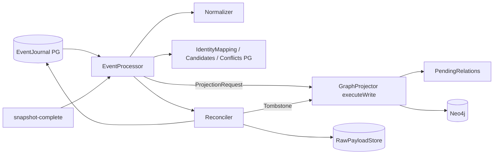

# ingestion/graph-projector: дизайн

> Сокращения путей как в [`requirements.md`](requirements.md): `GP`, `GPT`, `IT`, `CM`, `ES`, `IS`. Use case: [`process-event/`](process-event/design.md), [`project-request/`](project-request/design.md), [`deferred-relations/`](deferred-relations/design.md), [`reconcile-missing-set/`](reconcile-missing-set/design.md). Внешние контракты (форма графа, коды, форматы): [`contracts.md`](contracts.md).

## Интерфейс

Пакет `io.github.unlocker.archrag.graphprojector` (+ `…graphprojector.schema`). Конфигурации через `@ConfigurationProperties` в модуле нет: он создаётся вручную бинами `ingestion-service` 🟢 (`IS/IngestionServiceConfiguration.java:70-72, 85-86, 94-97, 103-112`).

| Символ | Сигнатура | Результат / исключения |
|---|---|---|
| `EventProcessor.process` | `(CanonicalEvent event, RawPayloadRef raw)` | `ProcessingResult(status, errorCode, projection)`; `IllegalArgumentException`, если события нет в журнале (`GP/EventProcessor.java:185-199`) 🟢 |
| `EventProcessor` (конструкторы) | 7/8/9/10 аргументов: `journal, normalizer, identity, projection, reconciliation, candidates, conflicts[, lookup[, eamLookup[, warnings]]]`; короткие подставляют `DeploymentLookup.NONE`, `EamLookup.NONE`, `NormalizationWarnings.NONE` | все зависимости `requireNonNull` (`GP/EventProcessor.java:119-176`) 🟢 |
| `EventProcessor.CONSUMER` | `"projector"` | имя consumer в `consumer_checkpoint` (`GP/EventProcessor.java:84`) 🟢 |
| `EventProcessor.sourceCode` | `static (String urn)` → `SourceSystemCode` или `null` | `urn:corp:{eam\|scm\|cmdb\|deploymap}` (`GP/EventProcessor.java:634-645`) 🟢 |
| `GraphProjection` (порт) | `project`, `applied`, `isActive`, `activeRecords` | единственная реализация — `GraphProjector` (`GP/GraphProjection.java:9-41`) 🟢 |
| `GraphProjector.project` | `(ProjectionRequest)` → `ProjectionResult` | `session.executeWrite(tx -> write(tx, request))`; исключения драйвера наружу (`GP/GraphProjector.java:106-111`) 🟢 |
| `GraphProjector.applied` | `(SourceKey)` → `Optional<AppliedRecord(version, active)>` | только записи с `sourceVersion IS NOT NULL`, `executeRead` (`GP/GraphProjector.java:113-129`) 🟢 |
| `GraphProjector.isActive` | `(SourceKey)` → `boolean` | `count(r) > 0` по `active = true` (`GP/GraphProjector.java:131-144`) 🟢 |
| `GraphProjector.activeRecords` | `(SourceSystemCode)` → `List<ActiveRecord(key, version)>` | все активные записи источника с версией (`GP/GraphProjector.java:146-163`) 🟢 |
| `GraphProjector` как `DeploymentLookup` | `repositoryByUrl`, `itSystemByEamCode`, `servicesImplementedIn`, `eamSystemOfService`, `chartDeploymentsOfService` | чтение активных записей и **открытых** связей (`validTo IS NULL`) (`GP/GraphProjector.java:165-235, 277-300`) 🟢 |
| `GraphProjector` как `EamLookup` | `solutionPlatform`, `systemsOfSolution` | (`GP/GraphProjector.java:237-271`) 🟢 |
| `Reconciler.reconcile` | `(String source, String syncRunId, String eventId, long objectCount)` → `Report(tombstoned, ignoredOldVersion, keptRecentlyTouched, keptInSnapshot)` | `IllegalArgumentException` (источник неизвестен), `IllegalStateException` (прогон неполон) (`GP/Reconciler.java:86-144`) 🟢 |
| `ReconciliationTrigger.snapshotComplete` | `(source, syncRunId, eventId, objectCount)` | `NOOP` по умолчанию; `Reconciler` — реализация (`GP/ReconciliationTrigger.java:8-20`, `GP/Reconciler.java:88-91`) 🟢 |
| `ProjectionRequest` | `(key, version, eventTime, syncRunId, gids, commands, conflicts)` | компактный конструктор проверяет инварианты (`GP/ProjectionRequest.java:37-98`) 🟢 |
| `Neo4jSchema.statements` / `apply` | `List<String>` / `(Driver)` | см. [`contracts.md`](contracts.md) §3 (`GP/schema/Neo4jSchema.java:41-75`) 🟢 |
| `TemporalRelationMigration.migrate` | `(Instant now)` → `long` | число обновлённых связей (`GP/TemporalRelationMigration.java:44-65`) 🟢 |

## Архитектура

Модуль ничего не знает про HTTP, диспетчер и replay: `ingestion-service` вызывает `EventProcessor.process` для строк журнала 🟢 (`IS/JournalDispatcher.java`, цитируется в [`../event-journal/`](../event-journal/design.md)).

## Фазы обработки `upserted`-события

Подробно — [`process-event/design.md`](process-event/design.md). Порядок фиксирован и важен 🟢 (`GP/EventProcessor.java:201-252`):

1. `sourceCode` → `UNKNOWN_SOURCE` (карантин).
2. `decideBeforeWrite` (только для `RECEIVED`): `DUPLICATE`/`IGNORED_OLD_VERSION`.
3. `→ VALIDATED`; `Normalizer.normalize`; `Quarantined` → карантин с кодом нормализатора.
4. `warnings.record`; `UnresolvedReference` → `DeferRelation`; `→ NORMALIZED`.
5. `resolveGids` (PG) → `recordCandidates` (PG) → `ignoreIfOlderOnRetry` → `assertProperties`, `assertSystemRelation`, `assertSystemPlatform` (PG).
6. `→ RESOLVED`; `write` → `GraphProjector.project` (Neo4j) → `recheckServiceDeployments`/`recheckSolutionSystems` (PG) → `finish` (`PROJECTED`/`IGNORED_OLD_VERSION` + checkpoint).

## Фазы транзакции проекции

Подробно — [`project-request/design.md`](project-request/design.md). `GraphProjector.write` 🟢 (`GP/GraphProjector.java:302-359`): блокировка `SourceRecord` → решение по версии → `PendingRelations.deleteOf` → команды по порядку списка → `closeReplacedRelations` (не для tombstone) → `markRelationOnlyRecord` (запись без узла) → `writeConflictMarkers` → `linkSyncRun`.

## Зависит от / Связанные спецификации

Из [`_reversa_sdd/traceability/spec-impact-matrix.md`](../traceability/spec-impact-matrix.md) (§1 строка `ingestion/graph-projector` и строки, где модуль стоит среди затрагиваемых; §2 связи вне `pom.xml`).

**Прямые зависимости `pom.xml`** 🟢 (`ingestion/graph-projector/pom.xml:17-39`): `canonical-model` ([`../canonical-model/`](../canonical-model/design.md)), `event-schemas` ([`../event-schemas/`](../event-schemas/design.md)), `normalizer` ([`../normalizer/`](../normalizer/design.md)), `identity-resolution` ([`../identity-resolution/`](../identity-resolution/design.md)), `neo4j-java-driver`. `event-journal` в `pom.xml` **нет**: модуль работает с журналом только через порт `EventJournal` из `event-schemas` 🟢. Зависимость от `access/*` и `adapters/*` отсутствует (направление зависимостей из `CLAUDE.md` соблюдено).

| Связь (матрица) | Что значит для модуля | Источник |
|---|---|---|
| §1 строка `ingestion/graph-projector`: прямо затрагивает `ingestion-service` | `ingestion-service` строит `GraphProjector`, `EventProcessor`, `Reconciler`, применяет `Neo4jSchema` и `TemporalRelationMigration` (`IS/IngestionServiceConfiguration.java:70-72, 85-112`); изменение сигнатур конструкторов ломает сборку сервиса | матрица §1 🟢 |
| §1 то же, через данные: **схема Neo4j** | имена свойств и индексов (`isCurrent`, `deletedAt`, `active`, `validTo`, `assertedBy*`, индекс `asset_text`) читают шаблоны `graph-query-core`; контракт — [`contracts.md`](contracts.md) §1–§3. Проверки: `GraphProjectorIT`, `GraphQueryCoreIT` | матрица §1, §2 № 4 🟡 |
| §1 строка `canonical-model` | `NodeLabel`, `RelationType` (`temporal`, `identityProperties`), `GraphCommand`, `AuthorityMatrix`, `SourceRecord`: новая метка/тип связи требует пересмотра `Neo4jSchema` (constraint порождается из `NodeLabel.canonical()`) и `closeReplacedRelations`; проверки `Neo4jSchemaTest` | матрица §1, §3 «Новая метка» 🟢 |
| §1 строка `event-schemas` | `ProcessingStatus`, `CanonicalEvent`, `EventJournal`, `SourceVersion`: новый статус затрагивает `FINISHED`/`finish` | матрица §1, §3 «Новый статус» 🟢 |
| §1 строки `normalizer`, `identity-resolution` | входные `NormalizationResult`/`DeploymentLookup` и порты PG: изменение — прямо затрагивает модуль | матрица §1 🟢 |
| §1 строка `adapters/adapter-core` (через данные) | формат raw и типы событий `deleted`/`snapshot-complete`; `Reconciler` собирает raw DELETE вручную | матрица §1, §2 № 1, № 7 |
| §2 № 1 | литералы `architecture.asset.deleted.v1`, `architecture.sync.snapshot-complete.v1` продублированы (`GP/EventProcessor.java:92-93`), общего источника и теста имён нет | 🔴 → [`questions.md`](questions.md) Q-06 |
| §2 № 2 | таблица кодов источников — третья копия `sourceCode` (`GP/EventProcessor.java:634-645`), её же использует `Reconciler` (`GP/Reconciler.java:101`) | 🔴 → Q-06 |
| §2 № 3 | регистр источника: в графе `SourceRecord.source` и `SyncRun.adapter` — `SourceSystemCode.name()` в верхнем регистре (`GP/GraphProjector.java:698, 713-716`), в журнале — URN, в консоли — нижний | 🔴 → Q-06 |
| §2 № 4 | индекс `asset_text` создаёт модуль (`GP/schema/Neo4jSchema.java:57-58`), читает `AssetTemplates.java:52` | 🟡 → [`contracts.md`](contracts.md) §3 |
| §2 № 7 | tombstone-событие `Reconciler` собирается как raw JSON вручную (`GP/Reconciler.java:196-201`), формат читает replay (`IS/StoredEventReader`); совпадение с `InboxWriter.rawJson` — только по комментарию | 🟡 → Q-07 |
| §2 № 12 | `AuthorityMatrix.defaults()` создаётся отдельно для `GraphProjector` и `SourceConflicts` (`IS/IngestionServiceConfiguration.java:64, 86`) | 🟢 |

Соседние спецификации и их 🔴, с которыми согласован модуль (подробно — [`questions.md`](questions.md) §«Сквозные»):
[`../identity-resolution/questions.md`](../identity-resolution/questions.md) Q-03 (approve не обновляет граф до replay), [`../event-journal/questions.md`](../event-journal/questions.md) R-2/R-3/R-4 (выход из `QUARANTINED`, `SUPERSEDED`, лимит попыток), [`../canonical-model/questions.md`](../canonical-model/questions.md) Q-1 (`SyncRun` остаётся `RUNNING`) и Q-3 (`CloseAssertion`), [`../normalizer/questions.md`](../normalizer/questions.md) Q-03 (закрытие связей).

## Поток данных и порядок побочных эффектов

| Шаг | Хранилище | Внутри `executeWrite`? | Evidence |
|---|---|---|---|
| `identity.resolve/find` | PostgreSQL | нет | `GP/EventProcessor.java:569-601` 🟢 |
| `candidates.record/forget` | PostgreSQL | нет | `GP/EventProcessor.java:231-236, 270-274` 🟢 |
| `conflicts.assertProperties/assertRelation/retract` | PostgreSQL | нет | `GP/EventProcessor.java:241-249, 279-284` 🟢 |
| `projection.project` | Neo4j | да (единственная транзакция) | `GP/GraphProjector.java:106-111` 🟢 |
| `recheck*` | PostgreSQL + чтение Neo4j | нет (после коммита) | `GP/EventProcessor.java:374-382` 🟢 |
| `journal.transition`, `saveCheckpoint` | PostgreSQL | нет | `GP/EventProcessor.java:603-627` 🟢 |
| `rawStore.put`, `journal.append` (tombstone) | S3, PostgreSQL | нет (до `project`) | `GP/Reconciler.java:170-171` 🟢 |

## Решения дизайна

| Решение | Evidence | Уверенность |
|---|---|---|
| Версия — решатель идемпотентности; `contentHash` в решении не участвует | `GP/VersionDecision.java:20-38` | 🟢 |
| Блокировка записи фиктивным `SET r._lock = true REMOVE r._lock` до чтения версии | `GP/GraphProjector.java:304-310` | 🟢 |
| `MERGE` узла по **корневой** метке и `gid`, подтип — `SET n:<Label>`, прочие подтипы корня снимаются | `GP/GraphProjector.java:442-457, 737-745` | 🟢 |
| Связи с идентичностью (`DEPLOYED_FROM {commit}`) — свойства входят в шаблон `MERGE` ребра | `GP/GraphProjector.java:580-589, 649-660`; `CM/relation/RelationType.java` (`DEPLOYED_FROM … Set.of("commit")`) | 🟢 |
| Отложенные связи — узлы `PendingRelation`, свойства связи JSON-строкой (Neo4j не хранит map; JSON-библиотеку не добавляли) | `GP/PendingRelations.java:24-30`, `GP/PropertyJson.java:9-11` | 🟢 |
| Tombstone `Reconciler` идёт через журнал и S3, а не прямой записью в граф | `GP/Reconciler.java:45-48, 156-182` | 🟢 |
| Канонический узел создаётся и неавторитетным источником (`ON CREATE SET n.isCurrent = true`) — «пустой» узел | `GP/GraphProjector.java:454` | 🟡 → Q-09 |
| `snapshot-complete` проходит все статусы до `RESOLVED` без проверок и без записи в граф | `GP/EventProcessor.java:289-300` | 🟢 |

## Состояние

Модуль состояния в памяти не держит (все поля `final`); состояние — в Neo4j (запись, версия, `active`, `PendingRelation`), PostgreSQL (журнал, checkpoint, `gid`, утверждения, кандидаты) и S3 (raw tombstone) 🟢. `GraphProjector` потокобезопасен постольку, поскольку драйвер и сессия на операцию потокобезопасны; конкурентная запись одного ключа сериализуется блокировкой записи в Neo4j 🟡 (`GP/GraphProjector.java:304-310`).

## Наблюдаемость

Прямых метрик в модуле нет. Единственное логирование — `System.Logger` WARNING «service has {0} EAM systems; system conflict check skipped» (только число, без значений) 🟢 (`GP/GraphProjector.java:83, 229-232`). Предупреждения нормализации уходят в порт `NormalizationWarnings` (метрики — в `ingestion-service`, `metrics::recordWarnings`) 🟢 (`GP/EventProcessor.java:218-220`, `IS/IngestionServiceConfiguration.java:111`). Коды ошибок и причины — в строке журнала (`errorCode`, `errorReason`), см. [`contracts.md`](contracts.md) §4.

## Риски и пробелы

См. [`questions.md`](questions.md): 🔴 Q-01…Q-06 и Q-08, 🟡 Q-07 и Q-09…Q-19.
