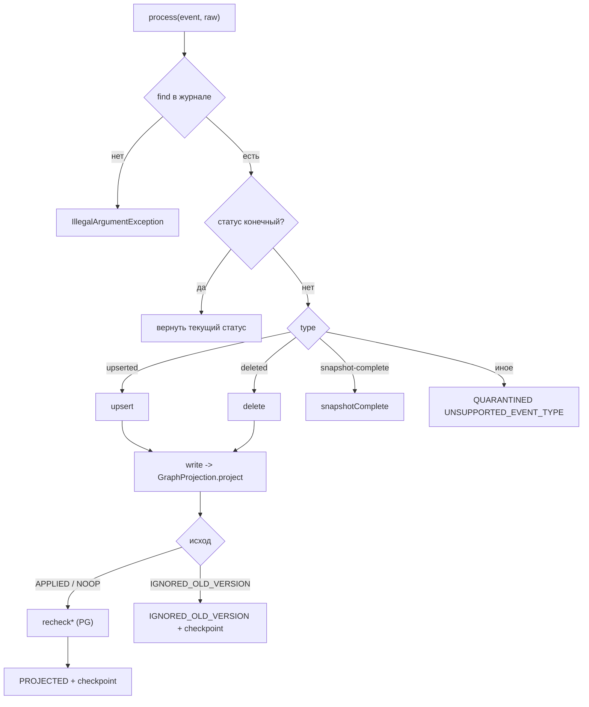

# graph-projector / process-event: дизайн

> Сокращения путей как в [`../requirements.md`](../requirements.md). Требования сценария: [`requirements.md`](requirements.md); модульный дизайн (зависимости, порядок побочных эффектов): [`../design.md`](../design.md); контракты (коды, checkpoint): [`../contracts.md`](../contracts.md).

## Интерфейс

`ProcessingResult process(CanonicalEvent event, RawPayloadRef raw)` — публичный вход (`GP/EventProcessor.java:185`). `raw` нужен нормализатору (его hash попадает в `SourceRecord.contentHash`); для `delete` и маркера не используется 🟢 (`GP/EventProcessor.java:181, 195-196`).

`ProcessingResult(status, errorCode, projection)`: `status` — статус строки журнала после обработки; `errorCode` — для `QUARANTINED`/`RETRYING`; `projection` — результат проектора или `null` 🟢 (`GP/ProcessingResult.java:6-18`).

## Диаграмма

Подробные блок-схемы `upsert`, `write` — [`../../flowcharts/graph-projector.md`](../../flowcharts/graph-projector.md).

## Основной поток `upsert` (по шагам)

1. `sourceCode(event.source())`: `null` → `quarantine(UNKNOWN_SOURCE, "event source is not known")` (`GP/EventProcessor.java:202-205`).
2. `key = SourceKey(source, data.sourceType, data.sourceId)` (`GP/EventProcessor.java:207`).
3. `decideBeforeWrite(…, tombstone=false)`: если статус ≠ `RECEIVED` — пропуск; иначе `projection.applied(key)`; пусто → пропуск; `VersionDecision.forUpsert(incoming, applied.version)` → `APPLY` (пропуск) / `SAME` (`finish DUPLICATE`) / `OLD` (`finish IGNORED_OLD_VERSION`) (`GP/EventProcessor.java:303-322`).
4. `advance(VALIDATED)`; `normalizer.normalize(event, raw)`; `NormalizationResult.Quarantined(errorCode, reason)` → `quarantine` (`GP/EventProcessor.java:212-216`).
5. `Normalized`: `warnings.record(source, codes)` только при непустом списке; `commands = result.commands()` + `DeferRelation(rel)` на каждую различную `unresolved().relation()`; `advance(NORMALIZED)` (`GP/EventProcessor.java:217-224`).
6. `resolveGids(key, commands)` — `LinkedHashMap`: первым `key → identity.resolve(key)`; затем для каждого конца `UpsertRelation` (`from`, `to`), не совпадающего с уже имеющимся, — `identity.find(endpoint)`; пусто → `ProjectionException(UNRESOLVED_ENDPOINT, "relation endpoint has no gid")` → `retry` (`GP/EventProcessor.java:225-230, 569-601`). Ветки `DeferRelation`, `UpsertNode`, `TombstoneSourceRecord` `gid` не требуют (исчерпывающий `switch` по sealed-интерфейсу).
7. `recordCandidates`: `FeatureExtractor.labelOf(key, commands)` → если метка есть, `candidates.record(key, label, FeatureExtractor.extract(key, commands, Map.copyOf(gids)))`; карта `gids` только читается. `IdentityStoreException` → `retry(IDENTITY_CANDIDATE_FAILED, "identity candidate store failed")` (`GP/EventProcessor.java:231-236, 394-397`). Правила matching — [`../../identity-resolution/candidate-matching/requirements.md`](../../identity-resolution/candidate-matching/requirements.md).
8. `ignoreIfOlderOnRetry(…, false)`: для статуса ≠ `RECEIVED` повторно сверяет версию; `OLD` → `finish IGNORED_OLD_VERSION` (`GP/EventProcessor.java:237-240, 329-344`).
9. Конфликты (PG, вне Neo4j) — [`../../identity-resolution/source-conflicts/requirements.md`](../../identity-resolution/source-conflicts/requirements.md):
   - `assertProperties`: для **первого** `UpsertNode` команд: `NodeProperties.of(data)` → `Map<String,String>` (`String.valueOf`), `conflicts.assertProperties(key, gid, label, values)` → `ConflictMarkers.of(gid, openConflicts)`; без `UpsertNode` — `ConflictMarkers.none()` (`GP/EventProcessor.java:403-413`).
   - `assertSystemRelation` (только `source == DEPLOYMAP` и `UpsertNode` с `Deployment`): `master` = система EAM сервиса SCM, найденного по `UpsertRelation HAS_DEPLOYMENT` этого события (`to == key`, `from.source == SCM`, `from.sourceType == "SERVICE"`) через `lookup.eamSystemOfService`, только если `deployment.eamSystemId != null`; `chartValue` = `String.valueOf(eamSystemId)` или `""`; результат `conflicts.assertRelation(key, gid, "eamSystemId", chartValue, master, masterId-или-"")` заменяет `markers` полным набором `gid` (`GP/EventProcessor.java:422-453`).
   - `assertSystemPlatform` (только `source == EAM`, `sourceType == "IT_SYSTEM"`, `UpsertNode` с `ITSystem`): решение системы — из `USES_SOLUTION` команд (`UpsertRelation` либо `DeferRelation`, `from == key`) → `eamLookup.solutionPlatform`, с `platformId != null`; `master` пуст, если у системы нет `platformId`; `conflicts.assertRelation(key, gid, "platformId", …)` (`GP/EventProcessor.java:494-527`).
   - `IdentityStoreException` в любом → `retry(SOURCE_CONFLICT_FAILED, "source conflict store failed")` (`GP/EventProcessor.java:241-249`).
10. `advance(RESOLVED)`; `write(…)` (`GP/EventProcessor.java:250-251`).

### `write` и перепроверки

`projection.project(new ProjectionRequest(key, data.sourceVersion, event.time(), entry.syncRunId(), gids, commands, markers))` (`GP/EventProcessor.java:355-358`). Исключения → статус:

| Исключение | Исход | Код |
|---|---|---|
| `ProjectionException` | `RETRYING` | `e.code()` |
| `IllegalArgumentException` | `QUARANTINED` | `INVALID_COMMANDS` («commands violate projection invariants») |
| `TransientException`, `ServiceUnavailableException`, `SessionExpiredException` | `RETRYING` | `GRAPH_UNAVAILABLE`, причина `getClass().getSimpleName()` |
| `ClientException`, код начинается с `Neo.ClientError.Statement.` или `Neo.ClientError.Request.` | `QUARANTINED` | `GRAPH_REJECTED`, причина — код Neo4j |
| прочие `ClientException` | `RETRYING` | `GRAPH_CLIENT_ERROR`, причина — код Neo4j |
| прочие `Neo4jException` | `RETRYING` | `GRAPH_ERROR`, причина — имя класса |

(`GP/EventProcessor.java:359-373`.) Порядок `catch` важен: `TransientException` и подклассы `ClientException`/`Neo4jException` ловятся от частного к общему. Остальные `RuntimeException` не ловятся.

Если исход не `IGNORED_OLD_VERSION`: `recheckServiceDeployments(key, commands)` и `recheckSolutionSystems(key, commands)` (оба в PG, `IdentityStoreException` → `retry(SOURCE_CONFLICT_FAILED)`: граф уже записан, повтор даст `NOOP`) (`GP/EventProcessor.java:374-382`):

- `recheckServiceDeployments`: только для SCM-`SERVICE` без tombstone; для каждого `lookup.chartDeploymentsOfService(key)` с известным `gid` — `conflicts.assertRelation(deployment.key, gid, "eamSystemId", eamSystemId, master, …)`; маркеры `ASSERTS` развёртываний не пишутся (`GP/EventProcessor.java:461-484`).
- `recheckSolutionSystems`: только для EAM-`SOLUTION` без tombstone; `platformId` решения — из `UpsertNode Solution` события, иначе из графа (`null` источника не затирает известное); для каждой `eamLookup.systemsOfSolution(key)` с `gid` — `assertRelation(system, gid, "platformId", …)`; маркеры не пишутся (ограничение 1 ADR [0030](../../../docs/adr/0030-deployment-system-conflict.md)/[0031](../../../docs/adr/0031-it-system-platform-invariant.md)) (`GP/EventProcessor.java:529-561`).

Итог: `finish(event, PROJECTED | IGNORED_OLD_VERSION, result)` (`GP/EventProcessor.java:383-387`).

## Поток `delete`

`sourceCode` → `UNKNOWN_SOURCE`; `dataschema` ≠ `SCHEMA_ASSET_DELETED` → `UNKNOWN_SCHEMA_VERSION`; `decideBeforeWrite(…, tombstone=true)` (`forTombstone`: равная версия применяется к активной записи); `→VALIDATED`, `→NORMALIZED` (без нормализатора); `candidates.forget(key)` (сбой → `IDENTITY_CANDIDATE_FAILED`); `ignoreIfOlderOnRetry(…, true)`; `retractProperties(key)`: `identity.find(key)` → `ConflictMarkers.of(gid, conflicts.retract(key, gid))`, без `gid` — `none()`; `→RESOLVED`; `write(…, List.of(new TombstoneSourceRecord(key, event.time())), Map.of(), markers)` (`GP/EventProcessor.java:254-287, 563-566`).

## Поток `snapshot-complete`

`→VALIDATED→NORMALIZED→RESOLVED`; `reconciliation.snapshotComplete(event.source(), event.data().sourceId(), event.id(), objectCount(event))`; `RuntimeException e` → `retry(RECONCILIATION_TRIGGER_FAILED, e.getClass().getSimpleName())`; иначе `finish(PROJECTED, null)` (`GP/EventProcessor.java:289-300`). Идемпотентность и работа `Reconciler` — [`../reconcile-missing-set/design.md`](../reconcile-missing-set/design.md). `objectCount(event)` = `payload["objectCount"]` как `Number.longValue()`, иначе `0` (`GP/EventProcessor.java:629-631`) 🟡 [R.8: решение принято, реализация — UNLOCKER-276 (п. 6)] Q-05.

## Получение `gid` и узлы под crosswalk

Проектор не знает про crosswalk: `identity.resolve(key)` вернёт общий `gid`, если approve уже записан; узлы, спроецированные до approve, остаются под старым `gid` до replay/rebuild 🟡 — [`../questions.md`](../questions.md) Q-02, [`../../identity-resolution/gid-mapping-crosswalk/requirements.md`](../../identity-resolution/gid-mapping-crosswalk/requirements.md).

## Статусы

`advance(target)`: читает текущий статус; если `current.ordinal() >= target.ordinal()` и `current ≠ RETRYING` — no-op; иначе `journal.transition(source, id, target, null, null)` (`GP/EventProcessor.java:603-610`). Порядок enum: `RECEIVED, VALIDATED, NORMALIZED, RESOLVED, PROJECTED, QUARANTINED, RETRYING, SUPERSEDED, DUPLICATE, IGNORED_OLD_VERSION` (`ES/ProcessingStatus.java:9-18`). `retry` — `transition(RETRYING, code, reason)`; `quarantine` — `journal.toDlq(source, id, code, reason)`; `finish` — `transition(status, null, null)` + `saveCheckpoint("projector", source, id)` (`GP/EventProcessor.java:612-627`). Допустимые переходы — [`../../event-schemas/processing-status-lifecycle/design.md`](../../event-schemas/processing-status-lifecycle/design.md).

## Зависимости

См. [`../design.md`](../design.md) «Зависит от»: `EventJournal` (`find`, `transition`, `toDlq`, `saveCheckpoint`), `Normalizer`, `IdentityMapping`, `IdentityCandidates`, `SourceConflicts`, `GraphProjection`, `ReconciliationTrigger`, `DeploymentLookup`, `EamLookup`, `NormalizationWarnings` (`GP/EventProcessor.java:107-116`).

## Риски и пробелы

🟢 Q-01 (`SUPERSEDED` удалён, UNLOCKER-281; `retry` эскалирует в `QUARANTINED` с `RETRY_LIMIT_EXCEEDED` по `max-attempts`); 🟡 [R.8: решение принято, реализация — UNLOCKER-276 (п. 6)] [`../questions.md`](../questions.md) Q-05 (маркер без `objectCount`); 🟡 Q-10 (кандидаты до проверки версии на retry), Q-11 (маркер повторяется бесконечно), Q-15 (PG-утверждения vs граф при частичной записи), Q-16 (ограничения сверок). Порядок побочных эффектов при падении между шагами: PG-кандидаты и утверждения записаны, граф — нет → событие `RETRYING`, повтор перезапишет их идемпотентно 🟢 (`GP/EventProcessor.java:234, 247`).
