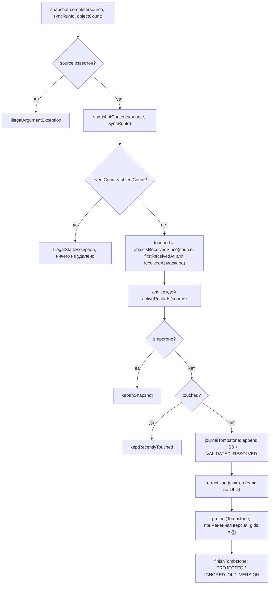

# graph-projector / reconcile-missing-set: дизайн

> Сокращения путей как в [`../requirements.md`](../requirements.md). Требования: [`requirements.md`](requirements.md); модульный дизайн: [`../design.md`](../design.md); формат tombstone-события и raw: [`../contracts.md`](../contracts.md) §6.1.

## Интерфейс

| Символ | Сигнатура | Результат |
|---|---|---|
| `Reconciler(journal, rawStore, projection, clock, identity, conflicts)` | `EventJournal`, `RawPayloadStore`, `GraphProjection`, `Clock`, `IdentityMapping`, `SourceConflicts`; все `requireNonNull` | (`GP/Reconciler.java:70-83`) 🟢 |
| `snapshotComplete` | `(String source, String syncRunId, String eventId, long objectCount)` → `void` | вызывает `reconcile`, отчёт отбрасывается (`GP/Reconciler.java:88-91`) 🟢 |
| `reconcile` | `(String source, String syncRunId, String eventId, long objectCount)` → `Report` | `IllegalArgumentException` / `IllegalStateException` (`GP/Reconciler.java:100-144`) 🟢 |
| `Report` | `record(int tombstoned, int ignoredOldVersion, int keptRecentlyTouched, int keptInSnapshot)` | (`GP/Reconciler.java:86`) 🟢 |
| `EVENT_ID_PREFIX` | `"reconcile:"` | (`GP/Reconciler.java:61`) 🟢 |

В `ingestion-service` `Reconciler` создаётся с `Clock.systemUTC()` и теми же `journal`, `rawStore`, `projector`, `identity`, `conflicts`, что и `EventProcessor` (`IS/IngestionServiceConfiguration.java:94-97`) 🟢.

## Диаграмма

Исходная блок-схема архивариуса — [`../../flowcharts/graph-projector.md`](../../flowcharts/graph-projector.md) («`Reconciler.reconcile` — missing set»).

## Основной поток `reconcile`

1. `code = EventProcessor.sourceCode(source)`; `null` → `IllegalArgumentException` (`GP/Reconciler.java:101-104`).
1a. (UNLOCKER-279) `objectCount < 0` → `SnapshotRejectedException`; `partial` → пропуск без чтения графа (RC-12.2).
2. `run = journal.snapshotContents(source, syncRunId)`; `run.eventCount() < objectCount` → `IllegalStateException` (`GP/Reconciler.java:105-108`). Состав прогона — события с `event_id` `snap:<syncRunId>:…` (SQL `starts_with`, чтобы `%` и `_` в `syncRunId` не работали как шаблон) 🟢 (`ingestion/event-journal/src/main/java/io/github/unlocker/archrag/eventjournal/PostgresEventJournal.java:275-299`).
3. `since = run.firstReceivedAt() ?? journal.find(source, eventId).orElseThrow().receivedAt()`; `touched = journal.objectsReceivedSince(source, since)`; `now = clock.instant()` (`GP/Reconciler.java:109-114`).
4. (UNLOCKER-279) Сначала missing set собирается списком, затем проверяется порог `maxMissingShare` (RC-12.3); только после этого цикл по `projection.activeRecords(code)` (`GP/Reconciler.java:119-142`): `ref = ObjectRef(key.sourceType, key.sourceId)`; `run.objects().contains(ref)` → `inSnapshot++`; `touched.contains(ref)` → `recent++`; иначе:
   1. `tombstoneId = journalTombstone(source, key, record.version(), now, syncRunId)`;
   2. `markers = retract(key, record.version())`;
   3. `result = projection.project(new ProjectionRequest(key, record.version(), now, syncRunId, Map.of(), List.of(new TombstoneSourceRecord(key, now)), markers))`;
   4. `finishTombstone(source, tombstoneId, result.outcome())`; `APPLIED` → `tombstoned++`, `IGNORED_OLD_VERSION` → `old++`.
5. `return new Report(tombstoned, old, recent, inSnapshot)`.

### `journalTombstone` (`GP/Reconciler.java:156-182`)

- `eventId = "reconcile:" + syncRunId + ":" + sourceType + "/" + sourceId`.
- Если строки нет: `CanonicalEvent(eventId, source, TYPE_ASSET_DELETED, subject, now, SCHEMA_ASSET_DELETED, syncRunId, AssetEventData(sourceType, sourceId, version, Map.of()))`; `subject = sourceType.toLowerCase(ROOT).replace('_','-') + "/" + sourceId`; `ref = rawStore.put(source, rawDelete(…).getBytes(UTF_8))`; `journal.append(event, ref, syncRunId)`.
- Затем `entry = journal.find(…)`; для шагов `VALIDATED, NORMALIZED, RESOLVED`: если `entry.status() == RETRYING` или `entry.status().ordinal() < step.ordinal()` → `entry = journal.transition(source, eventId, step, null, null)`.
- `rawDelete`: `{"sourceType":q,"sourceId":q,"sourceVersion":N,"operation":"DELETE","completeness":"COMPLETE","updatedAt":"<now>","payload":{}}`; `quote` экранирует `"`, `\` и символы `< 0x20` (`\u%04x`) (`GP/Reconciler.java:196-220`).

### `retract` (`GP/Reconciler.java:146-154`)

Если `projection.applied(key)` присутствует и `VersionDecision.forTombstone(version, applied.version, applied.active) == OLD` → `ConflictMarkers.none()`; иначе `identity.find(key).map(gid -> ConflictMarkers.of(gid, conflicts.retract(key, gid))).orElseGet(ConflictMarkers::none)`.

### `finishTombstone` (`GP/Reconciler.java:184-194`)

`status = outcome == IGNORED_OLD_VERSION ? IGNORED_OLD_VERSION : PROJECTED`; если текущий статус строки не `PROJECTED` и не `IGNORED_OLD_VERSION` — `journal.transition(source, eventId, status, null, null)`.

## Взаимодействие с replay и rebuild

`snapshot-complete` replay пропускает (`SKIPPED_SNAPSHOT_MARKER`, `IS/ReplayService.java:80`), поэтому удаления при replay/rebuild воспроизводятся только через сохранённые строки `reconcile:…` типа `deleted`, которые проходят `EventProcessor.delete` 🟡 (поведение replay — спецификация `ingestion-service`; цитируется по `_reversa_sdd/code-analysis.md` §Q6.2). Это причина, по которой tombstone журналируется **до** записи в граф (D-12).

## Зависимости

`EventJournal` (`snapshotContents`, `objectsReceivedSince`, `find`, `append`, `transition`), `RawPayloadStore.put`, `GraphProjection` (`activeRecords`, `applied`, `project`), `IdentityMapping.find`, `SourceConflicts.retract`, `Clock`; `EventProcessor.sourceCode`, `TYPE_ASSET_DELETED`, `SCHEMA_ASSET_DELETED` (пакетно-приватные константы) 🟢 (`GP/Reconciler.java:63-68, 101, 164, 167`). Журнал: [`../../event-journal/design.md`](../../event-journal/design.md), конфликты: [`../../identity-resolution/source-conflicts/design.md`](../../identity-resolution/source-conflicts/design.md).

## Решения

| Решение | Evidence | Уверенность |
|---|---|---|
| Множество прогона — из журнала, не из графа | `GP/Reconciler.java:35-37` | 🟢 |
| Tombstone с применённой версией, а не «сейчас» | `GP/Reconciler.java:42-44` | 🟢 |
| «Недавно тронутые» защищены от удаления | `GP/Reconciler.java:39-41, 126-129` | 🟢 |
| Tombstone фиксируется в журнале/S3 до графа | `GP/Reconciler.java:45-48` | 🟢 |
| Остаточная гонка с `retract` принята | `GP/Reconciler.java:53-55` | 🟡 |

## Наблюдаемость

Прямых логов и метрик в `Reconciler` нет; `Report` возвращает `reconcile`, но `snapshotComplete` его отбрасывает, а `EventProcessor` фиксирует лишь итоговый статус маркера 🟢 (`GP/Reconciler.java:88-91`, `GP/EventProcessor.java:293-299`). Метрики событий и `sync.lag` — в `ingestion-service`.

## Риски и пробелы

🟢 Q-05 закрыт в UNLOCKER-279 в части `objectCount` ([`requirements.md`](requirements.md) RC-12); проверка `dataschema` маркера остаётся открытой;  🟡 Q-07 (raw DELETE вручную), Q-11 (неизвестный источник/неполный прогон повторяются бесконечно), Q-12 (строка `reconcile:…` в `QUARANTINED` → `IllegalStateException` в `finishTombstone`), Q-13 (tombstone с применённой версией: тот же `ver` не воскресит). Пустой прогон с `objectCount = 0` удаляет **всё** активное — это зафиксировано тестом как штатное поведение для пустого источника (`emptyRunWithMarkerTombstonesEverythingActiveBeforeTheMarker`) 🟢.
