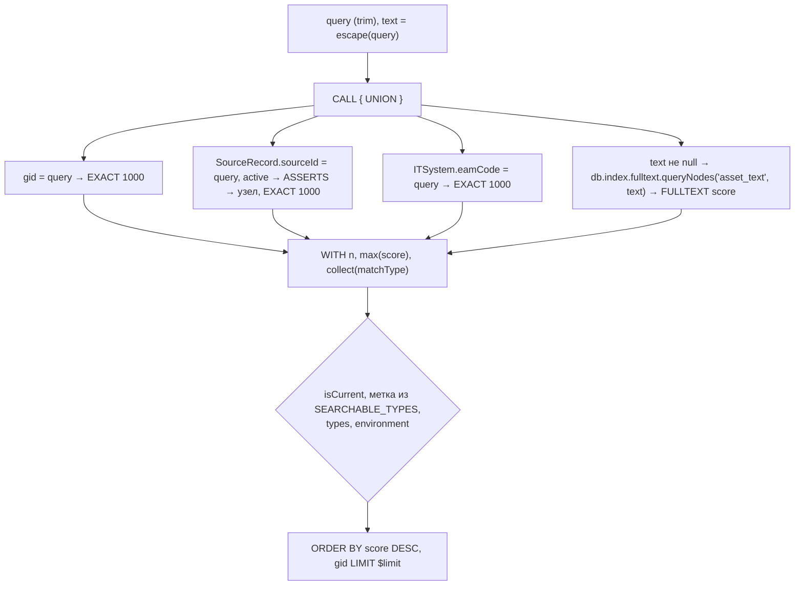

# asset-search: дизайн

> Модульный дизайн: [`../design.md`](../design.md). Контракты (колонки ответа): [`../contracts.md`](../contracts.md) §4.

## Interface

| Символ | Сигнатура | Результат | Трассировка |
|--------|-----------|-----------|-------------|
| `AssetTemplates.SEARCH_ASSETS` | `QueryTemplate` `search_assets`, NODES | см. контракты | `access/graph-query-core/src/main/java/io/github/unlocker/archrag/graphquerycore/templates/AssetTemplates.java:37-96` 🟢 |
| `AssetTemplates.GET_ASSET` | `get_asset` | | `access/graph-query-core/src/main/java/io/github/unlocker/archrag/graphquerycore/templates/AssetTemplates.java:112-141` 🟢 |
| `AssetTemplates.ASSET_RELATIONS` | `asset_relations` | | `access/graph-query-core/src/main/java/io/github/unlocker/archrag/graphquerycore/templates/AssetTemplates.java:150-168` 🟢 |
| `AssetTemplates.EXPLAIN_PROVENANCE` | `explain_provenance` | | `access/graph-query-core/src/main/java/io/github/unlocker/archrag/graphquerycore/templates/AssetTemplates.java:180-210` 🟢 |
| `AssetTemplates.SEARCHABLE_TYPES` / `RELATION_TYPES` | `List<String>` | allowlist'ы | `access/graph-query-core/src/main/java/io/github/unlocker/archrag/graphquerycore/templates/AssetTemplates.java:16-17, 102-103` 🟢 |
| `FulltextQuery.escape` | `static (String) -> String` | экранированный запрос или `null` | `access/graph-query-core/src/main/java/io/github/unlocker/archrag/graphquerycore/templates/FulltextQuery.java:25-40` 🟢 |

## Fluxo Principal

1. Подготовка ввода — на вызывающем: `query = trim(ввод)`, `text = FulltextQuery.escape(query)`; все четыре параметра передаются, включая `null` (`access/admin-console/src/main/java/io/github/unlocker/archrag/adminconsole/api/GraphController.java:86-91`) 🟢.
2. Шаблон собирается `.formatted(...)` из констант `LABELS`, `EXACT_SCORE`, `ENV`, `cypherList(SEARCHABLE_TYPES)` (`access/graph-query-core/src/main/java/io/github/unlocker/archrag/graphquerycore/templates/AssetTemplates.java:84-94`) 🟢.
3. Фильтр окружения: четыре ветки `UNION` внутри одного `EXISTS` (`access/graph-query-core/src/main/java/io/github/unlocker/archrag/graphquerycore/templates/AssetTemplates.java:59-70`) 🟢.

## Fluxos Alternativos

- `text = null`: четвёртая ветка `UNION` отсекается `WITH $text AS t WHERE t IS NOT NULL`; остаются точные совпадения (`access/graph-query-core/src/main/java/io/github/unlocker/archrag/graphquerycore/templates/AssetTemplates.java:51`) 🟢.
- `get_asset` / `explain_provenance` на неизвестный `gid` → ноль строк (вызывающий решает, что это «не найдено») 🟢 (`access/graph-query-core/src/main/java/io/github/unlocker/archrag/graphquerycore/templates/AssetTemplates.java:116, 184`).
- Имя актива берётся `coalesce(name, hostname, url, code)` (`access/graph-query-core/src/main/java/io/github/unlocker/archrag/graphquerycore/templates/AssetTemplates.java:73, 160`) 🟢.

## Dependências

Индекс `asset_text`, ограничения и индексы по `gid`, `eamCode`, `SourceRecord` из `Neo4jSchema` (`access/graph-query-core/src/main/java/io/github/unlocker/archrag/graphquerycore/templates/AssetTemplates.java:48, 52`); потребители — `access/mcp-server` и `access/admin-console`.

## Decisões de Design Identificadas

| Решение | Evidence | Уверенность |
|---------|----------|-------------|
| `EXACT_SCORE = 1000.0` гарантирует, что точное совпадение выше любого FULLTEXT-score | `access/graph-query-core/src/main/java/io/github/unlocker/archrag/graphquerycore/templates/AssetTemplates.java:19-20` | 🟡 |
| Точное совпадение по `eamCode`: SCM ссылается на систему кодом EAM | `access/graph-query-core/src/main/java/io/github/unlocker/archrag/graphquerycore/templates/AssetTemplates.java:26-28` | 🟢 |
| Служебные связи (`ASSERTS`, `OWNS_RECORD`, `PROCESSED`, `PART_OF`, `HOSTED_ON`) не входят в `asset_relations` | `access/graph-query-core/src/main/java/io/github/unlocker/archrag/graphquerycore/templates/AssetTemplates.java:98-101` | 🟢 |

## Riscos e Lacunas

- 🟡 FULLTEXT-индекс только на `ITSystem|Service`, остальные метки — только точное совпадение (Q-09).
- 🟡 Связность по имени индекса `asset_text` (Q-08).
- 🟡 `properties(n)` без пометки недоверенного текста (Q-05).
