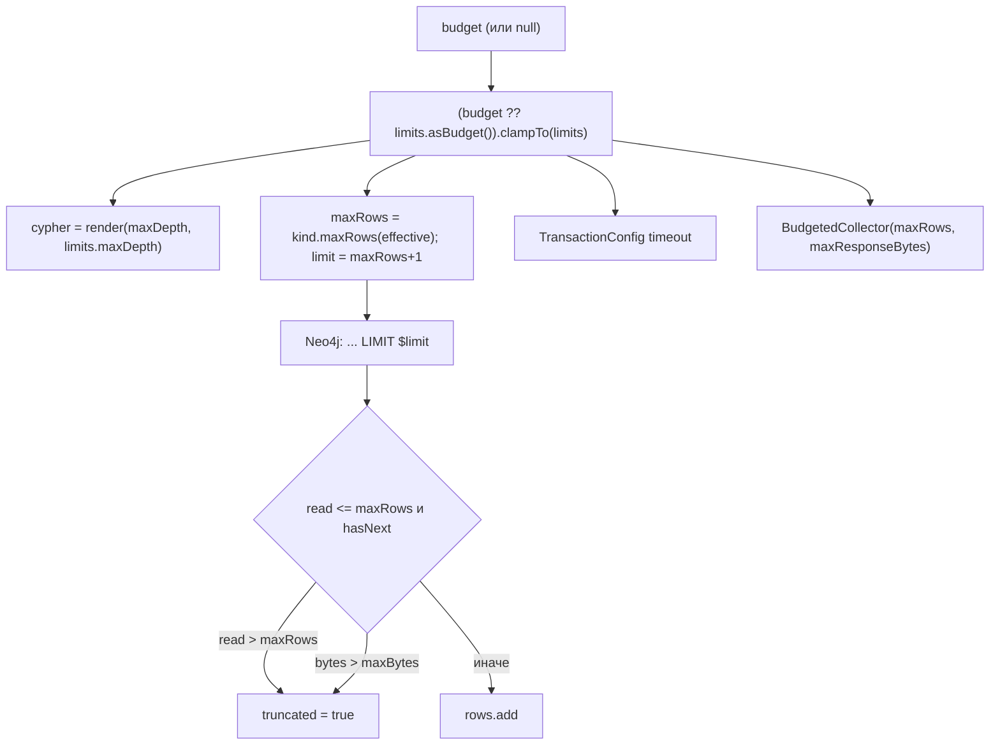

# budget-limits: дизайн

> Модульный дизайн: [`../design.md`](../design.md).

## Interface

| Символ | Сигнатура | Результат | Трассировка |
|--------|-----------|-----------|-------------|
| `ResultBudget` | `record(int maxDepth, int maxNodes, int maxPaths, Duration timeout, long maxResponseBytes)` | инвариант: всё положительное | `access/graph-query-core/src/main/java/io/github/unlocker/archrag/graphquerycore/ResultBudget.java:17-27` 🟢 |
| `ResultBudget.clampTo` | `(QueryLimits) -> ResultBudget` | `min` по полю; таймаут — меньший | `access/graph-query-core/src/main/java/io/github/unlocker/archrag/graphquerycore/ResultBudget.java:30-37` 🟢 |
| `QueryLimits` | `record(...)` те же поля | конструктор валидирует через `new ResultBudget(...)` | `access/graph-query-core/src/main/java/io/github/unlocker/archrag/graphquerycore/QueryLimits.java:14-20` 🟢 |
| `QueryLimits.asBudget` | `() -> ResultBudget` | потолки как бюджет | `access/graph-query-core/src/main/java/io/github/unlocker/archrag/graphquerycore/QueryLimits.java:22-25` 🟢 |
| `ResultKind.maxRows` | `(ResultBudget) -> int` | `NODES`: `maxNodes`; `PATHS`: `maxPaths` | `access/graph-query-core/src/main/java/io/github/unlocker/archrag/graphquerycore/ResultKind.java:11-13` 🟢 |
| `BudgetedCollector` | `(int maxRows, long maxBytes)` | `IllegalArgumentException` при `<1` | `access/graph-query-core/src/main/java/io/github/unlocker/archrag/graphquerycore/BudgetedCollector.java:32-38` 🟢 |
| `BudgetedCollector.collect` | `(Iterator<Map>) -> Collected(rows, truncated)` | см. ниже | `access/graph-query-core/src/main/java/io/github/unlocker/archrag/graphquerycore/BudgetedCollector.java:41-58` 🟢 |

## Fluxo Principal

1. Подготовка бюджета — `access/graph-query-core/src/main/java/io/github/unlocker/archrag/graphquerycore/GraphQueryExecutor.java:66-74` 🟢.
2. Сбор — `access/graph-query-core/src/main/java/io/github/unlocker/archrag/graphquerycore/BudgetedCollector.java:41-58` 🟢.

## Fluxos Alternativos

- Строка не сериализуется Jackson → `IllegalStateException("Cannot serialize result row")` (`access/graph-query-core/src/main/java/io/github/unlocker/archrag/graphquerycore/BudgetedCollector.java:61-65`) 🟢.
- Потолок глубины конфигурации меньше запрошенной глубины → глубина режется молча (`access/graph-query-core/src/main/java/io/github/unlocker/archrag/graphquerycore/ResultBudget.java:32`); вызывающие, которым нужен отказ, проверяют диапазон сами (MCP `trace_dependencies` отклоняет `maxDepth` вне `1..6`, консоль — глубину окрестности вне `1..2`) 🟡 (`access/admin-console/src/main/java/io/github/unlocker/archrag/adminconsole/api/GraphController.java:134-136`; `CLAUDE.md`).

## Dependências

Jackson 3 `JsonMapper` для размера строки (`access/graph-query-core/src/main/java/io/github/unlocker/archrag/graphquerycore/BudgetedCollector.java:7-8, 27`); `QueryLimits` создаёт приложение.

## Decisões de Design Identificadas

| Решение | Evidence | Уверенность |
|---------|----------|-------------|
| `maxRows + 1` как способ отличить усечение от точного совпадения | `access/graph-query-core/src/main/java/io/github/unlocker/archrag/graphquerycore/GraphQueryExecutor.java:72`; `access/graph-query-core/src/main/java/io/github/unlocker/archrag/graphquerycore/BudgetedCollector.java:13-15` | 🟢 |
| Размер ответа = сумма JSON-размеров строк, без накладных расходов обёртки ответа | `access/graph-query-core/src/main/java/io/github/unlocker/archrag/graphquerycore/BudgetedCollector.java:51, 60-66` | 🟡 |
| `QueryLimits` валидируется тем же инвариантом, что и бюджет | `access/graph-query-core/src/main/java/io/github/unlocker/archrag/graphquerycore/QueryLimits.java:17-20` | 🟢 |

## Riscos e Lacunas

- 🔴 `truncated` не сообщает об обрезке по глубине (Q-03).
- 🟡 `maxPaths` в Javadoc `ResultBudget` назван «резервируемым», хотя `PATHS` использует его (Q-13).
