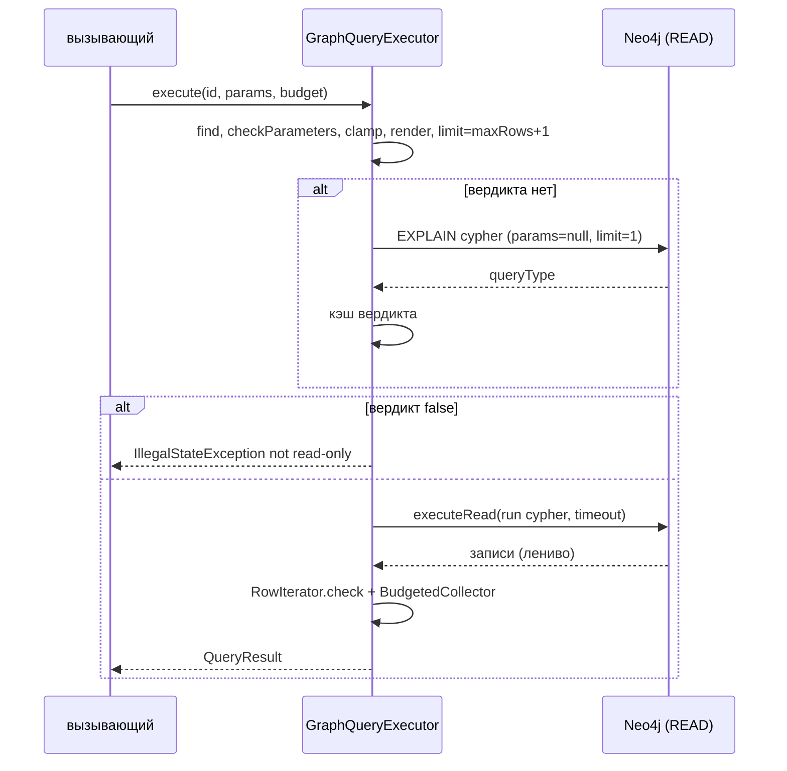

# execute-template: дизайн

> Модульный дизайн: [`../design.md`](../design.md). Контракты: [`../contracts.md`](../contracts.md) §1.

## Interface

| Символ | Сигнатура | Результат | Трассировка |
|--------|-----------|-----------|-------------|
| `GraphQueryExecutor.execute` | `(String, Map<String,Object>, ResultBudget) -> QueryResult` | см. [`../design.md`](../design.md) | `access/graph-query-core/src/main/java/io/github/unlocker/archrag/graphquerycore/GraphQueryExecutor.java:60-97` 🟢 |
| `verifyReadOnly` / `explainIsReadOnly` | private | вердикт по ID из кэша или из `EXPLAIN` | `access/graph-query-core/src/main/java/io/github/unlocker/archrag/graphquerycore/GraphQueryExecutor.java:99-124` 🟢 |
| `checkParameters` | private static | строгое сравнение ключей | `access/graph-query-core/src/main/java/io/github/unlocker/archrag/graphquerycore/GraphQueryExecutor.java:133-146` 🟢 |
| `RowIterator` | private static | ленивое чтение `Result`, `Record → LinkedHashMap` | `access/graph-query-core/src/main/java/io/github/unlocker/archrag/graphquerycore/GraphQueryExecutor.java:149-170` 🟢 |
| `check(Object)` | private static | рекурсивный запрет `Node`/`Relationship`/`Path` | `access/graph-query-core/src/main/java/io/github/unlocker/archrag/graphquerycore/GraphQueryExecutor.java:173-183` 🟢 |

## Fluxo Principal

1. Шаги 1–4 `execute` — `access/graph-query-core/src/main/java/io/github/unlocker/archrag/graphquerycore/GraphQueryExecutor.java:61-74` 🟢.
2. `verifyReadOnly` перед открытием рабочей сессии (`access/graph-query-core/src/main/java/io/github/unlocker/archrag/graphquerycore/GraphQueryExecutor.java:76`) 🟢.
3. Рабочая сессия и транзакция — `access/graph-query-core/src/main/java/io/github/unlocker/archrag/graphquerycore/GraphQueryExecutor.java:78-87` 🟢.

## Fluxos Alternativos

- Вердикт `false` в кэше → `IllegalStateException("Template '<id>' is not read-only")` без обращения к рабочей транзакции (`access/graph-query-core/src/main/java/io/github/unlocker/archrag/graphquerycore/GraphQueryExecutor.java:106-108`) 🟢.
- `Neo4jException` при `EXPLAIN` → `translate`, вердикт не записывается (`access/graph-query-core/src/main/java/io/github/unlocker/archrag/graphquerycore/GraphQueryExecutor.java:120-123`) 🟢.
- `Neo4jException` при рабочем запросе → `translate`: таймаут или как есть (`access/graph-query-core/src/main/java/io/github/unlocker/archrag/graphquerycore/GraphQueryExecutor.java:94-96`) 🟢.
- `IllegalStateException` из `check` внутри транзакции не перехватывается и покидает `execute` (не `Neo4jException`) 🟢 (`access/graph-query-core/src/main/java/io/github/unlocker/archrag/graphquerycore/GraphQueryExecutor.java:94, 185-188`).
- Гонка двух потоков на первом запуске шаблона: оба выполнят `EXPLAIN`, результат один и тот же; дедупликации нет 🟡 (`access/graph-query-core/src/main/java/io/github/unlocker/archrag/graphquerycore/GraphQueryExecutor.java:101-105`).

## Dependências

`Driver` (внешний бин приложения), `QueryTemplateRegistry`, `ResultBudget`, `BudgetedCollector` (`access/graph-query-core/src/main/java/io/github/unlocker/archrag/graphquerycore/GraphQueryExecutor.java:40-41, 74`).

## Decisões de Design Identificadas

| Решение | Evidence | Уверенность |
|---------|----------|-------------|
| Вердикт `EXPLAIN` — ленивая проверка при первом запуске, а не в конструкторе (конструктор не ходит в БД) | `access/graph-query-core/src/main/java/io/github/unlocker/archrag/graphquerycore/GraphQueryExecutor.java:30, 45-48` | 🟢 |
| `EXPLAIN` идёт в отдельной `READ`-сессии и не входит в `elapsed` | `access/graph-query-core/src/main/java/io/github/unlocker/archrag/graphquerycore/GraphQueryExecutor.java:115-119` | 🟢 |
| Возвращаются `Map`/`List`/скаляры драйвера (`asObject()`), без собственных DTO | `access/graph-query-core/src/main/java/io/github/unlocker/archrag/graphquerycore/GraphQueryExecutor.java:166` | 🟢 |

## Riscos e Lacunas

- 🔴 `EXPLAIN` как слой защиты не описан в ADR 0005 (Q-01).
- 🟡 `EXPLAIN` с `null`-параметрами строит план, возможно отличный от рабочего (Q-11).
- 🟡 Тела ошибок `Neo4jException` (кроме таймаута) пробрасываются без обёртки; их показ клиенту решает вызывающий (в консоли это стандартный 500, см. [`../../admin-console/questions.md`](../../admin-console/questions.md) Q-05).
