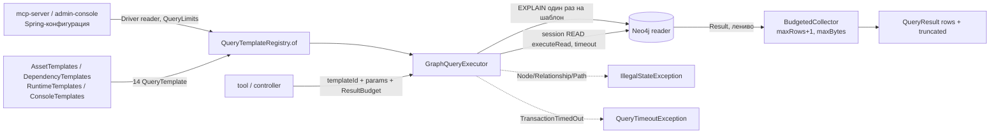

# access/graph-query-core: требования

> Библиотека (не приложение): единственный путь чтения графа для `access/mcp-server` и `access/admin-console`. Пути в трассировке развёрнуты до корня репозитория. Дизайн: [`design.md`](design.md); внешние контракты: [`contracts.md`](contracts.md); открытые вопросы: [`questions.md`](questions.md); решения: [`decisions.md`](decisions.md).
> Use case-спецификации: [`execute-template/`](execute-template/requirements.md), [`budget-limits/`](budget-limits/requirements.md), [`template-registry/`](template-registry/requirements.md), [`asset-search/`](asset-search/requirements.md), [`trace-and-footprint/`](trace-and-footprint/requirements.md).

## Визуальная схема



## Visão Geral

`graph-query-core` исполняет именованные параметризованные Cypher-шаблоны на read-only сессии Neo4j. Вызывающий передаёт ID шаблона, значения параметров и бюджет; Cypher-текст принимается только из зарегистрированных констант (ловушки 1–3 `CLAUDE.md`). Модуль режет бюджет до потолков конфигурации, проверяет `EXPLAIN` перед первым запуском, ограничивает число строк и байт ответа и запрещает возвращать узлы, связи и пути. Spring в модуле нет: драйвер и `QueryLimits` создаёт приложение 🟢 (`access/graph-query-core/pom.xml:17-31`; `access/graph-query-core/src/main/java/io/github/unlocker/archrag/graphquerycore/GraphQueryExecutor.java:23-48`).

## Responsabilidades

- Каталог 14 шаблонов чтения: 4 актива, 3 трассировки, 1 runtime footprint, 6 консольных 🟢 (`access/graph-query-core/src/main/java/io/github/unlocker/archrag/graphquerycore/templates/AssetTemplates.java:37-210`, `access/graph-query-core/src/main/java/io/github/unlocker/archrag/graphquerycore/templates/DependencyTemplates.java:82-123`, `access/graph-query-core/src/main/java/io/github/unlocker/archrag/graphquerycore/templates/RuntimeTemplates.java:29-90`, `access/graph-query-core/src/main/java/io/github/unlocker/archrag/graphquerycore/templates/ConsoleTemplates.java:182-189`).
- Статическая валидация шаблона в конструкторе (`LIMIT $limit`, набор параметров, ограниченные обходы, единственный плейсхолдер `{maxDepth}`) 🟢 (`access/graph-query-core/src/main/java/io/github/unlocker/archrag/graphquerycore/QueryTemplate.java:42-105`).
- Реестр с уникальными ID и проверкой литеральной глубины 🟢 (`access/graph-query-core/src/main/java/io/github/unlocker/archrag/graphquerycore/QueryTemplateRegistry.java:32-45`).
- Исполнитель: параметры, бюджет, `EXPLAIN`-вердикт, `executeRead` с таймаутом, сборка результата 🟢 (`access/graph-query-core/src/main/java/io/github/unlocker/archrag/graphquerycore/GraphQueryExecutor.java:60-97`).
- Бюджет: `ResultBudget`, потолки `QueryLimits`, `BudgetedCollector` 🟢 (`access/graph-query-core/src/main/java/io/github/unlocker/archrag/graphquerycore/ResultBudget.java:17-38`, `access/graph-query-core/src/main/java/io/github/unlocker/archrag/graphquerycore/QueryLimits.java:14-25`, `access/graph-query-core/src/main/java/io/github/unlocker/archrag/graphquerycore/BudgetedCollector.java:41-58`).
- Экранирование ввода для Lucene-запроса FULLTEXT-индекса 🟢 (`access/graph-query-core/src/main/java/io/github/unlocker/archrag/graphquerycore/templates/FulltextQuery.java:25-40`).
- Allowlist'ы меток и типов связей как публичные константы для вызывающих 🟢 (`access/graph-query-core/src/main/java/io/github/unlocker/archrag/graphquerycore/templates/AssetTemplates.java:16-17, 102-103`; `access/graph-query-core/src/main/java/io/github/unlocker/archrag/graphquerycore/templates/DependencyTemplates.java:18-25, 98-102`; `access/graph-query-core/src/main/java/io/github/unlocker/archrag/graphquerycore/templates/ConsoleTemplates.java:19-38`).

## Regras de Negócio

- Исполнитель принимает ID шаблона, а не Cypher; публичного метода, принимающего текст запроса, нет 🟢 (`access/graph-query-core/src/main/java/io/github/unlocker/archrag/graphquerycore/GraphQueryExecutor.java:60-64`; тест `platform/integration-tests/src/test/java/io/github/unlocker/archrag/integrationtests/GraphQueryCoreIT.java:137`).
- Набор ключей `params` обязан совпасть с объявленным `parameters` шаблона; `limit` вызывающий передать не может 🟢 (`access/graph-query-core/src/main/java/io/github/unlocker/archrag/graphquerycore/GraphQueryExecutor.java:133-146`; `access/graph-query-core/src/main/java/io/github/unlocker/archrag/graphquerycore/QueryTemplate.java:53-56`).
- Единственное место подстановки в текст Cypher — `{maxDepth}`; в запрос попадает проверенный `int` из `1..ceiling` (ловушка 2) 🟢 (`access/graph-query-core/src/main/java/io/github/unlocker/archrag/graphquerycore/QueryTemplate.java:125-138`).
- Любой variable-length путь обязан иметь верхнюю границу (число или `{maxDepth}`); `*` и `*1..` отвергаются при создании шаблона 🟢 (`access/graph-query-core/src/main/java/io/github/unlocker/archrag/graphquerycore/QueryTemplate.java:87-99`; тест `access/graph-query-core/src/test/java/io/github/unlocker/archrag/graphquerycore/QueryTemplateRegistryTest.java:69`).
- Литеральная глубина шаблона не превышает потолок `maxDepth` реестра 🟢 (`access/graph-query-core/src/main/java/io/github/unlocker/archrag/graphquerycore/QueryTemplateRegistry.java:35-39`).
- Чтение только через `executeRead` в сессии `AccessMode.READ`; записывающих вызовов в модуле нет (ловушка 3) 🟢 (`access/graph-query-core/src/main/java/io/github/unlocker/archrag/graphquerycore/GraphQueryExecutor.java:35-36, 78-87, 117-118`).
- Перед первым запуском шаблона `EXPLAIN` обязан дать `QueryType.READ_ONLY`; вердикт кэшируется по ID, провал необратим до перезапуска; ошибка планирования вердикта не фиксирует 🟢 (`access/graph-query-core/src/main/java/io/github/unlocker/archrag/graphquerycore/GraphQueryExecutor.java:99-124`; тест `platform/integration-tests/src/test/java/io/github/unlocker/archrag/integrationtests/GraphQueryCoreIT.java:79`).
- Бюджет запроса режется до потолков (`min` по каждому полю); `null` вместо бюджета означает потолки целиком 🟢 (`access/graph-query-core/src/main/java/io/github/unlocker/archrag/graphquerycore/GraphQueryExecutor.java:67`; `access/graph-query-core/src/main/java/io/github/unlocker/archrag/graphquerycore/ResultBudget.java:30-37`).
- Лимит строк в Cypher = `maxRows + 1`; из результата читается не более `maxRows + 1` строк; лишняя строка и строка, превысившая байтовый порог, отбрасываются с `truncated=true` 🟢 (`access/graph-query-core/src/main/java/io/github/unlocker/archrag/graphquerycore/GraphQueryExecutor.java:69-74`; `access/graph-query-core/src/main/java/io/github/unlocker/archrag/graphquerycore/BudgetedCollector.java:41-58`).
- Потолок строк зависит от `ResultKind`: `NODES` → `maxNodes`, `PATHS` → `maxPaths` 🟢 (`access/graph-query-core/src/main/java/io/github/unlocker/archrag/graphquerycore/ResultKind.java:11-13`).
- Узлы, связи и пути (в том числе вложенные в списки и map) в строке результата запрещены; шаблон возвращает проекции 🟢 (`access/graph-query-core/src/main/java/io/github/unlocker/archrag/graphquerycore/GraphQueryExecutor.java:172-188`).
- Таймаут транзакции из бюджета; код `TransactionTimedOut` → `QueryTimeoutException`, частичного результата нет 🟢 (`access/graph-query-core/src/main/java/io/github/unlocker/archrag/graphquerycore/GraphQueryExecutor.java:73, 94-96, 126-131`).
- Тело `executeRead` повторяется драйвером при транзиентных ошибках; внутри только чтение и новый сборщик строк, внешних побочных эффектов нет (ловушка 7) 🟢 (`access/graph-query-core/src/main/java/io/github/unlocker/archrag/graphquerycore/GraphQueryExecutor.java:79-87`).
- Метки и типы связей подставляются в текст шаблона из констант классов, значения от вызывающих — только параметрами (ловушка 1) 🟢 (`access/graph-query-core/src/main/java/io/github/unlocker/archrag/graphquerycore/templates/AssetTemplates.java:22, 214-217`).
- Принадлежность значений параметров `types`/`relationTypes`/`relTypes` allowlist'у ядро не проверяет — это обязанность вызывающего 🟡 (`access/graph-query-core/src/main/java/io/github/unlocker/archrag/graphquerycore/templates/DependencyTemplates.java:11-13`; Q-02).

## Requisitos Funcionais

| ID | Требование | Приоритет | Критерий приёмки |
|----|-----------|-----------|------------------|
| RF-01 | Исполнить шаблон по ID с параметрами и бюджетом, вернуть `QueryResult` | Must | [`execute-template`](execute-template/requirements.md) AC-01; `platform/integration-tests/src/test/java/io/github/unlocker/archrag/integrationtests/GraphQueryCoreIT.java:161` |
| RF-02 | Отказать на неизвестный шаблон, лишний или недостающий параметр до обращения к БД | Must | AC-02; `platform/integration-tests/src/test/java/io/github/unlocker/archrag/integrationtests/GraphQueryCoreIT.java:150` |
| RF-03 | Закрыть шаблон, не прошедший `EXPLAIN READ_ONLY`, навсегда | Must | AC-03; `platform/integration-tests/src/test/java/io/github/unlocker/archrag/integrationtests/GraphQueryCoreIT.java:79` |
| RF-04 | Запретить узлы, связи и пути в результате | Must | AC-04; `platform/integration-tests/src/test/java/io/github/unlocker/archrag/integrationtests/GraphQueryCoreIT.java:123` |
| RF-05 | Урезать бюджет до потолков, подставить глубину числом | Must | [`budget-limits`](budget-limits/requirements.md) AC-01; `access/graph-query-core/src/test/java/io/github/unlocker/archrag/graphquerycore/ResultBudgetTest.java:14`; `platform/integration-tests/src/test/java/io/github/unlocker/archrag/integrationtests/GraphQueryCoreIT.java:187` |
| RF-06 | Усекать результат по строкам и байтам, помечая `truncated` | Must | AC-02, AC-03; `access/graph-query-core/src/test/java/io/github/unlocker/archrag/graphquerycore/BudgetedCollectorTest.java:49, 58`; `platform/integration-tests/src/test/java/io/github/unlocker/archrag/integrationtests/GraphQueryCoreIT.java:161, 177` |
| RF-07 | Переводить таймаут транзакции в `QueryTimeoutException` | Must | AC-04; `platform/integration-tests/src/test/java/io/github/unlocker/archrag/integrationtests/GraphQueryCoreIT.java:201` |
| RF-08 | Валидировать шаблон и реестр статически | Must | [`template-registry`](template-registry/requirements.md) AC-01..AC-03; `access/graph-query-core/src/test/java/io/github/unlocker/archrag/graphquerycore/QueryTemplateRegistryTest.java:20-112` |
| RF-09 | Поиск актива: точное совпадение и FULLTEXT с экранированием Lucene | Must | [`asset-search`](asset-search/requirements.md) AC-01..AC-03; `access/graph-query-core/src/main/java/io/github/unlocker/archrag/graphquerycore/templates/FulltextQuery.java:25-40`; `access/graph-query-core/src/test/java/io/github/unlocker/archrag/graphquerycore/templates/FulltextQueryTest.java:10-26` |
| RF-10 | Карточка актива, связи 1 уровня, происхождение | Must | AC-04, AC-05; `access/graph-query-core/src/test/java/io/github/unlocker/archrag/graphquerycore/templates/AssetTemplatesTest.java:14-40` |
| RF-11 | Трассировка downstream/upstream и impact с ограниченной глубиной | Must | [`trace-and-footprint`](trace-and-footprint/requirements.md) AC-01, AC-02; `access/graph-query-core/src/test/java/io/github/unlocker/archrag/graphquerycore/templates/DependencyTemplatesTest.java:18-90` |
| RF-12 | Runtime footprint системы | Must | AC-03; `access/graph-query-core/src/test/java/io/github/unlocker/archrag/graphquerycore/templates/RuntimeTemplatesTest.java:15-54` |
| RF-13 | Консольные шаблоны: сводка, окрестность, последние прогоны | Must | AC-04; `access/graph-query-core/src/test/java/io/github/unlocker/archrag/graphquerycore/templates/ConsoleTemplatesTest.java:18-56` |

## Requisitos Não Funcionais

| Тип | Требование | Evidence | Уверенность |
|-----|------------|----------|-------------|
| Безопасность | Только чтение: `AccessMode.READ` + `executeRead`; на уровне СУБД reader в Community не ограничен | `access/graph-query-core/src/main/java/io/github/unlocker/archrag/graphquerycore/GraphQueryExecutor.java:35-36, 82`; Q-06 | 🟢/🟡 |
| Безопасность | Параметры вместо конкатенации; метки из констант | `access/graph-query-core/src/main/java/io/github/unlocker/archrag/graphquerycore/templates/AssetTemplates.java:22`; `access/graph-query-core/src/main/java/io/github/unlocker/archrag/graphquerycore/templates/ConsoleTemplates.java:59-60` | 🟢 |
| Безопасность | Ввод для Lucene экранируется, операторы `AND/OR/NOT` нейтрализуются приведением к нижнему регистру | `access/graph-query-core/src/main/java/io/github/unlocker/archrag/graphquerycore/templates/FulltextQuery.java:30-39` | 🟢 |
| Безопасность | Тексты ошибок не содержат значений параметров (только ID шаблона и имя параметра) | `access/graph-query-core/src/main/java/io/github/unlocker/archrag/graphquerycore/GraphQueryExecutor.java:136-143`; `access/graph-query-core/src/main/java/io/github/unlocker/archrag/graphquerycore/QueryTimeoutException.java:9` | 🟢 |
| Производительность | Таймаут транзакции из бюджета, по умолчанию потолок конфигурации (в консоли 5 с) | `access/graph-query-core/src/main/java/io/github/unlocker/archrag/graphquerycore/GraphQueryExecutor.java:73`; `access/admin-console/src/main/resources/application.yml:35-41` | 🟢 |
| Производительность | Ограничение размера ответа по сериализованному JSON строки | `access/graph-query-core/src/main/java/io/github/unlocker/archrag/graphquerycore/BudgetedCollector.java:51-54, 60-66` | 🟢 |
| Производительность | Фильтр окружения построен одним `EXISTS` с `UNION`, а не `OR EXISTS` (холодное планирование 8–26 с, UNLOCKER-216) | `access/graph-query-core/src/main/java/io/github/unlocker/archrag/graphquerycore/templates/AssetTemplates.java:34-35` | 🟢 |
| Надёжность | Конструктор исполнителя в БД не ходит; сбой планирования `EXPLAIN` не закрывает шаблон | `access/graph-query-core/src/main/java/io/github/unlocker/archrag/graphquerycore/GraphQueryExecutor.java:45-48, 120-123`; `platform/integration-tests/src/test/java/io/github/unlocker/archrag/integrationtests/GraphQueryCoreIT.java:103` | 🟢 |
| Сопровождаемость | Три копии `cypherList` в классах шаблонов | `access/graph-query-core/src/main/java/io/github/unlocker/archrag/graphquerycore/templates/AssetTemplates.java:215-217`; `access/graph-query-core/src/main/java/io/github/unlocker/archrag/graphquerycore/templates/DependencyTemplates.java:128-130`; `access/graph-query-core/src/main/java/io/github/unlocker/archrag/graphquerycore/templates/ConsoleTemplates.java:200-202` | 🟡 |
| Потокобезопасность | Кэш вердиктов — `ConcurrentHashMap`; реестр неизменяем | `access/graph-query-core/src/main/java/io/github/unlocker/archrag/graphquerycore/GraphQueryExecutor.java:43`; `access/graph-query-core/src/main/java/io/github/unlocker/archrag/graphquerycore/QueryTemplateRegistry.java:23` | 🟢 |

> Inferido a partir do código. SLO по задержке запросов в модуле не заданы 🟢 [R.8: ответ владельца, вопрос 12] (см. [`questions.md`](questions.md) Q-10).

## Критерии приёмки (сквозные)

```gherkin
# AC-05: только чтение, позитив
Дано исполнитель создан с драйвером reader и реестром из read-шаблонов
Когда выполняется шаблон search_assets с полным набором параметров
Тогда запрос идёт в сессии READ через executeRead, результат — QueryResult без узлов и связей      # GraphQueryCoreIT.nodesRelationshipsAndPathsInResultAreForbidden (негативная сторона), SearchAssetsIT

# AC-06: только чтение, негатив
Дано шаблон с текстом CREATE/SET/DELETE, оканчивающийся на LIMIT $limit
Когда вызывается execute
Тогда IllegalStateException "not read-only", БД не изменена, повторный вызов снова отказывает    # GraphQueryCoreIT.writingTemplatesFailExplainCheckOnFirstExecuteAndStayClosed

Дано сессия READ и запрос CREATE напрямую
Когда выполняется в executeRead
Тогда Neo4j отвечает Neo.ClientError.Statement.AccessMode                                       # GraphQueryCoreIT.readSessionConfigRejectsWritesAtDatabaseLevel
```

## Prioridade (MoSCoW)

| Требование | MoSCoW | Justificativa |
|-----------|--------|---------------|
| Только-чтение (RF-01..04) | Must | Критерий готовности 6 PoC, ADR 0005/0018 |
| Бюджет, усечение, таймаут (RF-05..07) | Must | Защита от неограниченных обходов |
| Статическая валидация (RF-08) | Must | Ловушка 2 |
| Шаблоны активов, трассировки, runtime, консоли (RF-09..13) | Must | Потребители — tools MCP и API консоли |
| Проверка членства значений в allowlist внутри ядра | Won't | Не реализовано (🔴 Q-02) |
| Признак усечения по глубине | Won't | Не реализовано (🔴 Q-03) |

## Зависит от / Связанные спецификации

См. раздел «Зависит от / Связанные спецификации» в [`design.md`](design.md).

## Rastreabilidade de Código

| Файл | Класс | Покрытие |
|------|-------|----------|
| `access/graph-query-core/src/main/java/io/github/unlocker/archrag/graphquerycore/GraphQueryExecutor.java` | `GraphQueryExecutor` | 🟢 |
| `access/graph-query-core/src/main/java/io/github/unlocker/archrag/graphquerycore/QueryTemplate.java`, `access/graph-query-core/src/main/java/io/github/unlocker/archrag/graphquerycore/QueryTemplateRegistry.java`, `access/graph-query-core/src/main/java/io/github/unlocker/archrag/graphquerycore/ResultKind.java` | шаблон и реестр | 🟢 |
| `access/graph-query-core/src/main/java/io/github/unlocker/archrag/graphquerycore/ResultBudget.java`, `access/graph-query-core/src/main/java/io/github/unlocker/archrag/graphquerycore/QueryLimits.java`, `access/graph-query-core/src/main/java/io/github/unlocker/archrag/graphquerycore/BudgetedCollector.java`, `access/graph-query-core/src/main/java/io/github/unlocker/archrag/graphquerycore/QueryResult.java`, `access/graph-query-core/src/main/java/io/github/unlocker/archrag/graphquerycore/QueryTimeoutException.java` | бюджет, результат | 🟢 |
| `access/graph-query-core/src/main/java/io/github/unlocker/archrag/graphquerycore/templates/AssetTemplates.java`, `access/graph-query-core/src/main/java/io/github/unlocker/archrag/graphquerycore/templates/FulltextQuery.java` | активы, поиск | 🟢 |
| `access/graph-query-core/src/main/java/io/github/unlocker/archrag/graphquerycore/templates/DependencyTemplates.java`, `access/graph-query-core/src/main/java/io/github/unlocker/archrag/graphquerycore/templates/RuntimeTemplates.java` | трассировка, runtime | 🟢 |
| `access/graph-query-core/src/main/java/io/github/unlocker/archrag/graphquerycore/templates/ConsoleTemplates.java` | консоль | 🟢 |
| `access/graph-query-core/pom.xml` | зависимости (`canonical-model`, driver, Jackson 3) | 🟢 |
