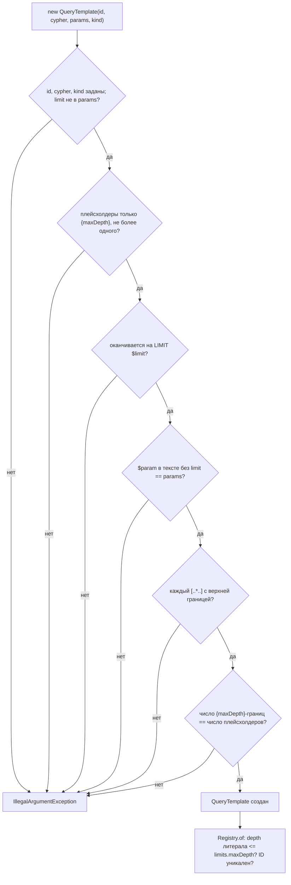

# template-registry: дизайн

> Модульный дизайн: [`../design.md`](../design.md).

## Interface

| Символ | Сигнатура | Результат | Трассировка |
|--------|-----------|-----------|-------------|
| `QueryTemplate` | `record(String id, String cypher, Set<String> parameters, ResultKind kind)` | `parameters` копируется неизменяемо; валидация | `access/graph-query-core/src/main/java/io/github/unlocker/archrag/graphquerycore/QueryTemplate.java:21-58` 🟢 |
| `QueryTemplate.LIMIT_PARAMETER` / `MAX_DEPTH_PLACEHOLDER` | `"limit"` / `"{maxDepth}"` | константы | `access/graph-query-core/src/main/java/io/github/unlocker/archrag/graphquerycore/QueryTemplate.java:25, 28` 🟢 |
| `QueryTemplate.maxLiteralDepth` | `() -> int` | наибольшая числовая верхняя граница; 0, если литералов нет | `access/graph-query-core/src/main/java/io/github/unlocker/archrag/graphquerycore/QueryTemplate.java:108-118` 🟢 |
| `QueryTemplate.hasDepthPlaceholder` | `() -> boolean` | есть ли `{maxDepth}` | `access/graph-query-core/src/main/java/io/github/unlocker/archrag/graphquerycore/QueryTemplate.java:121-123` 🟢 |
| `QueryTemplate.render` | `(int depth, int ceiling) -> String` | подстановка (`\{\s*maxDepth\s*}` → число) | `access/graph-query-core/src/main/java/io/github/unlocker/archrag/graphquerycore/QueryTemplate.java:133-138` 🟢 |
| `QueryTemplateRegistry.of` | `(Collection, QueryLimits) -> QueryTemplateRegistry` | см. правила | `access/graph-query-core/src/main/java/io/github/unlocker/archrag/graphquerycore/QueryTemplateRegistry.java:32-45` 🟢 |

## Fluxo Principal

1. Конструктор — `access/graph-query-core/src/main/java/io/github/unlocker/archrag/graphquerycore/QueryTemplate.java:42-58`; `validate` — `access/graph-query-core/src/main/java/io/github/unlocker/archrag/graphquerycore/QueryTemplate.java:60-105` 🟢.
2. Реестр — `access/graph-query-core/src/main/java/io/github/unlocker/archrag/graphquerycore/QueryTemplateRegistry.java:32-45` 🟢.

## Fluxos Alternativos

- Граница пути — числовой литерал: допускается форма `*N`, `*..N`, `*M..N` (группа `(\d+|\{maxDepth})`) 🟢 (`access/graph-query-core/src/main/java/io/github/unlocker/archrag/graphquerycore/QueryTemplate.java:40`).
- Путь внутри шаблона отсутствует: `maxLiteralDepth() = 0`, плейсхолдера нет — проверок глубины нет 🟢 (`access/graph-query-core/src/main/java/io/github/unlocker/archrag/graphquerycore/QueryTemplate.java:108-118`).
- Строка шаблона с `.formatted(...)` собирается из констант классов-шаблонов до передачи в конструктор; проверка идёт по итоговому тексту (`access/graph-query-core/src/main/java/io/github/unlocker/archrag/graphquerycore/templates/AssetTemplates.java:84-94`) 🟢.

## Dependências

Только `java.util.regex`; `QueryLimits` для потолка глубины (`access/graph-query-core/src/main/java/io/github/unlocker/archrag/graphquerycore/QueryTemplateRegistry.java:32-39`).

## Decisões de Design Identificadas

| Решение | Evidence | Уверенность |
|---------|----------|-------------|
| Валидация на регулярных выражениях, с честным комментарием об ограничении | `access/graph-query-core/src/main/java/io/github/unlocker/archrag/graphquerycore/QueryTemplate.java:34-40` | 🟢 |
| Реестр не проверяет read-only (это обязанность исполнителя через `EXPLAIN`) | `access/graph-query-core/src/main/java/io/github/unlocker/archrag/graphquerycore/QueryTemplateRegistry.java:10-16` | 🟢 |
| `replaceAll` при `render` допускает пробелы внутри скобок плейсхолдера | `access/graph-query-core/src/main/java/io/github/unlocker/archrag/graphquerycore/QueryTemplate.java:137` | 🟢 |

## Riscos e Lacunas

- 🟡 Регулярные выражения могут не распознать экзотическую форму пути (Q-12).
- 🟡 Проверка того, что `kind` соответствует реальной форме результата, не выполняется; `PATHS` vs `NODES` определяет автор шаблона (`access/graph-query-core/src/main/java/io/github/unlocker/archrag/graphquerycore/ResultKind.java:4-9`).
