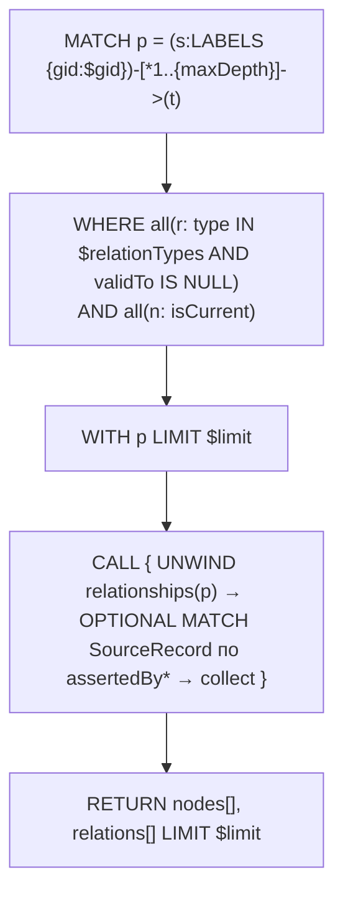

# trace-and-footprint: дизайн

> Модульный дизайн: [`../design.md`](../design.md). Контракты (параметры/колонки): [`../contracts.md`](../contracts.md) §4.

## Interface

| Символ | Сигнатура | Результат | Трассировка |
|--------|-----------|-----------|-------------|
| `DependencyTemplates.TRACE_DOWNSTREAM` / `TRACE_UPSTREAM` | `QueryTemplate` PATHS, параметры `gid, relationTypes` | пути | `access/graph-query-core/src/main/java/io/github/unlocker/archrag/graphquerycore/templates/DependencyTemplates.java:82-95` 🟢 |
| `DependencyTemplates.IMPACT_UPSTREAM` | `trace_impact`, PATHS, `gid, relationTypes, environment` | пути до `Service|ITSystem` | `access/graph-query-core/src/main/java/io/github/unlocker/archrag/graphquerycore/templates/DependencyTemplates.java:112-123` 🟢 |
| `RuntimeTemplates.RUNTIME_FOOTPRINT` | `runtime_footprint`, NODES, `systemGid, environment` | строки footprint | `access/graph-query-core/src/main/java/io/github/unlocker/archrag/graphquerycore/templates/RuntimeTemplates.java:29-90` 🟢 |
| `ConsoleTemplates.GRAPH_STATS_NODES` / `GRAPH_STATS_RELATIONS` / `GRAPH_LAST_UPDATE` | сводка | счётчики и время | `access/graph-query-core/src/main/java/io/github/unlocker/archrag/graphquerycore/templates/ConsoleTemplates.java:47-97` 🟢 |
| `ConsoleTemplates.NEIGHBORHOOD_NODES` / `NEIGHBORHOOD_EDGES` | окрестность | узлы и рёбра | `access/graph-query-core/src/main/java/io/github/unlocker/archrag/graphquerycore/templates/ConsoleTemplates.java:105-152` 🟢 |
| `ConsoleTemplates.LATEST_SYNC_RUNS` | `console_latest_sync_runs` | последние прогоны | `access/graph-query-core/src/main/java/io/github/unlocker/archrag/graphquerycore/templates/ConsoleTemplates.java:159-179` 🟢 |
| `ConsoleTemplates.ALL` | `List<QueryTemplate>` | шесть консольных шаблонов (без шаблонов `AssetTemplates`) | `access/graph-query-core/src/main/java/io/github/unlocker/archrag/graphquerycore/templates/ConsoleTemplates.java:181-189` 🟢 |

## Fluxo Principal

1. Обход и фильтр — `access/graph-query-core/src/main/java/io/github/unlocker/archrag/graphquerycore/templates/DependencyTemplates.java:29-33, 85` 🟢; проекция — `access/graph-query-core/src/main/java/io/github/unlocker/archrag/graphquerycore/templates/DependencyTemplates.java:40-70` 🟢.
2. Impact добавляет условие по окружению для `Deployment` (`access/graph-query-core/src/main/java/io/github/unlocker/archrag/graphquerycore/templates/DependencyTemplates.java:115-121`) 🟢.
3. Footprint — цепочка `OPTIONAL MATCH`: система → сервис → deployment+environment → compute → (VM → host) (`access/graph-query-core/src/main/java/io/github/unlocker/archrag/graphquerycore/templates/RuntimeTemplates.java:33-41`) 🟢.
4. Окрестность: узлы запросом `UNION` центра и обхода, затем рёбра одним запросом по `gids` — два вызова исполнителя на стороне консоли (`access/graph-query-core/src/main/java/io/github/unlocker/archrag/graphquerycore/templates/ConsoleTemplates.java:109-118, 139-149`) 🟢.

## Fluxos Alternativos

- Узел без `name` получает `coalesce(name, hostname, url, code)` (`access/graph-query-core/src/main/java/io/github/unlocker/archrag/graphquerycore/templates/DependencyTemplates.java:62`) 🟢.
- Тип compute в footprint определяется метками: `VirtualMachine`, `PhysicalServer`, иначе `ComputeInstance` (`access/graph-query-core/src/main/java/io/github/unlocker/archrag/graphquerycore/templates/RuntimeTemplates.java:70-72`) 🟢.
- Для `HOSTED_ON` в footprint `validFrom` всегда `null` (связь нетемпоральна) (`access/graph-query-core/src/main/java/io/github/unlocker/archrag/graphquerycore/templates/RuntimeTemplates.java:84-85`) 🟢.
- `LATEST_SYNC_RUNS` группирует `collect(s)[0]` после сортировки `startedAt DESC` (`access/graph-query-core/src/main/java/io/github/unlocker/archrag/graphquerycore/templates/ConsoleTemplates.java:163-166`) 🟢.

## Dependências

Схема графа (`Neo4jSchema`), allowlist'ы `TRACE_LABELS`/`TRACE_RELATION_TYPES`; потребители: `access/mcp-server` (trace, impact, footprint), `access/admin-console` (консольные шаблоны).

## Decisões de Design Identificadas

| Решение | Evidence | Уверенность |
|---------|----------|-------------|
| Два шаблона направления вместо одного: направление и граница пути не параметризуются | `access/graph-query-core/src/main/java/io/github/unlocker/archrag/graphquerycore/templates/DependencyTemplates.java:11-13` | 🟢 |
| Происхождение шага пути (`assertedBy*`) с ребра, свежесть — из `SourceRecord` | `access/graph-query-core/src/main/java/io/github/unlocker/archrag/graphquerycore/templates/DependencyTemplates.java:36-38, 44-57` | 🟡 |
| Агрегаты сводки считаются до проекции литерала, иначе пустой вход не даёт строки с нулём | `access/graph-query-core/src/main/java/io/github/unlocker/archrag/graphquerycore/templates/ConsoleTemplates.java:43-46` | 🟢 |
| Подсчёт по счётчикам хранилища, а не обходом графа | `access/graph-query-core/src/main/java/io/github/unlocker/archrag/graphquerycore/templates/ConsoleTemplates.java:45-46` | 🟡 |

## Riscos e Lacunas

- 🔴 `truncated` не показывает обрезку по глубине (Q-03).
- 🟡 Порядок и состав путей при усечении не определены (Q-04).
- 🟡 Обход раскрывается по всем типам связей и фильтруется постфактум (`access/graph-query-core/src/main/java/io/github/unlocker/archrag/graphquerycore/templates/DependencyTemplates.java:29-33`; `../../code-analysis.md:849`).
